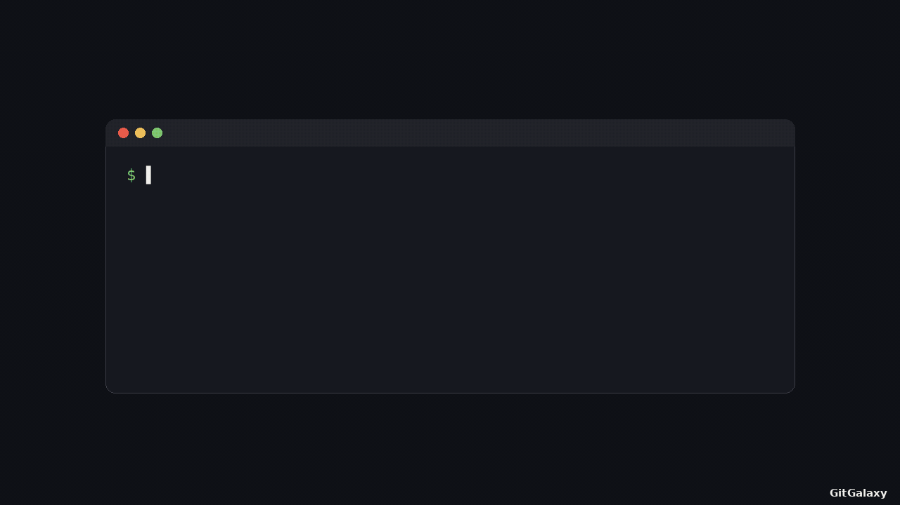
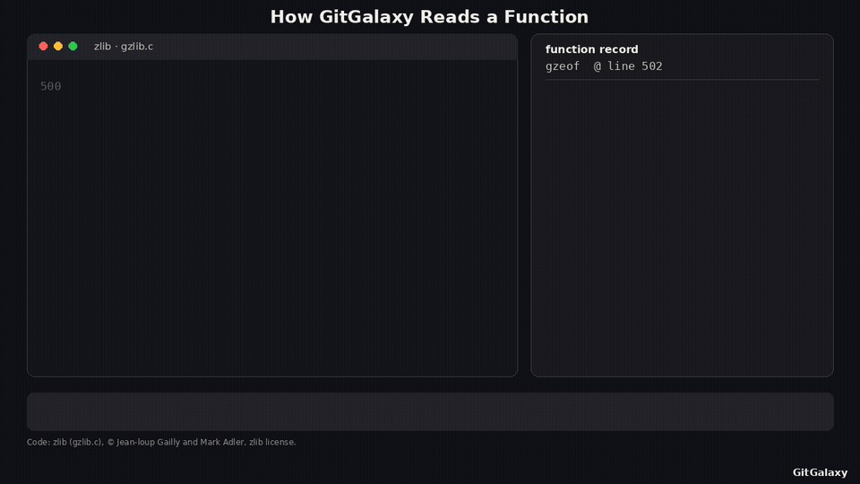
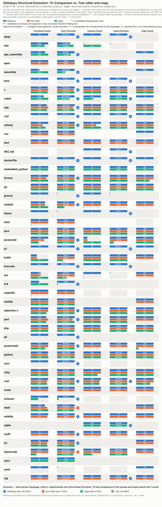
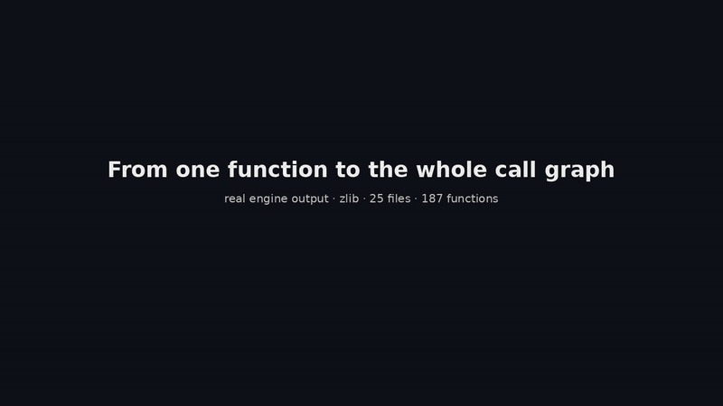
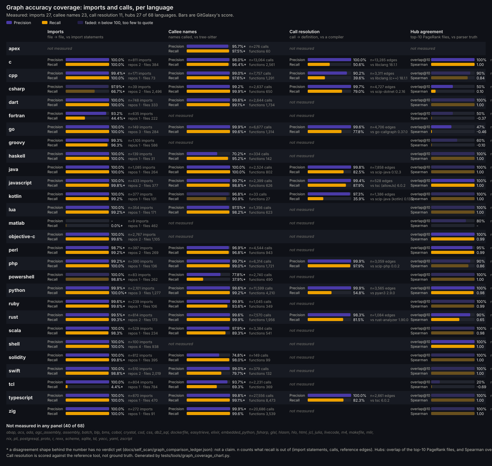
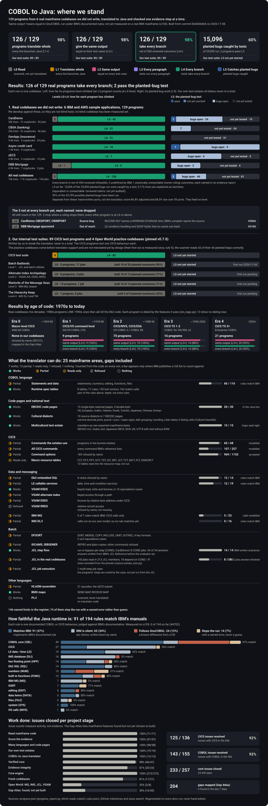

<div align="center">

# GitGalaxy

### Know any codebase deeply, and give your AI agents the same knowledge.

One command turns any repository (59 languages, no build, no compiler) into knowledge you can compare, query, and
hand to a coding agent. The pipeline is also thorough enough to be the basis for our
[CICS-to-Java translator](gitgalaxy/tools/cobol_to_java/README.md), which proves each ported program against the original.

<table>
<tr>
<td align="center" width="250"><h2>&lt; 1 s</h2></td>
<td align="center" width="250"><h2>59</h2></td>
<td align="center" width="250"><h2>0</h2></td>
</tr>
<tr>
<td align="center" valign="top"><sub><strong>for most repositories</strong><br />Kubernetes, 2.46M lines, in about 65 s · single run, 2026-09-19<br /><em><a href="#every-size-in-seconds">speed model and source</a></em></sub></td>
<td align="center" valign="top"><sub><strong>languages, down to the function</strong><br />72 recognized<br /><em><a href="#languages">the full list</a></em></sub></td>
<td align="center" valign="top"><sub><strong>install dependencies</strong><br />runs locally; nothing leaves your machine<br /><em><a href="#privacy-and-deployment">privacy</a></em></sub></td>
</tr>
</table>

<a href="#quickstart"><strong>Quickstart</strong></a> ·
<a href="https://squid-protocol.github.io/gitgalaxy/"><strong>Docs</strong></a> ·
<a href="https://gitgalaxy.io/"><strong>Visualizer</strong></a> ·
<a href="https://pypi.org/project/gitgalaxy/"><strong>PyPI</strong></a> ·
<a href="LICENSE"><strong>License: PolyForm Noncommercial</strong></a> ·
<a href="mailto:joe@gitgalaxy.io"><strong>Commercial use</strong></a>

</div>

---

<a id="what-it-does"></a>

## What it does

GitGalaxy scans a full repository in one pass and outputs what it learns as seven reports: an AI architecture
brief, a SQLite knowledge graph, a full scan database, SARIF findings, a CycloneDX SBOM, 3D visualizer data and a
forensic audit manifest.

<p><a href="docs/media/scan-flow-rainbow.gif"></a></p>
<sub><strong>One real scan, start to finish.</strong> Every number comes from the scan's own output, and the bar is its real
wall clock. Click for full size. <a href="docs/media/README.md#one-scan-every-language">How it was made</a>.
(continued → <a href="docs/how-it-works.md">every film, explained</a> ·
<a href="docs/wiki/02-03-aperture-filter.md">the gates</a> ·
<a href="docs/wiki/02-01-pipeline-overview.md">the pipeline</a>)</sub>

<a id="how-it-does-it"></a>

## How it does it

GitGalaxy reads every function, in every language, with the same sensors: it finds the function, counts its
language keywords by family, and turns those counts into a fingerprint you can compare across any repository.

<p></p>
<sub><strong>What the engine reads in one function</strong>, rendered from real engine output. See
<a href="docs/how-it-works.md">more examples</a>, including the same film in Python, Java and COBOL. That fingerprint
is what <a href="docs/how-it-works.md#finding-a-copy-without-its-name">finds a renamed copy</a>, such as OpenSSL
functions inside BoringSSL.
(continued → <a href="docs/wiki/02-07-the-prism.md">the prism</a> ·
<a href="docs/wiki/02-08-the-detector.md">the detector</a>)</sub>

<a id="where-it-came-from"></a>

## Where it came from

We built a scanner that pulls the structure out of code: its functions, their arguments, and their language keyword
families.

It started with a tool GitGalaxy's creator, Joe Esquibel, used every day as a scientist: the BLAST algorithm. BLAST breaks a DNA or protein
sequence into short words, finds where those words match across millions of other sequences, and extends the matches
into alignments. In seconds you can find a gene's relatives without knowing what the gene does.
([continued: the BLAST philosophy](docs/wiki/03-01-claim-1-search-strategies.md))

Stated plainly, this project takes the ideas and logic behind BLAST and applies them to code. GitGalaxy breaks every
function, in every language, into the same structural words. That makes code comparable across languages,
repositories and decades.

The BLAST paradigm changed how biologists, and all of us, understand DNA. We're working to do the same for code. Looking
at code this way turns problems that are traditionally hard into easy ones. PET scanners, X-rays and MRIs let us see
inside bodies we can't open. This engine does the same for codebases too big, too old or too broken to read: it needs
no build and no compiler. It reads signals in ways no one has done before at this scale.

We've been pointing it at a few questions to put the engine through its paces:

- **[DOOM's DNA](docs/wiki/museum-of-code/teardown-of-doom.md)**: how much of the original game's wiring survives when
  it is ported to other languages.
- **[Every Model Has a Tell](docs/wiki/museum-of-code/every-model-has-a-tell.md)**: three AI coding models (Claude
  Sonnet, Claude Haiku and OpenAI Codex) built the same ten programs, and the shape of their code alone kept giving
  them away (exploratory).
- **[CICS to Java](gitgalaxy/tools/cobol_to_java/README.md)**: translating mainframe COBOL into Java, and proving
  each ported program against the original.
- **Positional languages**: fixed-format COBOL, where meaning depends on the column (the
  [engine's COBOL rules](gitgalaxy/standards/language_standards/languages/cobol.py) read column 7 for comments and
  blank out columns 73-80, the punch-card sequence area), and the
  [Apollo 11 guidance computer's assembly](docs/wiki/museum-of-code/teardown-of-apollo-11.md).
- **[Structure vs history](https://github.com/squid-protocol/temporal-crucible)**: a pre-registered test, over
  thousands of Git snapshots, of whether code structure predicts defects. It does not; change history does. That
  result is below.

([continued: every study in the Museum of Code](docs/wiki/museum-of-code/index.md))

We feel like we've barely scratched the surface. BLAST has been used by tens of thousands of researchers to answer
thousands of different questions. We built this engine to be used the same way.

<a id="how-we-validated-it"></a>
<a id="accuracy-measured"></a>
<a id="proof-not-just-claims"></a>
<a id="evidence-not-just-claims"></a>

## How we validated it

Every claim below links to the data behind it. Read the numbers as an **upper bound**:
- **Sampling:** they are measured on our own pinned corpora, mainly the
  [Language Crucible](https://github.com/squid-protocol/language-crucible). That corpus samples each language
  incompletely, and the engine was tuned against it.
- **Sensors:** the engine has to be set up and tuned for each language, and anything its sensors are not built to see
  is missed.

The full record is in [the validation program](docs/validation.md) (continued →
[methodology](docs/wiki/08-01-methodology.md) · [graph accuracy](docs/graph_accuracy.md) ·
[language detection accuracy](docs/wiki/03-11-claim-11-multi-signal-detection.md) ·
[known blind spots](docs/known_blind_spots.md)).

**Functions.** On the pinned Language Crucible, GitGalaxy is benchmarked against Tree-sitter and Universal Ctags.
- Validated function precision is 100% across the 31 languages Tree-sitter can compare (audit of 2026-08-30).
- Every disagreement is checked against the real source, with a verdict: 200 of 201 logged shapes are validated
  ([ledger](docs/self_scan/tri_comparison_ledger.json)).



**The graphs.** Blast radius and the "structural pillars" come from the import graph. The function rankings come from
the call graph.

<p></p>

- **Call links:** where they are measured against a reference analyser, they are 93.2% (Java), 99.8% (Python) and
  99.9% (TypeScript) precise.
- **Recall:** about half of all calls are left unlinked (44-57%), so function fan-in and PageRank are a lower bound
  ([graph accuracy](docs/graph_accuracy.md)).
- **Import graph:** measured in 20 of 59 languages. The chart names every language not yet measured
  ([epic #3772](https://github.com/squid-protocol/gitgalaxy/issues/3772)).



**Same intent, same measurement.** The [Keyword Rosetta](https://github.com/squid-protocol/keyword-rosetta) corpus
plants the same 12-probe program in every language. Any difference in what the engine measures is therefore language
bias.
- Open engine defects are 1.1% of comparable cells (33 of 3,125; bias report of 2026-10-30).
- Every other out-of-band cell is a validated variation, such as a construct the language cannot express.


**What it does not claim.** We tested, pre-registered, whether per-file structure predicts defects. It ran over about
3,550 Git snapshots of two repositories. It does not predict them. Two *history* metrics did: recidivism and change
entropy. Structure describes; history predicts
([temporal-crucible](https://github.com/squid-protocol/temporal-crucible),
[hypothesis ledger](https://github.com/squid-protocol/temporal-crucible/blob/main/docs/HYPOTHESES.md)).

More: [raw output](https://github.com/squid-protocol/gitgalaxy-raw-output) for hundreds of repositories, unedited ·
[where it beats an AST](docs/why_gitgalaxy_beats_ast_here.md) · [where it goes blind](docs/known_blind_spots.md).

<a id="cics-to-java-ported-then-proven"></a>
<a id="cobol-to-java-ported-then-proven"></a>

<a id="every-port-ships-with-its-evidence"></a>

## Automated CICS to Java Pipelines, with full evidence chains & testing harnesses for both languages

CICS is IBM's transaction system for COBOL applications. The translator does three things:
- **Ports by rule:** it turns a CICS and batch COBOL estate into a compiling Spring Boot project, and ports each
  program with fixed translation rules written into GitGalaxy. No AI model writes the Java, so the same COBOL always
  produces the same Java.
- **Checks the outputs:** it checks each ported program against the original COBOL, with the same inputs and
  byte-identical outputs, on our own test harness and oracle. The oracle is currently GnuCOBOL, not z/OS.
- **Records the evidence:** each program gets an evidence record and an **evidence level** from L0 (inventoried) to L5
  (every surviving mutant accounted for).

[](https://github.com/squid-protocol/gitgalaxy/blob/generated/docs/language_status/progress.md)

**Start with:** [the translator](gitgalaxy/tools/cobol_to_java/README.md) ·
[the definition of done](docs/language_status/definition_of_done.md)

(continued → [the equivalence harness](docs/wiki/05-20-equivalence-harness.md) ·
[ported programs, det vs model](docs/wiki/05-19-proven-cobol-to-java-ports.md) ·
[recipe: equivalence testing](docs/wiki/cookbook/cobol-equivalence-testing.md) ·
[recipe: estate to Spring Boot](docs/wiki/cookbook/scaffold-spring-boot.md))

---

<a id="quickstart"></a>

## Quickstart

```bash
pip install gitgalaxy                 # zero install dependencies
galaxyscope path/to/repo              # all six reports
galaxyscope path/to/repo --llm-only   # just the architecture brief, for you or your agent
```

Hand the brief to an agent with *"Read this architecture brief, then tell me where to start
reading this codebase"*. The brief carries its own interpretation prompt, so the model doesn't
have to guess what the numbers mean. Other modes: `--sarif-only`, `--sbom-only`, `--db-only`,
`--gpu-only`, `--audit-only`. Everything runs locally. See
[Installation](#installation) for the optional extras and CI templates.

<a id="what-a-scan-gives-you"></a>
<a id="the-scanner"></a>
<a id="one-graph-not-five-separate-tools"></a>
<a id="pick-your-front-door"></a>

## What a scan gives you

### What you ask, what you get

| You ask | GitGalaxy gives you |
|---|---|
| *What is this repository made of?* | Language composition and the macro state of the repo, in the first page of the [architecture brief](https://github.com/squid-protocol/gitgalaxy/blob/generated/docs/gitgalaxy_architecture_brief.md). |
| *What is load-bearing? What breaks if I change this?* | An import graph and a function call graph with PageRank blast radius, articulation points, choke points and cycles. [Call graph](docs/function_call_graph.md) · [graph accuracy](docs/graph_accuracy.md) |
| *Where should I read first?* | The heaviest functions and files, and ranked hitlists, with the formula printed in the report. [Architecture brief](https://github.com/squid-protocol/gitgalaxy/blob/generated/docs/gitgalaxy_architecture_brief.md) |
| *Where are secrets, unsafe calls, dynamic execution, I/O, concurrency?* | The Structural Surface Profile: 13 per-file vectors showing where each pattern concentrates. [Vectors](docs/vectors.md) |
| *What dependencies are actually on disk?* | A CycloneDX SBOM from the scan itself, plus supply-chain audits. [SBOM](docs/wiki/04-02-sbom-generator.md) |
| *Which code is complex, high-churn, or owned by one person?* | Refactoring targets ranked by volatility and authorship concentration, and bus-factor exposure. |
| *Can I query it myself?* | A SQLite knowledge graph of every file, function and edge. |
| *What did the scan skip?* | An itemized list of every file it refused to scan, and why. Nothing is dropped silently. |

### The reports

| Output | Purpose |
|---|---|
| **LLM architecture brief** | Compact Markdown context for an engineer or an agent (below) |
| **SARIF** | CI and security dashboard integration |
| **CycloneDX SBOM** | Dependency inventory and compliance |
| **SQLite** | Queryable repository knowledge graph |
| **JSON audit data** | Forensic and automation workflows |
| **3D visualization data** | Interactive repository topology in the [Visualizer](https://gitgalaxy.io/) |

### The architecture brief

The flagship report is a single Markdown brief built to give an engineer, or an AI agent, a
working mental model of a repository they've never seen. It is self-contained: the risk
equations are printed in the report, and an embedded interpretation prompt lets any LLM
narrate it without hallucinating what the numbers mean. It covers macro state and language
composition, network topology (modularity, articulation points, cyclic density), dependency
choke points, the heaviest functions and files, per-file structural signatures with PageRank
blast radius, targeted and cumulative hitlists, supply-chain audits, and refactoring targets.
It ends with an itemized list of every file it *refused* to scan, and why.

Two examples, from the engine v2.12.0 batch published 2026-11-07. Both repositories are public. Clone
either and run `galaxyscope --llm-only <path>` to reproduce the full brief:

**curl**: 4,250 files, 1,105 of them scanned as code, 237,991 LOC across C, Perl, Python, Shell and M4. The brief
ranks `lib/mprintf.c` as the top structural pillar (411 inbound connections) and puts a *Perl* function,
`APPEND_imap` in `tests/ftpserver.pl` (Impact 2135, 1,672 LOC), at the top of the repo-wide function hitlist, in
the same ranking as the C code. That cross-language graph is the product: one comparable signal set across every
language in the repo. Why only 26% of the files: most of curl isn't code. The scan sets aside 1,948 test-case data
files in `tests/data`, about 900 documentation pages, 129 example programs under `docs/examples`, and the build and
platform files, and §5 of the brief lists every one with its reason.

**cics-genapp** (IBM's CICS COBOL/DB2 sample): 132 of 139 files scanned (95%), 44 COBOL programs and 29 JCL jobs.
The brief reads the COBOL wiring with no build: its top structural pillar is `base/src/lgcmarea.cpy`, the shared
COMMAREA copybook, included by 25 programs, so a change there reaches all of them. Outside the test programs, the
heaviest paragraph is `UPDATE-POLICY-DB2-INFO` in `base/src/lgupdb01.cbl`, the `SELECT FOR UPDATE` row-locking
logic, which is exactly where a maintainer of that program would want to look first.

Hundreds of unedited briefs for independently selected repositories are committed at
[gitgalaxy-raw-output](https://github.com/squid-protocol/gitgalaxy-raw-output). This repo's
own always-current self-scan brief is at
[`docs/gitgalaxy_architecture_brief.md`](https://github.com/squid-protocol/gitgalaxy/blob/generated/docs/gitgalaxy_architecture_brief.md).

<a id="languages"></a>

<details>
<summary><strong>Languages: 72 recognized, 59 read down to the function</strong></summary>

From the engine's language definitions
([`gitgalaxy/standards/language_standards/`](gitgalaxy/standards/language_standards/)) on
2026-10-24:

| level | count | languages |
|---|---|---|
| **Split into functions**: full structural extraction, functions with their own signals | 59 | `abap`, `acs`, `ada`, `agc_assembly`, `apex`, `assembly`, `batch`, `bms`, `c`, `cobol`, `cpp`, `crystal`, `csd`, `csharp`, `css`, `dart`, `db2_sql`, `dockerfile`, `easytrieve`, `elixir`, `embedded_python`, `fortran`, `fsharp`, `go`, `groovy`, `haskell`, `hlasm`, `html`, `java`, `javascript`, `jcl`, `kotlin`, `livecode`, `lua`, `m4`, `makefile`, `matlab`, `objective-c`, `perl`, `php`, `pli`, `postgresql`, `powershell`, `python`, `rexx`, `ruby`, `rust`, `scala`, `scheme`, `shell`, `solidity`, `sqlite`, `swift`, `tcl`, `typescript`, `yacc`, `yaml`, `zig`, `zscript` |
| **Structural rules, no function split** | 4 | `glsl`, `hlo`, `markdown`, `mlir` |
| **Recognized only**: identified, counted and filtered, no structural rules | 9 | `blp`, `csv`, `json`, `nix`, `pbtxt`, `plaintext`, `proto`, `td`, `xml` |

How well each language is *measured* is a separate question, answered in
[How we validated it](#how-we-validated-it).

</details>

---

<a id="real-world-scale"></a>

## Every size, in seconds


Every dot is a real public repository, from a 10-line npm package to `flutter` and
`freebsd-src`. Most repos finish in under a second. **Single run, measured 2026-09-19** (v2.9.1,
zero-dependency mode): **Kubernetes**, 2.46M analyzed lines, mostly Go and YAML, took about 65 s
between the first and last line of its scan log. Scan time follows a fitted two-regime model
(636 repos): flat at about 0.04 s below about 2.4K LOC, then
`time(s) ≈ 1.72e-05 × LOC^0.9975` (R²=0.92 over the 233 repos that fit it). The numbers come from
[`rate_model.json`](https://github.com/squid-protocol/gitgalaxy-raw-output/tree/main/speed_charts/latest)
and the [Kubernetes scan log](https://github.com/squid-protocol/gitgalaxy-raw-output/tree/main/v2.9.1/kubernetes)
in gitgalaxy-raw-output; they are a dated snapshot, and a later batch run replaces them. The limit: a handful of 20M+ LOC
outliers still take minutes, and a fast scan shows throughput, not insight quality. Accuracy
is measured separately [above](#how-we-validated-it). Every scan behind the chart is published
unedited in [gitgalaxy-raw-output](https://github.com/squid-protocol/gitgalaxy-raw-output).

---

<a id="what-gitgalaxy-is-and-isnt"></a>

## What GitGalaxy is, and isn't

**GitGalaxy is** repository-scale structural intelligence: language-agnostic source analysis,
one structural representation across mixed code, architecture mapping, CI-native evidence,
useful on broken or uncompiled repositories, and built for local and offline use.

**GitGalaxy is not** a replacement for CodeQL's deep dataflow analysis, Semgrep's rule
ecosystem or a dependency CVE database. It is not a proof of exploitability, a runtime
analyzer or a complete language parser, and a high surface reading is not a vulnerability.

| Tool | Primary question |
|---|---|
| **GitGalaxy** | What does this entire repository look like, structurally, and where should attention go first? |
| Tree-sitter | What syntactic structure does this source contain? |
| Ctags | Where are the navigable code entities? |
| Semgrep | Does this code match a specified pattern? |
| CodeQL | What data/control relationships can deeper analysis establish? |
| SCA/CVE tools | Is this dependency/version associated with a known advisory? |

GitGalaxy also uses Git history for churn, contributor concentration, bus-factor exposure,
refactoring hotspots and file ownership. Extending history from context to validation is
described in [the validation program](docs/validation.md#the-next-validation-risk-over-git-history).

## Privacy and deployment

GitGalaxy is designed for local and air-gapped operation.

-   Source code is not sent to a GitGalaxy cloud service.
-   Scanning and vectorization occur locally.
-   The scanner has no runtime network requirement.
-   CI/CD execution can remain inside the user's environment.
-   The browser visualizer operates on locally supplied data.

## Installation

``` bash
pip install gitgalaxy            # zero install dependencies
pip install "gitgalaxy[full]"    # + tiktoken, xgboost, scikit-learn, pandas, numpy, pyyaml
pip install "gitgalaxy[translator]"  # + tree-sitter-language-pack, for the CICS-to-Java translator
```

See the [documentation](https://squid-protocol.github.io/gitgalaxy/) for
current commands and configuration.

### Zero-dependency mode

A plain `pip install gitgalaxy` pulls in nothing, for environments where
every third-party package is a supply-chain question. Scans still run: every
structural signal, dependency edge, in/out-degree count, PageRank / blast
radius, betweenness, closeness, average path length, modularity, cyclic
density, articulation points and assortativity is measured exactly as in full
precision (these are computed natively). What needs the optional engines is
token mass and read cost (`tiktoken`), ML threat
classification (`xgboost`/`scikit-learn`/`pandas`/`numpy`) and YAML config/OpenAPI parsing
(`pyyaml`). A metric that was not computed is reported as absent (`n/a` /
NULL), never as a zero. Each output says when a scan ran in this mode, and
[`docs/zero_dependency_mode.md`](docs/zero_dependency_mode.md) lists, field by
field, what is identical and what is unavailable.

### CI/CD

Templates are provided for GitHub Actions, GitLab CI, Bitbucket Pipelines,
Azure Pipelines, and generic shell-invocable CI environments. See
[`templates/`](templates/) and the [CI integration
guide](github-action-readme.md).

## Explore further

| Resource | What it contains |
|---|---|
| [Documentation](https://squid-protocol.github.io/gitgalaxy/) | Architecture, claims and methodology |
| [The validation program](docs/validation.md) | The full proof narrative: thesis, benchmarks, validity ladder, next experiments |
| [Vector reference](docs/vectors.md) | The 13 per-file vectors: names, meaning, evidence, and the `risk_*` deprecation note |
| [Vector formula facts](docs/vector_formulas.md) | Mechanical per-calculator formula audit (inputs, arithmetic, constants) |
| [Language Crucible](https://github.com/squid-protocol/language-crucible) | Cross-language benchmark and golden corpus |
| [Keyword Rosetta](https://github.com/squid-protocol/keyword-rosetta) | Planted control corpus (56 languages as of 2026-10-30) and bias reports |
| [Raw Output](https://github.com/squid-protocol/gitgalaxy-raw-output) | Unedited scans of real repositories |
| [Evidence report](docs/language_status/evidence_report/README.md) · [definition of done](docs/language_status/definition_of_done.md) | Per estate, an evidence level per program, regenerated on every push to main; what "done" means |
| [CICS → Java: the tool](gitgalaxy/tools/cobol_to_java/README.md) | The pipeline from facts to a proven port, the target config, and the porting ticket |
| [Porting loop](docs/language_status/porting_loop.md) · [Mutation testing](docs/language_status/mutation_testing.md) · [CICS crucible](docs/language_status/cics_crucible.md) · [Statement inventory](docs/language_status/statement_inventory.md) | How ports are written and proven, how strong each proof is, the CICS trap corpus, and how much of a port a deterministic translator could write |
| [COBOL → Java examples](https://github.com/squid-protocol/cobol_to_java_examples) | COBOL repos (10 as of 2026-11-04) auto-translated to compiling Spring Boot architectures (`mvn clean compile` works out of the box) |
| [Population analyses](https://github.com/squid-protocol/gitgalaxy-population-analyses) | Statistical analyses over the raw-output scan population: archetype clustering, risk distributions, threat-classifier studies |
| [Museum of Code](https://squid-protocol.github.io/gitgalaxy/museum-of-code/) | Full architectural teardowns of real codebases (Apollo 11, IBM CICS benchmarks) |
| [Distribution telemetry](https://github.com/squid-protocol/squid-telemetry) | Public fetch metrics across GitHub/GitLab/[PyPI](https://pypi.org/project/gitgalaxy/), regenerated daily |
| [`tri_comparison_ledger.json`](docs/self_scan/tri_comparison_ledger.json) | Disagreement-by-disagreement validation record |
| [`manual_verification.json`](docs/self_scan/manual_verification.json) | Reviewed cases where comparator coverage is unavailable |
| [`how_to_investigate_a_discrepancy.md`](docs/self_scan/how_to_investigate_a_discrepancy.md) | Comparator-disagreement methodology |
| [Visualizer](https://gitgalaxy.io/) | Local browser-based repository visualization |

## License

Copyright (c) 2026 Joe Esquibel

GitGalaxy is distributed under the **PolyForm Noncommercial License 1.0.0**.

See the repository license for full terms.
