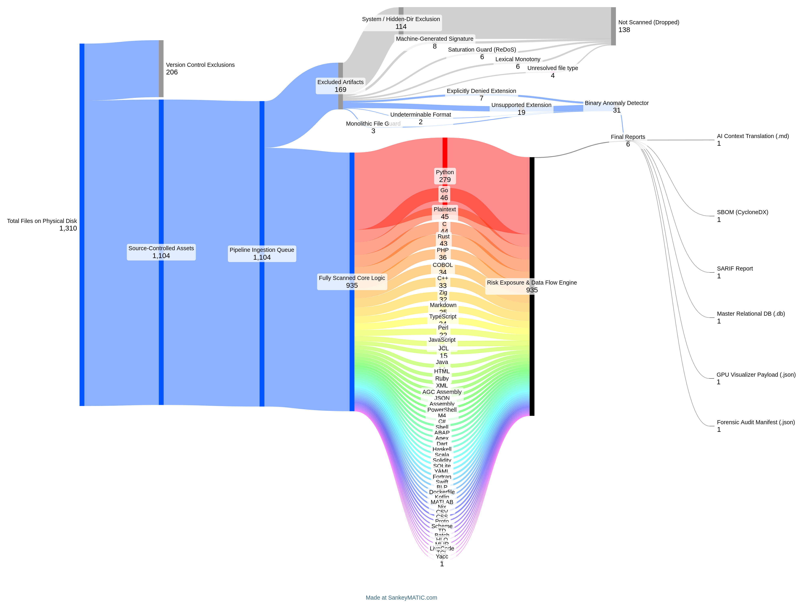

<div align="center">

# GitGalaxy

### Know any codebase deeply, and give your AI agents the same knowledge.

GitGalaxy is a scanning engine we built for one job: pulling the structure that matters out
of a whole repository. It reads every language in the repo in one pass and needs no build or
compiler. It is fast enough to run on every repo and every commit. And the facts go deep
enough to generate code: they drive an automated CICS-to-Java translator that proves each
ported program against the original, keeps the full evidence chain, and turns every miss into
a named, ranked fix.

<table>
<tr>
<td align="center" width="190"><h2>65 s</h2></td>
<td align="center" width="190"><h2>58</h2></td>
<td align="center" width="190"><h2>100%</h2></td>
<td align="center" width="190"><h2>L0 to L5</h2></td>
</tr>
<tr>
<td align="center" valign="top"><sub><strong>to scan Kubernetes</strong><br />2.46M lines, 11 file types · single run, 2026-09-19 (v2.9.1)<br /><em><a href="#every-size-in-seconds">speed model and source</a></em></sub></td>
<td align="center" valign="top"><sub><strong>languages, down to the function</strong><br />71 recognized · no build, no per-language toolchain<br /><em><a href="#languages">the full list</a> · counted from the registry, checked by a test</em></sub></td>
<td align="center" valign="top"><sub><strong>validated function precision</strong><br />vs tree-sitter, 31 languages · audit of 2026-08-30<br /><em><a href="docs/self_scan/tri_comparison_README.md">pinned corpus, dated source</a> · not every repo</em></sub></td>
<td align="center" valign="top"><sub><strong>CICS and batch programs, by evidence level</strong><br />no model; <a href="https://github.com/squid-protocol/gitgalaxy/blob/generated/docs/language_status/progress.md">live counts</a><br /><em><a href="#every-port-ships-with-its-evidence">oracle is GnuCOBOL</a>, not z/OS</em></sub></td>
</tr>
</table>

<a href="#quickstart"><strong>Quickstart</strong></a> ·
<a href="#pick-your-front-door"><strong>Scanner or translator</strong></a> ·
<a href="#the-scanner"><strong>Scanner</strong></a> ·
<a href="#cics-to-java-ported-then-proven"><strong>Translator</strong></a> ·
<a href="#accuracy-measured"><strong>Evidence</strong></a> ·
<a href="#what-gitgalaxy-is-and-isnt"><strong>Is / isn't</strong></a> ·
<a href="#installation"><strong>Install</strong></a> ·
<a href="https://squid-protocol.github.io/gitgalaxy/"><strong>Docs</strong></a> ·
<a href="https://gitgalaxy.io/"><strong>Visualizer</strong></a>

</div>

---

## One scan, every language, six reports



This is one real scan, drawn as a flow. 1,310 files on disk come in on the left. Version
control, generated code, binaries and denied extensions are filtered out, and every exclusion
is counted with its reason. The remaining 935 files, in about 50 languages from Python and Go
to COBOL, JCL and Apollo-era AGC assembly, go through **one engine** that measures them all
with the same signal set. Six reports come out the right-hand side: an AI-ready architecture
brief, a CycloneDX SBOM, SARIF, a SQLite knowledge graph, the 3D visualizer payload and a
forensic audit manifest.

GitGalaxy does not run a separate parser per language. It pulls a common set of
**structural signatures** from the source text: functions, classes, arguments, control flow,
state mutation, I/O, APIs and dependencies. So a Perl test helper and a C header rank in the
same list, and a repository that doesn't build can still be read.

<a id="languages"></a>

<details>
<summary><strong>Languages: 71 recognized, 58 read down to the function</strong></summary>

From the engine's language definitions
([`gitgalaxy/standards/language_standards/`](gitgalaxy/standards/language_standards/)) on
2026-10-24:

| level | count | languages |
|---|---|---|
| **Split into functions**: full structural extraction, functions with their own signals | 58 | `abap`, `acs`, `ada`, `agc_assembly`, `apex`, `assembly`, `batch`, `bms`, `c`, `cobol`, `cpp`, `crystal`, `csd`, `csharp`, `css`, `dart`, `db2_sql`, `dockerfile`, `easytrieve`, `embedded_python`, `fortran`, `fsharp`, `go`, `groovy`, `haskell`, `hlasm`, `html`, `java`, `javascript`, `jcl`, `kotlin`, `livecode`, `lua`, `m4`, `makefile`, `matlab`, `objective-c`, `perl`, `php`, `pli`, `postgresql`, `powershell`, `python`, `rexx`, `ruby`, `rust`, `scala`, `scheme`, `shell`, `solidity`, `sqlite`, `swift`, `tcl`, `typescript`, `yacc`, `yaml`, `zig`, `zscript` |
| **Structural rules, no function split** | 4 | `glsl`, `hlo`, `markdown`, `mlir` |
| **Recognized only**: identified, counted and filtered, no structural rules | 9 | `blp`, `csv`, `json`, `nix`, `pbtxt`, `plaintext`, `proto`, `td`, `xml` |

How well each language is *measured* is a separate question, answered in
[Accuracy, measured](#accuracy-measured).

</details>

<a id="real-world-scale"></a>

## Every size, in seconds


Every dot is a real public repository, from a 10-line npm package to `flutter` and
`freebsd-src`. Most repos finish in under a second. **Single run, measured 2026-09-19** (v2.9.1,
zero-dependency mode): **Kubernetes**, 2.46M analyzed lines, mostly Go and YAML, took about 65 s
between the first and last line of its scan log. Scan time follows a fitted two-regime model
(636 repos): flat at about 0.04 s below about 2.4K LOC, then
`time(s) ≈ 1.72e-05 × LOC^0.9975` (R²=0.92 over the 233 repos that fit it). The numbers come from
[`rate_model.json`](https://github.com/squid-protocol/gitgalaxy-raw-output/tree/main/speed_charts/latest)
and the [Kubernetes scan log](https://github.com/squid-protocol/gitgalaxy-raw-output/tree/main/v2.9.1/kubernetes)
in gitgalaxy-raw-output; they are a dated snapshot, and a later batch run replaces them. The limit: a handful of 20M+ LOC
outliers still take minutes, and a fast scan shows throughput, not insight quality. Accuracy
is measured separately [below](#accuracy-measured). Every scan behind the chart is published
unedited in [gitgalaxy-raw-output](https://github.com/squid-protocol/gitgalaxy-raw-output).

---

<a id="quickstart"></a>

## Quickstart

```bash
pip install gitgalaxy                 # zero install dependencies
galaxyscope path/to/repo              # all six reports
galaxyscope path/to/repo --llm-only   # just the architecture brief, for you or your agent
```

Hand the brief to an agent with *"Read this architecture brief, then tell me where to start
reading this codebase"*. The brief carries its own interpretation prompt, so the model doesn't
have to guess what the numbers mean. Other modes: `--sarif-only`, `--sbom-only`, `--db-only`,
`--gpu-only`, `--audit-only`. Everything runs locally. See
[Installation](#installation) for the optional extras and CI templates.

## Pick your front door

| If you want to... | Start here |
|---|---|
| **Understand a repository fast**, or hand an AI agent a real mental model of it | [The scanner ↓](#the-scanner): the architecture brief, the graph, the reports |
| **Gate CI** with SARIF, an SBOM and structural checks | [What a scan gives you ↓](#what-a-scan-gives-you) and the [CI templates](templates/) |
| **Move a CICS estate to Java** with proof that each program still behaves the same | [The translator ↓](#cics-to-java-ported-then-proven) |
| **Audit what a port claims**, input by input | [Every port ships with its evidence ↓](#every-port-ships-with-its-evidence) |
| **Check our claims** before you trust any of the above | [Accuracy, measured ↓](#accuracy-measured) |

---

<a id="the-scanner"></a>
<a id="one-graph-not-five-separate-tools"></a>

## The scanner

### What you ask, what you get

| You ask | GitGalaxy gives you |
|---|---|
| *What is this repository made of?* | Language composition and the macro state of the repo, in the first page of the [architecture brief](https://github.com/squid-protocol/gitgalaxy/blob/generated/docs/gitgalaxy_architecture_brief.md). |
| *What is load-bearing? What breaks if I change this?* | An import graph and a function call graph with PageRank blast radius, articulation points, choke points and cycles. [Call graph](docs/function_call_graph.md) · [graph accuracy](docs/graph_accuracy.md) |
| *Where should I read first?* | The heaviest functions and files, and ranked hitlists, with the formula printed in the report. [Architecture brief](https://github.com/squid-protocol/gitgalaxy/blob/generated/docs/gitgalaxy_architecture_brief.md) |
| *Where are secrets, unsafe calls, dynamic execution, I/O, concurrency?* | The Structural Surface Profile: 13 per-file vectors showing where each pattern concentrates. [Vectors](docs/vectors.md) |
| *What dependencies are actually on disk?* | A CycloneDX SBOM from the scan itself, plus supply-chain audits. [SBOM](docs/wiki/04-02-sbom-generator.md) |
| *Which code is complex, high-churn, or owned by one person?* | Refactoring targets ranked by volatility and authorship concentration, and bus-factor exposure. |
| *Can I query it myself?* | A SQLite knowledge graph of every file, function and edge. |
| *What did the scan skip?* | An itemized list of every file it refused to scan, and why. Nothing is dropped silently. |

<a id="what-a-scan-gives-you"></a>

### What a scan gives you

| Output | Purpose |
|---|---|
| **LLM architecture brief** | Compact Markdown context for an engineer or an agent (below) |
| **SARIF** | CI and security dashboard integration |
| **CycloneDX SBOM** | Dependency inventory and compliance |
| **SQLite** | Queryable repository knowledge graph |
| **JSON audit data** | Forensic and automation workflows |
| **3D visualization data** | Interactive repository topology in the [Visualizer](https://gitgalaxy.io/) |

### The architecture brief

The flagship report is a single Markdown brief built to give an engineer, or an AI agent, a
working mental model of a repository they've never seen. It is self-contained: the risk
equations are printed in the report, and an embedded interpretation prompt lets any LLM
narrate it without hallucinating what the numbers mean. It covers macro state and language
composition, network topology (modularity, articulation points, cyclic density), dependency
choke points, the heaviest functions and files, per-file structural signatures with PageRank
blast radius, targeted and cumulative hitlists, supply-chain audits, and refactoring targets.
It ends with an itemized list of every file it *refused* to scan, and why.

Two examples, scanned 2026-08-31 with the current engine. Both repositories are public. Clone
either and run `galaxyscope --llm-only <path>` to reproduce the full brief:

**curl**: 4,250 artifacts, 696 scanned, 112,653 LOC across C, Perl, Python, Shell, M4 and
Makefile. The brief ranks `src/tool_setup.h` as the top structural pillar (80 inbound
connections) and puts a *Perl* function, `APPEND_imap` in `tests/ftpserver.pl` (Impact 2135,
1,672 LOC), at the top of the repo-wide function hitlist, in the same ranking as the C code.
That cross-language graph is the product: one comparable signal set across every language in
the repo. The limit, stated in the same brief: only 16.4% of artifacts were scanned. The
ingestion filter drops binaries, generated code and test data aggressively, and §5 of the
brief itemizes every exclusion by extension and reason.

**cics-genapp** (IBM's CICS COBOL/DB2 sample): 92.1% scanned, 44 COBOL programs and 29 JCL
jobs. The cumulative hitlist leads with `base/src/lgupdb01.cbl` (mutation surface ~100%,
complexity load 92%). The heaviest paragraph in the repo is `UPDATE-POLICY-DB2-INFO`, the
`SELECT FOR UPDATE` row-locking logic, which is exactly where a maintainer of that program
would want to look first. The same brief also shows a limitation plainly. On a flat
architecture with no real import graph, the "structural pillars" list degenerates to
zero-connection files, and the report says to check the connection counts before trusting it.

Hundreds of unedited briefs for independently selected repositories are committed at
[gitgalaxy-raw-output](https://github.com/squid-protocol/gitgalaxy-raw-output). This repo's
own always-current self-scan brief is at
[`docs/gitgalaxy_architecture_brief.md`](https://github.com/squid-protocol/gitgalaxy/blob/generated/docs/gitgalaxy_architecture_brief.md).

---

<a id="cobol-to-java-ported-then-proven"></a>

## CICS to Java: ported, then proven

[](https://github.com/squid-protocol/gitgalaxy/blob/generated/docs/language_status/progress.md)

For mainframe estates the structural graph is the start of a migration. `cobol-to-java`
turns a CICS estate (its online transactions, plus the batch COBOL and JCL around them) into
a compiling Spring Boot project, and an equivalence harness proves each ported program
against the original COBOL: same inputs, byte-identical outputs. A port that is not proven
is not done, and a person approves every port.

**Iterably solvable.** On the public burned estates, the engine and its proof harness have turned
CICS-to-Java translation into an *iterably solvable* problem. Every gap surfaces as a named,
ranked fix: a construct the translator refuses by name, a failed proof, a fuzz difference, a
coverage hole, or a written-down assumption. One fix to the shared runtime repairs every
program that uses that rule, and every program carries its evidence chain from source to
proof. So a miss is a line on a ranked list, not a re-roll. These are the estates the
translator was developed against; a blind-estate trial has not run yet. The reasoning, and
the numbers moving week to week:
[Turning CICS → Java into an iterably solvable problem](https://github.com/squid-protocol/gitgalaxy/discussions/4784).

1. **Facts.** `cobol-refractor` records what the engine verified per program: record
   layouts, datasets, JCL steps, CICS commands, COMMAREAs, CALLs, DB2 tables.
2. **Skeleton.** `cobol-to-java` generates the project from those facts: JPA entities and
   repositories for VSAM, JDBC repositories for DB2, Spring Batch jobs from JCL, REST
   endpoints for CICS transactions, BMS screens as view models, and a runtime for FILE
   STATUS, abends and DISPLAY. Where a fact is missing it writes a worklist item, not a
   guess. The kind of Java is [configurable](gitgalaxy/tools/cobol_to_java/README.md#choosing-the-java-you-get-the-target-config).
3. **Port.** Each program with business logic gets a porting ticket. Either the
   deterministic translator ports it with no model
   ([det-port](docs/language_status/det_port_design.md): each statement becomes a call into a
   runtime that follows COBOL's rules byte for byte, and anything it cannot translate is a
   named `Hole`), or a person or a model the customer chooses writes the logic
   ([`port_runner`](gitgalaxy/tools/cobol_to_java/port_runner.py)). A model may also make a
   det port readable one method at a time, each rewrite proven or reverted.
4. **Prove.** [`tests/tools/equivalence.py`](tests/tools/equivalence.py) runs the COBOL
   under GnuCOBOL and the port on the JVM. Every output record, the return code or abend,
   every DISPLAY line, every CICS screen (text, attributes, cursor), every COMMAREA, every
   Db2 table the program changes (both sides on one IBM Db2 Community Edition), and every
   injected file-status or CICS-response fault run must match. A failed proof's
   findings go back to the porter: [the porting loop](docs/language_status/porting_loop.md).
5. **Measure the proof.** The COBOL's paragraph and branch coverage across the runs says
   what was exercised. [Mutation testing](docs/language_status/mutation_testing.md) breaks
   the port on purpose and counts how many broken ports the proof still catches.

<a id="every-port-ships-with-its-evidence"></a>

### Every port ships with its evidence

No model writes the deterministic port, and no one types the claim. Each ported program gets
an [evidence record](docs/language_status/evidence_records.md) committed beside it, the
unit a customer receives next to the Java:

- **The claim**, rendered from the numbers: runs and fault runs, records compared,
  paragraph and branch coverage, mutation scores with every survivor triaged.
- **The proof**: the verdict, per-output counts and the harness commit.
- **What it was proven against**: sha256 digests of the port, the case and its inputs.
- **The options it holds under**: TRUNC, NUMPROC, ARITH and the rest, each marked
  `found at <file>:<line>` or `assumed`.
- **The assumptions it rests on**: the entries in the
  [oracle-assumptions register](https://github.com/squid-protocol/gitgalaxy/blob/generated/docs/language_status/oracle_assumptions.md) its CICS commands
  name, each tagged MATCHED, REFUSED, DIFFERS or ASSUMED.

Change any input and the record goes stale; the release gate fails until it is re-proven.
The harness audits its own comparisons too. It has found, filed and fixed places where proofs
were weaker than they looked: DISPLAY output and low-values skipped
([#4635](https://github.com/squid-protocol/gitgalaxy/issues/4635)), only the first occurrence
of repeated fields compared ([#4765](https://github.com/squid-protocol/gitgalaxy/issues/4765)),
and CALL comparisons limited to mapped fields
([#4778](https://github.com/squid-protocol/gitgalaxy/issues/4778)).

Every program gets an **evidence level**. Levels are cumulative, and the numbers under each
are always shown
([definition of done](docs/language_status/definition_of_done.md)):

| level | name | the program... |
|---|---|---|
| L0 | inventoried | is in the estate's survey; nothing more is claimed |
| L1 | translated whole | translates with no hole and no refusal |
| L2 | executed equivalent | is equal to the COBOL oracle on every scenario of its case |
| L3 | paragraph coverage | L2, and the scenarios run every live paragraph |
| L4 | branch coverage | L3, and every branch outcome, net of reviewed infeasible ones |
| L5 | mutants accounted for | L4, and every surviving mutant of the port accounted for (not yet measured, [#4628](https://github.com/squid-protocol/gitgalaxy/issues/4628)) |

**Where it stands**: the public estates are det-ported with no model, and the current level counts, the CICS
commands modelled, the mutation kill rate and the crucibles are on the generated
[progress page](https://github.com/squid-protocol/gitgalaxy/blob/generated/docs/language_status/progress.md), each number with its source and the commit it was rendered at (this README
holds none, so it cannot drift). The [per-estate evidence report](docs/language_status/evidence_report/README.md) is
published on the `generated` branch, regenerated on every push to main and nightly. The det ports include COACTUPC
(account update, 4,236 lines), which no model ported in one answer; CICS programs that LINK
to others in the same task (checked together); and named counters, SYNCPOINT ROLLBACK and
abend backout across files and Db2. The design and runtime contract are in
[det_port_design.md](docs/language_status/det_port_design.md).

<details>
<summary><strong>Model-written ports</strong> (23 CardDemo programs, snapshot 2026-10-02)</summary>

| program | kind | ported by | proven on | COBOL branches covered | mutants caught |
|---|---|---|---|---|---|
| CBACT04C (interest) | batch | a person | 20 runs, 19 with faults | 85/86 | 30/35 (40 sampled) |
| CBTRN02C (posting) | batch | a person | 29 runs, 28 with faults | 95/96 | 27/32 (40 sampled) |
| CBTRN03C (report) | batch | Claude Sonnet 5.5, attempt 2 | 25 runs, 24 with faults | 81/82 | 26/37 (40 sampled) |
| COMEN01C (menu) | CICS | Claude Sonnet 5.5, attempt 1 | 11 scenarios | 28/33 | 77/135 (150 sampled) |
| COACTVWC (account view) | CICS | a person | 11 scenarios | 47/71 | not measured |
| CSUTLDTC (date check) | CALL | Claude Sonnet 5.5, attempt 2 | 11 calls | 4/10 | 131/190 (all) |
| COUSR01C (add user) | CICS, writes a file | Claude Sonnet 5.5, attempt 1 | 13 scenarios, each file compared after the task | 20/21 | not measured |
| COADM01C (admin menu) | CICS, CSD-defined programs (PGMIDERR) | Claude Sonnet 5.5, attempt 2 | 16 scenarios | -- | not measured |
| COCRDSLC (card detail) | CICS, reads a file | Claude Sonnet 5.5, attempt 2 | 21 scenarios | -- | not measured |
| COUSR02C (update user) | CICS, READ UPDATE / REWRITE | Claude Sonnet 5.5, attempt 1 | 23 scenarios, each file compared | -- | not measured |
| COTRN01C (view transaction) | CICS, reads a file | Claude Sonnet 5.5, attempt 1 | 15 scenarios | -- | not measured |
| COUSR03C (delete user) | CICS, DELETE | Claude Sonnet 5.5, attempt 1 | 18 scenarios, each file compared | -- | not measured |
| COUSR00C (user list) | CICS, browse both ways | Claude Sonnet 5.5, attempt 1 | 21 scenarios | -- | not measured |
| COTRN00C (transaction list) | CICS, browse both ways | Claude Sonnet 5.5, attempt 1 | 21 scenarios | -- | not measured |
| COTRN02C (add transaction) | CICS, browse + WRITE, CALLs CSUTLDTC | Claude Sonnet 5.5, attempt 1 | 31 scenarios, each file compared | -- | not measured |
| COBIL00C (bill payment) | CICS, ASKTIME / FORMATTIME, WRITE + REWRITE | Claude Sonnet 5.5, attempt 1 | 17 scenarios, each file compared | -- | not measured |
| COCRDLIC (card list) | CICS, filtered browse both ways | Claude Sonnet 5.5, attempt 2 | 43 scenarios | -- | not measured |
| COSGN00C (sign-on) | CICS, ASSIGN APPLID / SYSID | Claude Sonnet 5.5, attempt 1 | 12 scenarios | 17/17 | not measured |
| CORPT00C (report request) | CICS, WRITEQ TD (JCL to JOBS), CALLs CSUTLDTC | Claude Sonnet 5.5, attempt 1 | 16 scenarios, each JCL line compared | -- | not measured |
| CBACT02C (card file listing) | batch | Claude Sonnet 5.5, attempt 1 | normal run + 6 faults, SYSOUT compared | -- | not measured |
| CBACT03C (card xref listing) | batch | Claude Sonnet 5.5, attempt 1 | normal run + 6 faults | -- | not measured |
| CBCUS01C (customer listing) | batch | Claude Sonnet 5.5, attempt 1 | normal run + 6 faults | -- | not measured |
| CBTRN01C (daily transaction check) | batch, no JCL in the estate | Claude Sonnet 5.5, attempt 3 | normal run + 20 faults | -- | not measured |

</details>

On the [CICS crucible](docs/language_status/cics_crucible.md), a corpus of small CICS
applications built around known migration traps, the programs and scenarios are counted on the
[progress page](https://github.com/squid-protocol/gitgalaxy/blob/generated/docs/language_status/progress.md). The scenarios cover every live paragraph and branch. The ports were written by Claude Opus
5.5: 9 on the first attempt, 7 on the second, 1 on the third.

What these levels do not show:

- **The oracle is not a mainframe.** It is GnuCOBOL, a model of CICS, Db2 for Linux, and IBM
  services modelled only where IBM documents them. Anything else is refused, never guessed. Every
  known or suspected difference from z/OS, and whether a proven program reaches it, is in the
  [oracle-assumptions register](https://github.com/squid-protocol/gitgalaxy/blob/generated/docs/language_status/oracle_assumptions.md): for example a POINTER
  is 8 bytes here and 4 on z/OS (C9, which blocks three CBSA programs), and text compares in
  ASCII order, not EBCDIC (D1). Proving against captured z/OS output is
  [#4050](https://github.com/squid-protocol/gitgalaxy/issues/4050).
- **These are burned estates.** The burned estates and the crucible are public, and the
  translator and porting rules were built on them, so their levels are not first-try results.
  The real test is a blind estate seen for the first time; no such trial has run yet
  ([trial protocol](docs/language_status/fresh_estate_trials.md)).
- **"Equivalent" covers the paths the runs take**, not every possible input. L3 and L4
  narrow that gap; they don't close it. Det-port mutation (L5) is not measured yet.
- **A program is not proven while anything it calls has a hole.** If any program it LINKs or
  CALLs, however indirectly, has an untranslated construct, it stays at L1, even when no
  scenario reaches that construct ([#4803](https://github.com/squid-protocol/gitgalaxy/issues/4803)).
- **Refused programs are listed, not hidden.** IDMS, national/DBCS text, source defects,
  vendor copybooks and options IBM leaves undefined are refused by name; the families are in
  the [definition of done](docs/language_status/definition_of_done.md).
- **Translating the code is not migrating the system.** Data migration, JCL job streams,
  external interfaces, performance, security and cutover are not measured
  ([#4514](https://github.com/squid-protocol/gitgalaxy/issues/4514)).

The full pipeline, commands and target config are in the
[translator README](gitgalaxy/tools/cobol_to_java/README.md).

---

<a id="proof-not-just-claims"></a>
<a id="evidence-not-just-claims"></a>

## Accuracy, measured

Every number above links to something you can inspect. This section is the summary. The full
argument (method, verdicts, limits and what comes next) is in
[the validation program](docs/validation.md).

### Structural validation: GitGalaxy vs Tree-sitter vs Ctags

GitGalaxy is benchmarked against **Tree-sitter and Universal Ctags** on the pinned
[Language Crucible](https://github.com/squid-protocol/language-crucible) corpus. 24 of 45
languages get all three tools and 13 more get two. Every disagreement is investigated against
real source and recorded with a verdict (200 of 201 logged discrepancy shapes validated). On
that corpus, GitGalaxy's validated function precision is 100% across all 31
tree-sitter-comparable languages, and it is never the tool found wrong in a validated class or
argument disagreement. The limit: three structural targets on one fixed corpus. This does not
show that it parses as accurately as an AST in general.


### Graph validation: imports and calls (in progress)

Blast radius, PageRank and the "structural pillars" come from the **import graph**. The
function-level rankings come from the **call graph**. Neither graph is measured in every
language yet, and the chart below says which ones are:
- Measured languages show precision and recall with n.
- Every language not yet measured is listed by name.

As of 2026-09-26, out of 59 languages:
- **The import graph is measured in 20.** Engine edges are checked against each language's
  own import statements on pinned real repos
  ([`import_graph_accuracy.py`](tests/tools/import_graph_accuracy.py)).
- **Callee names are measured in 11**, against tree-sitter.
- **Call resolution is measured in 3**, against a reference analyser:
  - Python, vs pyan3: 99.8% precision on 1,806 judged links, 51.6% recall;
  - TypeScript, vs the TypeScript 6.0.2 type checker: 99.9% precision on 1,520 judged links,
    57.1% recall;
  - Java, vs scip-java (javac's own resolution): 93.2% precision on 3,727 judged links,
    44.2% recall. A call to an overloaded method is linked only when its argument count picks
    one overload ([#3835](https://github.com/squid-protocol/gitgalaxy/issues/3835)).

  A call link, when made, is usually right, but about half or more of calls are left
  unlinked. So function-level fan-in and PageRank are a lower bound.

The limits:
- The other 38 languages' graphs are built the same way but are **not measured**.
- Several measured languages rest on one repo with fewer than 100 imports. The chart fades
  those out.
- A `*` marks a number with disagreements still awaiting a verdict against source.

The plan to close these gaps is
[epic #3772](https://github.com/squid-protocol/gitgalaxy/issues/3772).


### Cross-language consistency: the Keyword Rosetta control corpus

This program asks the opposite question: **does GitGalaxy measure identical intent
identically in every language?** The
[keyword-rosetta](https://github.com/squid-protocol/keyword-rosetta) corpus plants the same
12-probe program in all 50 languages in the corpus, with exact known signal counts, so any
divergence is measured language bias, by construction.

Current answer: on average 94% of languages sit within ±25% of the cross-language median per
gated metric (56 chartable metrics, 54 holding ≥80%). **The open-defect share is 0.0%: 1 of
2,844 comparable cells** across 59 gated metrics. Every other out-of-band cell is a variation
the deviation ledger has validated, such as a construct the language cannot express. The
chart colours each deviation by cause: red is an open engine defect, grey is a validated
variation. The limit: a control corpus shows measurement inequality on identical intent. It
says nothing about accuracy on real code, which is the tri-comparison's job. The weakest
metrics, the security-lens probe and the full ledger story are in
[the validation program](docs/validation.md#cross-language-consistency-the-keyword-rosetta-control-corpus).


<a id="structural-surface-profile-what-gitgalaxy-claims-formerly-risk-exposure"></a>

### What the Structural Surface Profile claims

The 13 per-file vectors describe **where a structural or content pattern is concentrated**
relative to the rest of the repository. They do **not** predict defects. That per-file claim
was tested over Git history on ~3,550 scanned snapshots of two repositories, with every test
pre-registered, and it did not hold. What did predict were two *history* metrics: recidivism
and change entropy. Structure describes, history predicts. The full record is in
[the validation program](docs/validation.md#what-the-structural-surface-profile-claims) and
[`docs/vectors.md`](docs/vectors.md).

### The rest of the evidence

| Evidence | What it is |
|---|---|
| [Language Crucible](https://github.com/squid-protocol/language-crucible) | A pinned corpus of real-world source, including Godot, Roslyn, curl, Kubernetes and Apollo 11 flight software |
| Golden-master regression | Real source rescanned and compared against checked-in expected output, so every parser change has an observable diff ([`tests/README.md`](tests/README.md)) |
| Regression suite | **13,281 tests** collected (2026-10-01), of which 8,704 are per-language extraction tests across 54 languages and 1,222 cover the mainframe pipeline and the COBOL-to-Java proofs ([`tests/README.md`](tests/README.md)) |
| [Raw Output](https://github.com/squid-protocol/gitgalaxy-raw-output) | Unedited GitGalaxy output for hundreds of independently selected repositories |
| [Temporal Crucible](https://github.com/squid-protocol/temporal-crucible) | The pre-registered Git-history validation behind the claim above ([hypothesis ledger](https://github.com/squid-protocol/temporal-crucible/blob/main/docs/HYPOTHESES.md)) |
| [Where it beats an AST](docs/why_gitgalaxy_beats_ast_here.md) · [where it goes blind](docs/known_blind_spots.md) | Specific, evidenced cases both ways |

---

<a id="what-gitgalaxy-is-and-isnt"></a>

## What GitGalaxy is, and isn't

**GitGalaxy is** repository-scale structural intelligence: language-agnostic source analysis,
one structural representation across mixed code, architecture mapping, CI-native evidence,
useful on broken or uncompiled repositories, and built for local and offline use.

**GitGalaxy is not** a replacement for CodeQL's deep dataflow analysis, Semgrep's rule
ecosystem or a dependency CVE database. It is not a proof of exploitability, a runtime
analyzer or a complete language parser, and a high surface reading is not a vulnerability.

| Tool | Primary question |
|---|---|
| **GitGalaxy** | What does this entire repository look like, structurally, and where should attention go first? |
| Tree-sitter | What syntactic structure does this source contain? |
| Ctags | Where are the navigable code entities? |
| Semgrep | Does this code match a specified pattern? |
| CodeQL | What data/control relationships can deeper analysis establish? |
| SCA/CVE tools | Is this dependency/version associated with a known advisory? |

GitGalaxy also uses Git history for churn, contributor concentration, bus-factor exposure,
refactoring hotspots and file ownership. Extending history from context to validation is
described in [the validation program](docs/validation.md#the-next-validation-risk-over-git-history).

## Privacy and deployment

GitGalaxy is designed for local and air-gapped operation.

-   Source code is not sent to a GitGalaxy cloud service.
-   Scanning and vectorization occur locally.
-   The scanner has no runtime network requirement.
-   CI/CD execution can remain inside the user's environment.
-   The browser visualizer operates on locally supplied data.

## Installation

``` bash
pip install gitgalaxy            # zero install dependencies
pip install "gitgalaxy[full]"    # + tiktoken, xgboost, scikit-learn, pandas, numpy, pyyaml
pip install "gitgalaxy[translator]"  # + tree-sitter-language-pack, for the CICS-to-Java translator
```

See the [documentation](https://squid-protocol.github.io/gitgalaxy/) for
current commands and configuration.

### Zero-dependency mode

A plain `pip install gitgalaxy` pulls in nothing, for environments where
every third-party package is a supply-chain question. Scans still run: every
structural signal, dependency edge, in/out-degree count, PageRank / blast
radius, betweenness, closeness, average path length, modularity, cyclic
density, articulation points and assortativity is measured exactly as in full
precision (these are computed natively). What needs the optional engines is
token mass and read cost (`tiktoken`), ML threat
classification (`xgboost`/`scikit-learn`/`pandas`/`numpy`) and YAML config/OpenAPI parsing
(`pyyaml`). A metric that was not computed is reported as absent (`n/a` /
NULL), never as a zero. Each output says when a scan ran in this mode, and
[`docs/zero_dependency_mode.md`](docs/zero_dependency_mode.md) lists, field by
field, what is identical and what is unavailable.

### CI/CD

Templates are provided for GitHub Actions, GitLab CI, Bitbucket Pipelines,
Azure Pipelines, and generic shell-invocable CI environments. See
[`templates/`](templates/) and the [CI integration
guide](github-action-readme.md).

## Explore further

| Resource | What it contains |
|---|---|
| [Documentation](https://squid-protocol.github.io/gitgalaxy/) | Architecture, claims and methodology |
| [The validation program](docs/validation.md) | The full proof narrative: thesis, benchmarks, validity ladder, next experiments |
| [Vector reference](docs/vectors.md) | The 13 per-file vectors: names, meaning, evidence, and the `risk_*` deprecation note |
| [Vector formula facts](docs/vector_formulas.md) | Mechanical per-calculator formula audit (inputs, arithmetic, constants) |
| [Language Crucible](https://github.com/squid-protocol/language-crucible) | Cross-language benchmark and golden corpus |
| [Keyword Rosetta](https://github.com/squid-protocol/keyword-rosetta) | 50-language planted control corpus and bias reports |
| [Raw Output](https://github.com/squid-protocol/gitgalaxy-raw-output) | Unedited scans of real repositories |
| [Evidence report](docs/language_status/evidence_report/README.md) · [definition of done](docs/language_status/definition_of_done.md) | Per estate, an evidence level per program, regenerated on every push to main; what "done" means |
| [CICS → Java: the tool](gitgalaxy/tools/cobol_to_java/README.md) | The pipeline from facts to a proven port, the target config, and the porting ticket |
| [Porting loop](docs/language_status/porting_loop.md) · [Mutation testing](docs/language_status/mutation_testing.md) · [CICS crucible](docs/language_status/cics_crucible.md) · [Statement inventory](docs/language_status/statement_inventory.md) | How ports are written and proven, how strong each proof is, the CICS trap corpus, and how much of a port a deterministic translator could write |
| [COBOL → Java examples](https://github.com/squid-protocol/cobol_to_java_examples) | 10 COBOL repos auto-translated to compiling Spring Boot architectures (`mvn clean compile` works out of the box) |
| [Population analyses](https://github.com/squid-protocol/gitgalaxy-population-analyses) | Statistical analyses over the raw-output scan population: archetype clustering, risk distributions, threat-classifier studies |
| [Museum of Code](https://squid-protocol.github.io/gitgalaxy/museum-of-code/) | Full architectural teardowns of real codebases (Apollo 11, IBM CICS benchmarks) |
| [Distribution telemetry](https://github.com/squid-protocol/squid-telemetry) | Public fetch metrics across GitHub/GitLab/[PyPI](https://pypi.org/project/gitgalaxy/), regenerated daily |
| [`tri_comparison_ledger.json`](docs/self_scan/tri_comparison_ledger.json) | Disagreement-by-disagreement validation record |
| [`manual_verification.json`](docs/self_scan/manual_verification.json) | Reviewed cases where comparator coverage is unavailable |
| [`how_to_investigate_a_discrepancy.md`](docs/self_scan/how_to_investigate_a_discrepancy.md) | Comparator-disagreement methodology |
| [Visualizer](https://gitgalaxy.io/) | Local browser-based repository visualization |

## License

Copyright (c) 2026 Joe Esquibel

GitGalaxy is distributed under the **PolyForm Noncommercial License 1.0.0**.

See the repository license for full terms.
