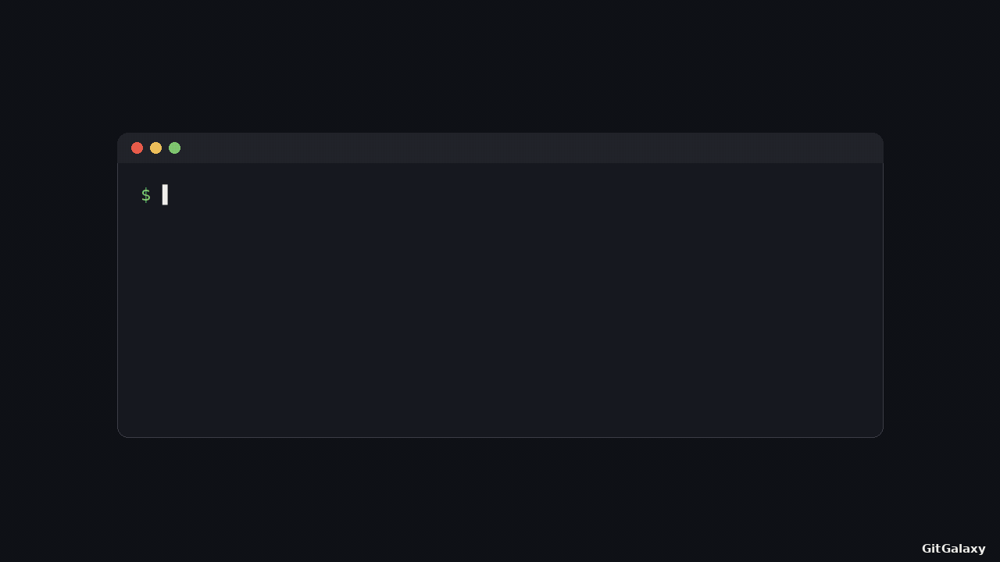
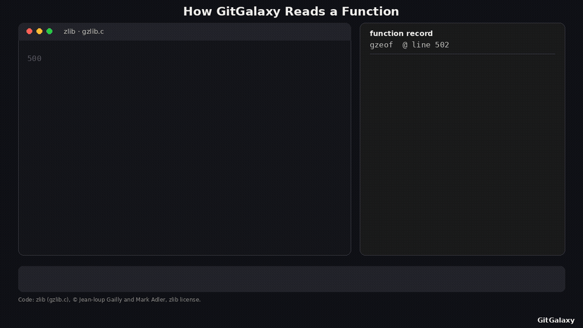
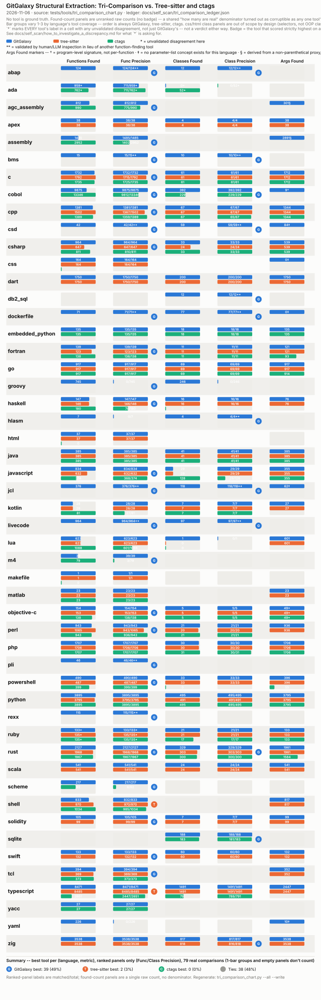
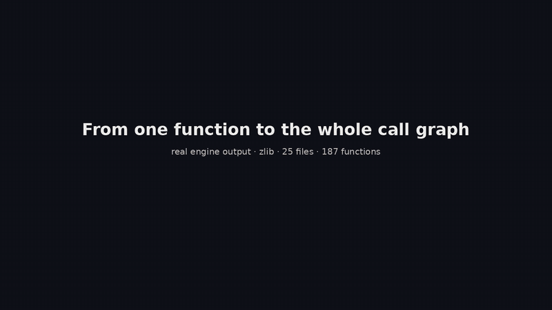
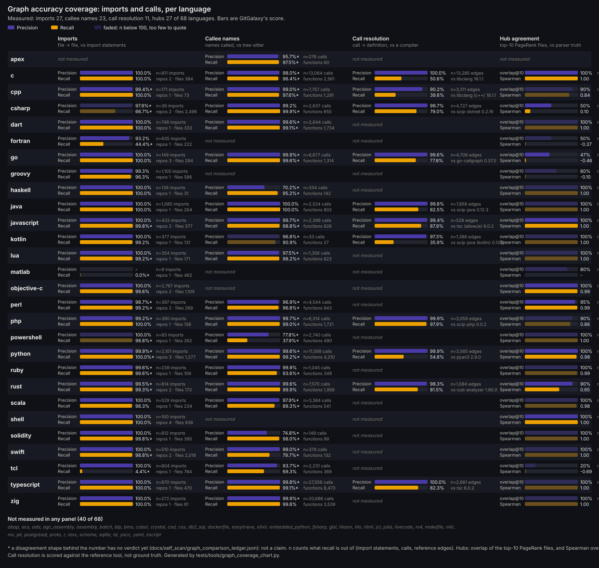
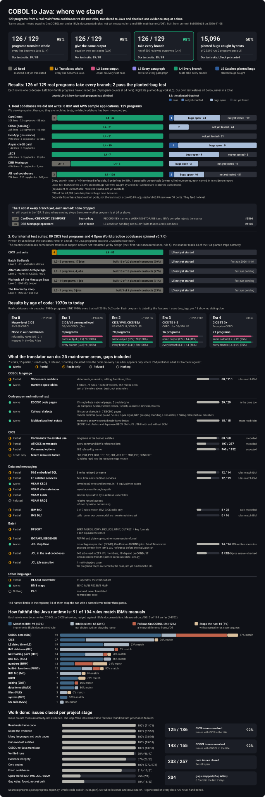

> **Mockup, not the live README.** A draft of the new top of the page: the hero, then what it does, how it does it,
> where it came from, and how we validated it. The sections after that are listed at the end and not yet rewritten.
> The text is drafted from the redesign outline. Two charts here load this branch's dark copies; the live README
> loads them from the `generated` branch, which turns dark once the docs workflows run after merge.

# GitGalaxy

### Know any codebase deeply, and give your AI agents the same knowledge.

One command turns any repository (59 languages, no build, no compiler) into structure you can compare, query, and
hand to a coding agent. Also: a [CICS-to-Java translator](gitgalaxy/tools/cobol_to_java/README.md) that proves each
ported program against the original.

<table>
<tr>
<td align="center" width="250"><h2>&lt; 1 s</h2></td>
<td align="center" width="250"><h2>59</h2></td>
<td align="center" width="250"><h2>0</h2></td>
</tr>
<tr>
<td align="center" valign="top"><strong>for most repositories</strong> Kubernetes, 2.46M lines, in about 65 s <em><a href="#how-we-validated-it">speed model</a></em></td>
<td align="center" valign="top"><strong>languages, down to the function</strong> 72 recognized <em><a href="README.md#languages">the full list</a></em></td>
<td align="center" valign="top"><strong>install dependencies</strong> runs locally; nothing leaves your machine <em><a href="README.md#privacy-and-deployment">privacy</a></em></td>
</tr>
</table>

<a href="#quickstart"><strong>Quickstart</strong></a> ·
<a href="https://squid-protocol.github.io/gitgalaxy/"><strong>Docs</strong></a> ·
<a href="https://gitgalaxy.io/"><strong>Visualizer</strong></a> ·
<a href="https://pypi.org/project/gitgalaxy/"><strong>PyPI</strong></a> ·
<a href="LICENSE"><strong>License: PolyForm Noncommercial</strong></a> ·
<a href="mailto:joe@gitgalaxy.io"><strong>Commercial use</strong></a>

---

## What it does

<strong>One real scan, start to finish.</strong> Every number comes from the scan's own output, and the bar is its real
wall clock. Click for full size. <a href="docs/media/README.md#one-scan-every-language">How it was made</a>.
(continued → <a href="docs/how-it-works.md">every film, explained</a> ·
<a href="docs/wiki/02-03-aperture-filter.md">the gates</a> ·
<a href="docs/wiki/02-01-pipeline-overview.md">the pipeline</a>)

## How it does it

<strong>What the engine reads in one function</strong>, rendered from real engine output. See
<a href="docs/how-it-works.md">more examples</a>, including the same film in Python, Java and COBOL. That fingerprint
is what <a href="docs/how-it-works.md#finding-a-copy-without-its-name">finds a renamed copy</a>, such as OpenSSL
functions inside BoringSSL.
(continued → <a href="docs/wiki/02-07-the-prism.md">the prism</a> ·
<a href="docs/wiki/02-08-the-detector.md">the detector</a>)

## Where it came from

We built a scanner that pulls the structure out of code: its functions, their arguments, and their language keyword
families.

It started with a tool GitGalaxy's creator, Joe Esquibel, used every day as a scientist: the BLAST algorithm. BLAST breaks a DNA or protein
sequence into short words, finds where those words match across millions of other sequences, and extends the matches
into alignments. In seconds you can find a gene's relatives without knowing what the gene does.
([continued: the BLAST philosophy](docs/wiki/03-01-claim-1-search-strategies.md))

Stated plainly, this project takes the ideas and logic behind BLAST and applies them to code. GitGalaxy breaks every
function, in every language, into the same structural words. That makes code comparable across languages,
repositories and decades.

The BLAST paradigm changed how biologists, and all of us, understand DNA. We're working to do the same for code. Looking
at code this way turns problems that are traditionally hard into easy ones. PET scanners, X-rays and MRIs let us see
inside bodies we can't open. This engine does the same for codebases too big, too old or too broken to read: it needs
no build and no compiler. It reads signals in ways no one has done before at this scale.

We've been pointing it at a few questions to put the engine through its paces:

- **[DOOM's DNA](docs/wiki/museum-of-code/teardown-of-doom.md)**: how much of the original game's wiring survives when
  it is ported to other languages.
- **[Every Model Has a Tell](docs/wiki/museum-of-code/every-model-has-a-tell.md)**: three AI coding models (Claude
  Sonnet, Claude Haiku and OpenAI Codex) built the same ten programs, and the shape of their code alone kept giving
  them away (exploratory).
- **[CICS to Java](gitgalaxy/tools/cobol_to_java/README.md)**: translating mainframe COBOL into Java, and proving
  each ported program against the original.
- **Positional languages**: fixed-format COBOL, where meaning depends on the column (the
  [engine's COBOL rules](gitgalaxy/standards/language_standards/languages/cobol.py) read column 7 for comments and
  blank out columns 73-80, the punch-card sequence area), and the
  [Apollo 11 guidance computer's assembly](docs/wiki/museum-of-code/teardown-of-apollo-11.md).
- **[Structure vs history](https://github.com/squid-protocol/temporal-crucible)**: a pre-registered test, over
  thousands of Git snapshots, of whether code structure predicts defects. It does not; change history does. That
  result is below.

([continued: every study in the Museum of Code](docs/wiki/museum-of-code/index.md))

We feel like we've barely scratched the surface. BLAST has been used by tens of thousands of researchers to answer
thousands of different questions. We built this engine to be used the same way.

## How we validated it

Every claim below links to the data behind it. Read the numbers as an **upper bound**:
- **Sampling:** they are measured on our own pinned corpora, mainly the
  [Language Crucible](https://github.com/squid-protocol/language-crucible). That corpus samples each language
  incompletely, and the engine was tuned against it.
- **Sensors:** the engine has to be set up and tuned for each language, and anything its sensors are not built to see
  is missed.

The full record is in [the validation program](docs/validation.md) (continued →
[methodology](docs/wiki/08-01-methodology.md) · [graph accuracy](docs/graph_accuracy.md) ·
[language detection accuracy](docs/wiki/03-11-claim-11-multi-signal-detection.md) ·
[known blind spots](docs/known_blind_spots.md)).

**Functions.** On the pinned Language Crucible, GitGalaxy is benchmarked against Tree-sitter and Universal Ctags.
- Validated function precision is 100% across the 31 languages Tree-sitter can compare (audit of 2026-08-30).
- Every disagreement is checked against the real source, with a verdict: 200 of 201 logged shapes are validated
  ([ledger](docs/self_scan/tri_comparison_ledger.json)).

**The graphs.** Blast radius and the "structural pillars" come from the import graph. The function rankings come from
the call graph.

- **Call links:** where they are measured against a reference analyser, they are 93.2% (Java), 99.8% (Python) and
  99.9% (TypeScript) precise.
- **Recall:** about half of all calls are left unlinked (44-57%), so function fan-in and PageRank are a lower bound
  ([graph accuracy](docs/graph_accuracy.md)).
- **Import graph:** measured in 20 of 59 languages. The chart names every language not yet measured
  ([epic #3772](https://github.com/squid-protocol/gitgalaxy/issues/3772)).

**Same intent, same measurement.** The [Keyword Rosetta](https://github.com/squid-protocol/keyword-rosetta) corpus
plants the same 12-probe program in every language. Any difference in what the engine measures is therefore language
bias.
- Open engine defects are 1.1% of comparable cells (33 of 3,125; bias report of 2026-10-30).
- Every other out-of-band cell is a validated variation, such as a construct the language cannot express.

**What it does not claim.** We tested, pre-registered, whether per-file structure predicts defects. It ran over about
3,550 Git snapshots of two repositories. It does not predict them. Two *history* metrics did: recidivism and change
entropy. Structure describes; history predicts
([temporal-crucible](https://github.com/squid-protocol/temporal-crucible),
[hypothesis ledger](https://github.com/squid-protocol/temporal-crucible/blob/main/docs/HYPOTHESES.md)).

More: [raw output](https://github.com/squid-protocol/gitgalaxy-raw-output) for hundreds of repositories, unedited ·
[where it beats an AST](docs/why_gitgalaxy_beats_ast_here.md) · [where it goes blind](docs/known_blind_spots.md).

## CICS to Java, with the evidence for each program

For mainframe teams: CICS is IBM's transaction system for COBOL applications. The translator does three things:
- **Ports by rule:** it turns a CICS and batch COBOL estate into a compiling Spring Boot project, and ports each
  program by rule, with no model.
- **Checks the outputs:** it checks each ported program against the original COBOL, with the same inputs and
  byte-identical outputs.
- **Records the evidence:** each program gets an evidence record and an **evidence level** from L0 (inventoried) to L5
  (every surviving mutant accounted for).

Translating the code is not migrating the system. The oracle is GnuCOBOL, not z/OS. The public estates are
development estates, and a first blind-estate trial has started.

**Start with:** [the translator](gitgalaxy/tools/cobol_to_java/README.md) ·
[the definition of done](docs/language_status/definition_of_done.md)

(continued → [the equivalence harness](docs/wiki/05-20-equivalence-harness.md) ·
[ported programs, det vs model](docs/wiki/05-19-proven-cobol-to-java-ports.md) ·
[recipe: equivalence testing](docs/wiki/cookbook/cobol-equivalence-testing.md) ·
[recipe: estate to Spring Boot](docs/wiki/cookbook/scaffold-spring-boot.md))

---

> **The rest of the page follows the outline.** It is not rewritten in this mockup:
> - Quickstart
> - What a scan gives you
> - Fast at any size
> - What GitGalaxy is, and isn't
> - Install and deploy
> - Learn more
> - License
>
> Until then, see the [live README](README.md).
