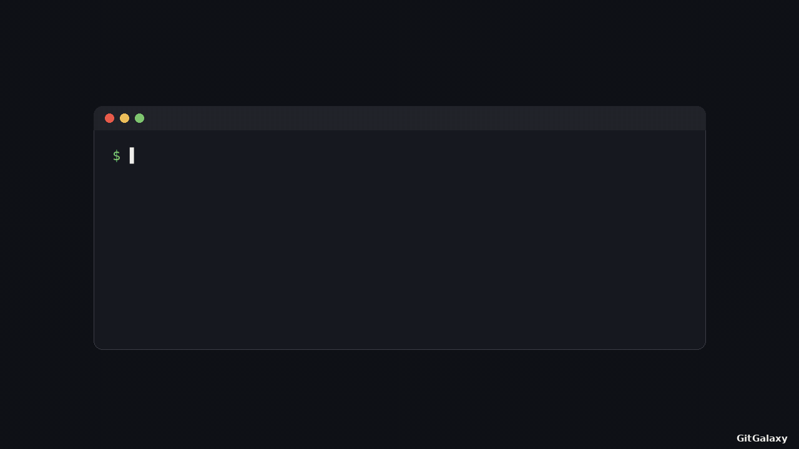
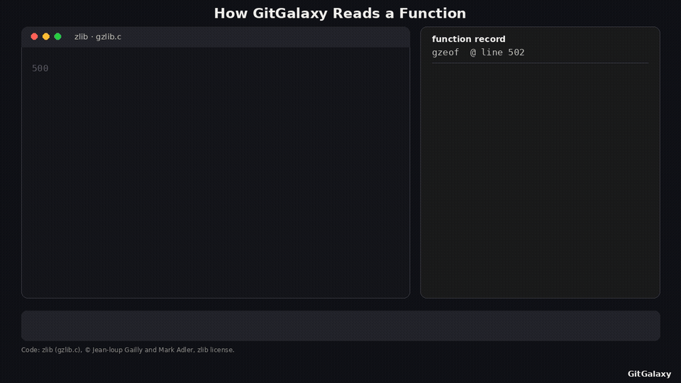
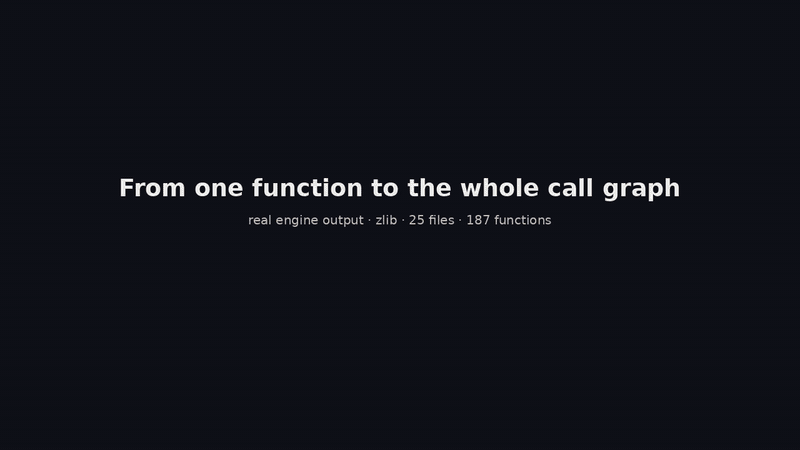
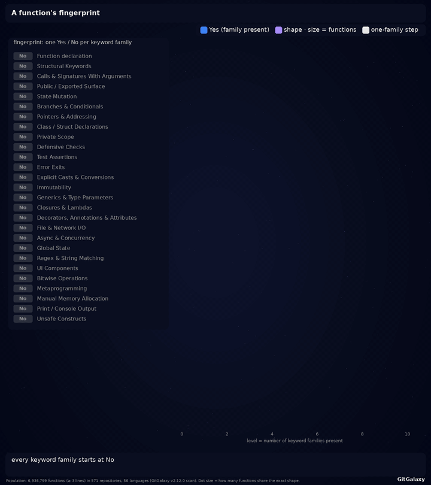
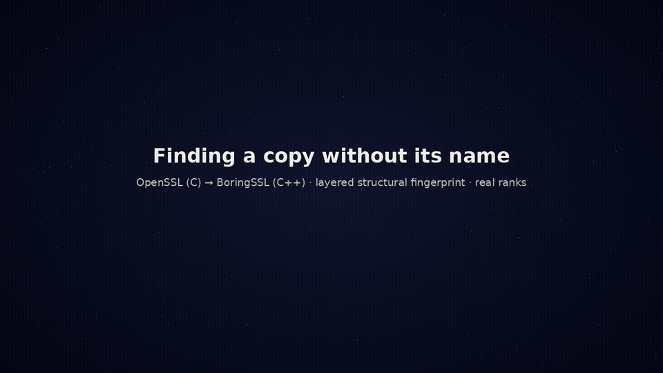
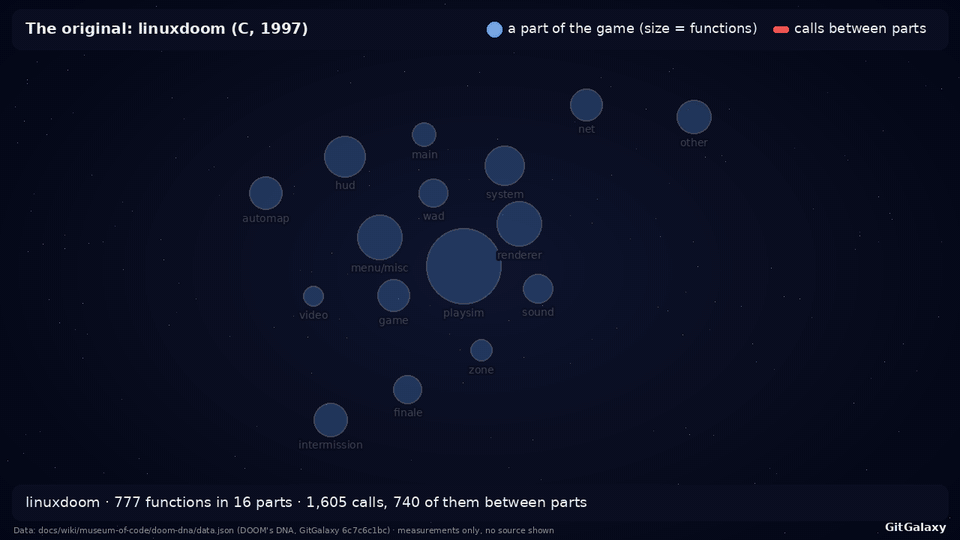
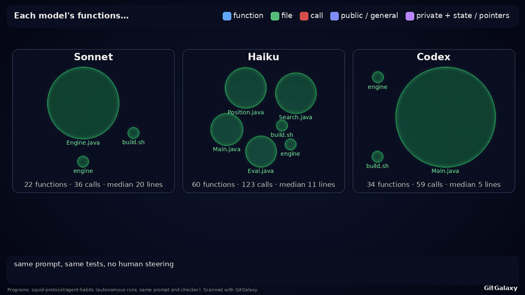
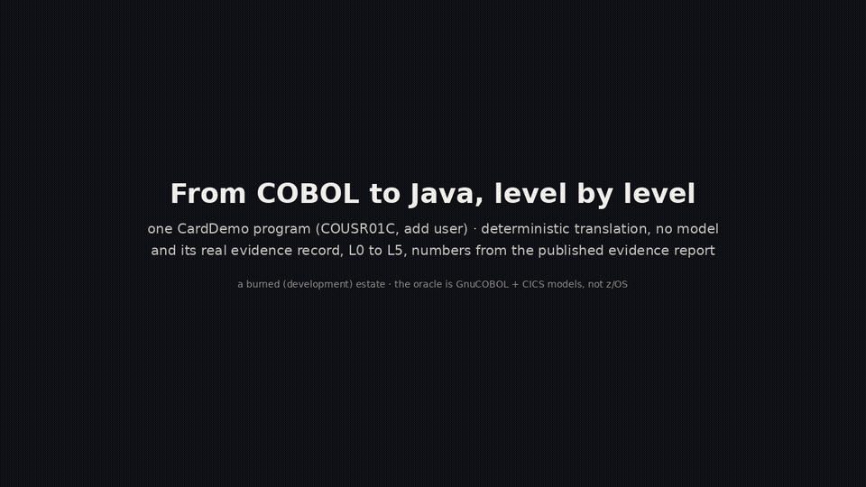

# How GitGalaxy works, shown

Short films of the engine at work, in the order the README tells the story. Every frame is rendered from real engine
output: the generators scan real code with this repository's engine, and they refuse to render if a drawn count
disagrees with the engine's own. How each film was made, and the command that regenerates it, is in
[docs/media/README.md](media/README.md).

[One scan](#one-scan-start-to-finish) · [One function](#one-function-read-by-the-engine) ·
[The call graph](#from-one-function-to-the-whole-call-graph) · [Function shapes](#how-function-shapes-are-built) ·
[Finding a copy](#finding-a-copy-without-its-name) · [DOOM](#one-game-many-languages) ·
[Three AI models](#same-job-three-ai-models) · [COBOL to Java](#from-cobol-to-java-level-by-level)

## One scan, start to finish

The film follows one real scan of language-crucible/data:
- 3,737 files on disk;
- 373 left out at three gates, each with its reason;
- 3,364 read, in 64 languages and formats;
- one engine, seven reports.

The bar along the bottom is the scan's real wall clock, which reaches 100% at 42.4 s. A
[to-scale version](media/scan-flow.gif) draws each language band by its file count.

(continued → [the path and content gates](wiki/02-03-aperture-filter.md) ·
[the statistical audit after parsing](wiki/02-11-spectral-audit.md) ·
[the whole pipeline](wiki/02-01-pipeline-overview.md) · [how it was made](media/README.md#one-scan-every-language))

## One function, read by the engine

The engine reads zlib's `gzeof()`:
1. it detects the language;
2. it finds the function and its arguments;
3. it counts each keyword family (branches, state changes, I/O, defensive checks and so on);
4. it takes a second pass for size and comments;
5. it writes the yes/no fingerprint of which families are present.

Names and comment text are never interpreted, only structure.

The same film in other languages:
- Python: [GIF](media/function-python.gif)
- Java: [GIF](media/function-java.gif)
- COBOL: [GIF](media/function-cobol.gif)

(continued → [splitting code from comments](wiki/02-07-the-prism.md) ·
[counting keyword hits into the signal schema](wiki/02-08-the-detector.md) ·
[the per-language rules](wiki/06-02-language-standards.md))

## From one function to the whole call graph

The film starts on zlib's `gzread()` and follows its calls two hops out. Then it zooms out to the whole codebase:
- 25 files;
- 187 functions;
- 291 resolved function calls;
- 33 `#include` links.

How accurate the graphs are:
- **Precision:** where they are measured, call links are 93-99.9% precise.
- **Recall:** about half of all calls are left unlinked, so fan-in is a lower bound.

(continued → [graph accuracy](graph_accuracy.md) · [how the graph is built](wiki/02-16-network-risk-sensor.md))

## How function shapes are built

A function's fingerprint is a column of Yes / No: which keyword families it contains. The film builds a real chain of
shapes, one family at a time. It comes from a scan of 745 repositories, 571 of which have functions of 3+ lines,
across 56 languages:
- 314,979 distinct shapes exist;
- 19,238 of them cover 90% of functions.

This is exploratory research data.

(continued → [the data and the chain](media/README.md#how-function-shapes-are-built))

## Finding a copy without its name

Each OpenSSL function in `v3_utl.c` is ranked against all 6,802 BoringSSL functions, by structure only, never by name.
Across all 572 current OpenSSL → BoringSSL copies, the true copy is found first **11% → 44%** as the layers are added.

(continued → [the method, the answer key, and the study figures it is not](media/README.md#finding-a-copy-without-its-name))

## One game, many languages

linuxdoom's 16 parts hold 777 functions and 1,605 calls. The film measures how much of that wiring 16 programs kept,
compared with a shuffled baseline:
- **Kept as much as a C fork did:** the Scheme and Go translations.
- **Kept none:** Java, Kotlin and C#.
- **At chance:** rewrites from scratch.

Caveats:
- Parts are assigned by name and path.
- "Kept none" may be the test's blind spot with very small functions.

(continued → [DOOM's DNA](wiki/museum-of-code/teardown-of-doom.md))

## Same job, three AI models

Claude Sonnet, Claude Haiku and OpenAI Codex each built the same programs with the same prompt and no human steering.
Measured by structure alone, a program's nearest same-job neighbour was written by the same model 42 of 50 times
(84%, against 28% by chance).
- This is exploratory.
- Inside one shared codebase, the model's handwriting mostly disappears.

(continued → [Every Model Has a Tell](wiki/museum-of-code/every-model-has-a-tell.md))

## From COBOL to Java, level by level

One CardDemo program, COUSR01C, is translated to Java by rule, with no model, and climbs the evidence ladder to
**L5**, where every surviving mutant has a reviewed verdict. Caveats:
- CardDemo is a development (burned) estate, so these are not first-try numbers.
- The oracle is GnuCOBOL plus GitGalaxy's CICS models, not z/OS.
- Levels are reported, never "proven".

(continued → [the translator](../gitgalaxy/tools/cobol_to_java/README.md) ·
[the equivalence harness](wiki/05-20-equivalence-harness.md) ·
[the definition of done](language_status/definition_of_done.md))
