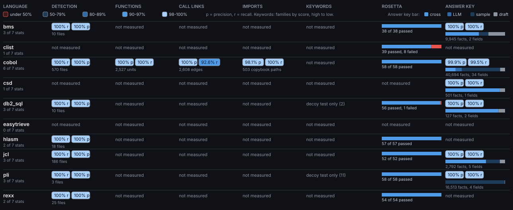
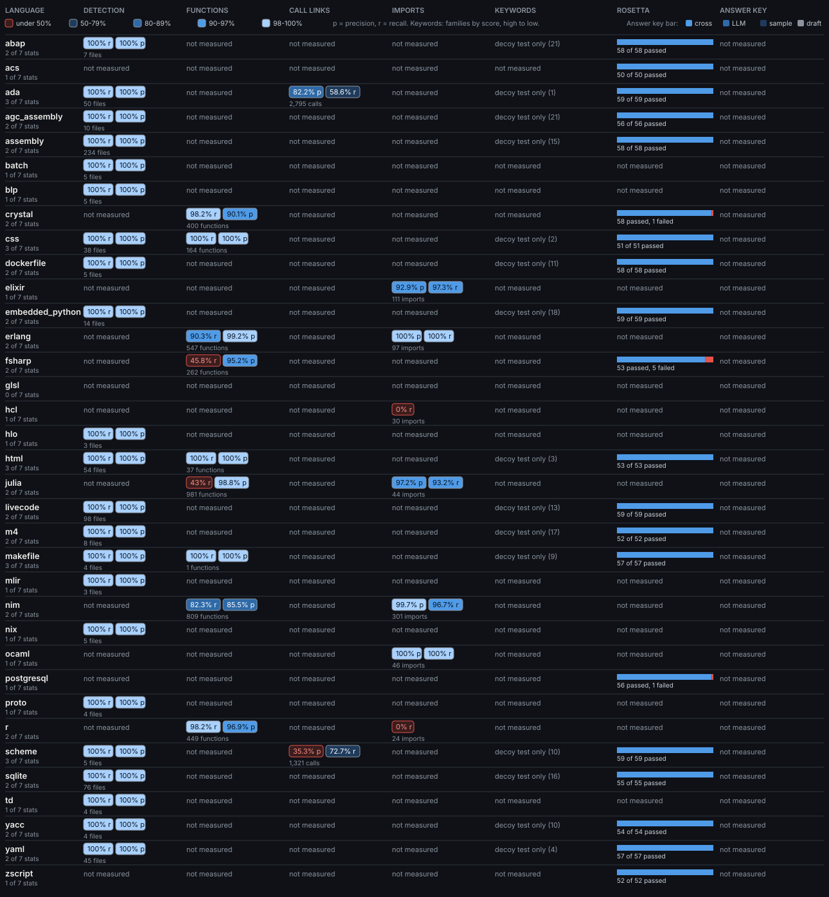

# Language evidence sheets

Seven independent measurements per language, each with its own method and sample size. There is no overall score:
a language's number says how it did against the best reference that exists for it, and the sheet says what that
reference is. Modern languages are grouped by how many of the stats are measured, which says how much evidence
exists and not how good the engine is; legacy and mainframe languages are kept together because most of their
evidence is a hand-built answer key. Generated by `tests/tools/language_sheets.py` from the committed baselines.

## Measured on 4 or more of the 7 stats (28 languages)

The same table as text, with links to each sheet

| language | measured | context | Detection | Functions | Call links | Imports | Keywords | Rosetta | Answer key |
|---|---|---|---|---|---|---|---|---|---|
| [apex](apex.md) | 4 of 7 | unclassified | 100% recall / 100% precision | 100% recall / 100% precision | 95.7% precision / 97.5% recall | not measured | decoy test only (15) | 59 of 59 passed, 0 failed | not measured |
| [c](c.md) | 6 of 7 | modern-tooled | 100% recall / 100% precision | 100% recall / 99.5% precision | 100% precision / 53% recall | 100% precision / 100% recall | 10 of 55 families: 5 >90, 2 90-75, 1 75-50, 2 <50 | 59 of 59 passed, 0 failed | not measured |
| [cpp](cpp.md) | 5 of 7 | unclassified | 100% recall / 100% precision | 100% recall / 100% precision | 98.6% precision / 41.7% recall | 99.4% precision / 100% recall | decoy test only (24) | 59 of 59 passed, 0 failed | not measured |
| [csharp](csharp.md) | 6 of 7 | unclassified | 100% recall / 100% precision | 100% recall / 100% precision | 99.7% precision / 79% recall | 17.5% precision / 66.7% recall | 12 of 58 families: 7 >90, 2 90-75, 1 75-50, 2 <50 | 59 of 59 passed, 0 failed | not measured |
| [dart](dart.md) | 5 of 7 | unclassified | 100% recall / 100% precision | 100% recall / 100% precision | 99.6% precision / 99.1% recall | 100% precision / 100% recall | decoy test only (21) | 59 of 59 passed, 0 failed | not measured |
| [fortran](fortran.md) | 5 of 7 | unclassified | 100% recall / 100% precision | 100% recall / 100% precision | 66.8% precision / 71.5% recall | 94.8% precision / 98.7% recall | decoy test only (15) | 59 of 59 passed, 0 failed | not measured |
| [go](go.md) | 6 of 7 | unclassified | 100% recall / 100% precision | 100% recall / 100% precision | 99.6% precision / 77.8% recall | 100% precision / 100% recall | 12 of 57 families: 4 >90, 2 90-75, 3 75-50, 3 <50 | 59 of 59 passed, 0 failed | not measured |
| [groovy](groovy.md) | 4 of 7 | unclassified | 100% recall / 100% precision | not measured | 90.1% precision / 95.3% recall | 99.3% precision / 96.3% recall | decoy test only (16) | 59 of 59 passed, 0 failed | not measured |
| [haskell](haskell.md) | 5 of 7 | unclassified | 100% recall / 100% precision | 100% recall / 99.3% precision | 95.7% precision / 98.9% recall | 100% precision / 100% recall | decoy test only (32) | 58 of 58 passed, 0 failed | not measured |
| [java](java.md) | 6 of 7 | unclassified | 100% recall / 100% precision | 100% recall / 100% precision | 99.8% precision / 82.5% recall | 100% precision / 100% recall | 12 of 55 families: 5 >90, 1 90-75, 2 75-50, 4 <50 | 59 of 59 passed, 0 failed | not measured |
| [javascript](javascript.md) | 6 of 7 | unclassified | 100% recall / 100% precision | 100% recall / 98.1% precision | 99.4% precision / 90.3% recall | 100% precision / 99.8% recall | 11 of 66 families: 5 >90, 1 90-75, 1 75-50, 4 <50 | 59 of 59 passed, 0 failed | not measured |
| [kotlin](kotlin.md) | 6 of 7 | unclassified | 100% recall / 100% precision | 100% recall / 100% precision | 98.3% precision / 49.7% recall | 100% precision / 99.2% recall | 12 of 57 families: 4 >90, 2 90-75, 1 75-50, 5 <50 | 58 of 58 passed, 0 failed | not measured |
| [lua](lua.md) | 6 of 7 | unclassified | 100% recall / 100% precision | 100% recall / 100% precision | 97.5% precision / 98.2% recall | 100% precision / 99.2% recall | 10 of 52 families: 5 >90, 1 75-50, 4 <50 | 59 of 59 passed, 0 failed | not measured |
| [matlab](matlab.md) | 5 of 7 | unclassified | 100% recall / 100% precision | 100% recall / 100% precision | 72.4% precision / 47.8% recall | 0% recall | decoy test only (26) | 59 of 59 passed, 0 failed | not measured |
| [objective-c](objective-c.md) | 5 of 7 | unclassified | 100% recall / 100% precision | 100% recall / 99.4% precision | 97.8% precision / 98.1% recall | 100% precision / 99.6% recall | decoy test only (28) | 59 of 59 passed, 0 failed | not measured |
| [perl](perl.md) | 5 of 7 | unclassified | 100% recall / 100% precision | 100% recall / 100% precision | 97.1% precision / 97.8% recall | 98.7% precision / 99.2% recall | decoy test only (20) | 59 of 59 passed, 0 failed | not measured |
| [php](php.md) | 6 of 7 | unclassified | 100% recall / 100% precision | 100% recall / 100% precision | 99.9% precision / 97.9% recall | 99.2% precision / 100% recall | 12 of 56 families: 7 >90, 2 90-75, 1 75-50, 2 <50 | 59 of 59 passed, 0 failed | not measured |
| [powershell](powershell.md) | 5 of 7 | unclassified | 100% recall / 100% precision | 100% recall / 100% precision | 97.4% precision / 96.4% recall | 100% precision / 98.8% recall | decoy test only (17) | 59 of 59 passed, 0 failed | not measured |
| [python](python.md) | 6 of 7 | unclassified | 100% recall / 100% precision | 100% recall / 100% precision | 99.9% precision / 54.8% recall | 99.9% precision / 100% recall | 23 of 67 families: 10 >90, 2 90-75, 4 75-50, 7 <50 | 59 of 59 passed, 0 failed | not measured |
| [ruby](ruby.md) | 6 of 7 | unclassified | 100% recall / 100% precision | 98.5% recall / 100% precision | 99.9% precision / 96.3% recall | 99.6% precision / 99.6% recall | 11 of 56 families: 2 >90, 1 90-75, 4 75-50, 4 <50 | 59 of 59 passed, 0 failed | not measured |
| [rust](rust.md) | 6 of 7 | unclassified | 100% recall / 100% precision | 100% recall / 100% precision | 98.3% precision / 81.5% recall | 99.5% precision / 99.3% recall | 11 of 59 families: 4 >90, 2 75-50, 5 <50 | 59 of 59 passed, 0 failed | not measured |
| [scala](scala.md) | 6 of 7 | unclassified | 100% recall / 100% precision | 100% recall / 100% precision | 99.2% precision / 93.8% recall | 100% precision / 98.3% recall | 12 of 57 families: 3 >90, 3 90-75, 1 75-50, 5 <50 | 59 of 59 passed, 0 failed | not measured |
| [shell](shell.md) | 6 of 7 | unclassified | 100% recall / 100% precision | 84.2% recall / 98.1% precision | 98.3% precision / 98.2% recall | 100% precision / 100% recall | 9 of 51 families: 2 >90, 2 90-75, 2 75-50, 3 <50 | 57 of 57 passed, 0 failed | not measured |
| [solidity](solidity.md) | 5 of 7 | unclassified | 100% recall / 100% precision | 100% recall / 94.3% precision | 114% precision / 99.3% recall | 100% precision / 99.8% recall | decoy test only (17) | 57 of 57 passed, 0 failed | not measured |
| [swift](swift.md) | 6 of 7 | unclassified | 100% recall / 100% precision | 100% recall / 99.2% precision | 99.7% precision / 95.6% recall | 100% precision / 98.8% recall | 12 of 57 families: 2 >90, 5 90-75, 4 75-50, 1 <50 | 58 of 58 passed, 0 failed | not measured |
| [tcl](tcl.md) | 5 of 7 | unclassified | 100% recall / 100% precision | 100% recall / 96.6% precision | 121.3% precision / 90% recall | 96.4% precision / 90% recall | decoy test only (14) | 58 of 58 passed, 0 failed | not measured |
| [typescript](typescript.md) | 6 of 7 | modern-tooled | 100% recall / 100% precision | 99.8% recall / 100% precision | 100% precision / 83% recall | 100% precision / 100% recall | 12 of 66 families: 3 >90, 2 90-75, 2 75-50, 5 <50 | 59 of 59 passed, 0 failed | not measured |
| [zig](zig.md) | 5 of 7 | unclassified | 100% recall / 100% precision | 100% recall / 100% precision | 99.9% precision / 99.9% recall | 100% precision / 100% recall | decoy test only (9) | 58 of 58 passed, 0 failed | not measured |

## Legacy and mainframe (10 languages)

Few of these have a parser or compiler to compare against, so most of their evidence is the answer-key column:
a key a separately written reader drafted and blind LLM reviewers re-read. The bar shows how much of that is
cross-verified and how much is still a draft. The reviewers are LLMs, not people, and no field has a human sign-off.

The same table as text, with links to each sheet

| language | measured | context | Detection | Functions | Call links | Imports | Keywords | Rosetta | Answer key |
|---|---|---|---|---|---|---|---|---|---|
| [bms](bms.md) | 3 of 7 | legacy/mainframe | 100% recall / 100% precision | not measured | not measured | not measured | not measured | 38 of 38 passed, 0 failed | 100% precision / 100% recall; 56% of 9,945 facts cross-verified, weakest tier draft |
| [clist](clist.md) | 1 of 7 | legacy/mainframe | not measured | not measured | not measured | not measured | not measured | 39 of 47 passed, 8 failed | not measured |
| [cobol](cobol.md) | 6 of 7 | legacy/mainframe | 100% recall / 100% precision | 100% precision / 100% recall | 100% precision / 92.6% recall | 98.1% precision / 100% recall | not measured | 58 of 58 passed, 0 failed | 99.9% precision / 99.5% recall; 17% of 40,694 facts cross-verified, weakest tier draft |
| [csd](csd.md) | 1 of 7 | legacy/mainframe | not measured | not measured | not measured | not measured | not measured | not measured | 100% precision / 100% recall; 91% of 501 facts cross-verified, weakest tier draft |
| [db2_sql](db2_sql.md) | 3 of 7 | legacy/mainframe | 100% recall / 100% precision | not measured | not measured | not measured | decoy test only (2) | 56 of 57 passed, 1 failed | 100% precision / 100% recall; 89% of 127 facts cross-verified, weakest tier draft |
| [easytrieve](easytrieve.md) | 0 of 7 | legacy/mainframe | not measured | not measured | not measured | not measured | not measured | not measured | not measured |
| [hlasm](hlasm.md) | 2 of 7 | legacy/mainframe | 100% recall / 100% precision | not measured | not measured | not measured | not measured | 57 of 57 passed, 0 failed | not measured |
| [jcl](jcl.md) | 3 of 7 | legacy/mainframe | 100% recall / 100% precision | not measured | not measured | not measured | not measured | 52 of 52 passed, 0 failed | 100% precision / 100% recall; 68% of 2,792 facts cross-verified, weakest tier draft |
| [pli](pli.md) | 3 of 7 | legacy/mainframe | 100% recall / 100% precision | not measured | not measured | not measured | decoy test only (11) | 58 of 58 passed, 0 failed | 100% precision / 100% recall; 0% of 16,513 facts cross-verified, weakest tier draft |
| [rexx](rexx.md) | 2 of 7 | legacy/mainframe | 100% recall / 100% precision | not measured | not measured | not measured | not measured | 54 of 54 passed, 0 failed | not measured |

## Sparsely measured (35 languages)

Fewer than 4 of the 7 stats are measured. For many of these the sheet says why: no parser or
reference tool exists, or the public corpus is small.

Chart of the sparsely measured languages

The same table as text, with links to each sheet

| language | measured | context | Detection | Functions | Call links | Imports | Keywords | Rosetta | Answer key |
|---|---|---|---|---|---|---|---|---|---|
| [abap](abap.md) | 2 of 7 | unclassified | 100% recall / 100% precision | not measured | not measured | not measured | decoy test only (21) | 58 of 58 passed, 0 failed | not measured |
| [acs](acs.md) | 1 of 7 | unclassified | not measured | not measured | not measured | not measured | not measured | 50 of 50 passed, 0 failed | not measured |
| [ada](ada.md) | 3 of 7 | unclassified | 100% recall / 100% precision | not measured | 82.2% precision / 58.6% recall | not measured | decoy test only (1) | 59 of 59 passed, 0 failed | not measured |
| [agc_assembly](agc_assembly.md) | 2 of 7 | unclassified | 100% recall / 100% precision | not measured | not measured | not measured | decoy test only (21) | 56 of 56 passed, 0 failed | not measured |
| [assembly](assembly.md) | 2 of 7 | unclassified | 100% recall / 100% precision | not measured | not measured | not measured | decoy test only (15) | 58 of 58 passed, 0 failed | not measured |
| [batch](batch.md) | 1 of 7 | unclassified | 100% recall / 100% precision | not measured | not measured | not measured | not measured | not measured | not measured |
| [blp](blp.md) | 1 of 7 | unclassified | 100% recall / 100% precision | not measured | not measured | not measured | not measured | not measured | not measured |
| [crystal](crystal.md) | 1 of 7 | unclassified | not measured | not measured | not measured | not measured | not measured | 58 of 59 passed, 1 failed | not measured |
| [css](css.md) | 3 of 7 | unclassified | 100% recall / 100% precision | 100% recall / 100% precision | not measured | not measured | decoy test only (2) | 51 of 51 passed, 0 failed | not measured |
| [dockerfile](dockerfile.md) | 2 of 7 | unclassified | 100% recall / 100% precision | not measured | not measured | not measured | decoy test only (11) | 58 of 58 passed, 0 failed | not measured |
| [elixir](elixir.md) | 1 of 7 | unclassified | not measured | not measured | not measured | 92.9% precision / 97.3% recall | not measured | not measured | not measured |
| [embedded_python](embedded_python.md) | 2 of 7 | unclassified | 100% recall / 100% precision | not measured | not measured | not measured | decoy test only (18) | 59 of 59 passed, 0 failed | not measured |
| [erlang](erlang.md) | 1 of 7 | unclassified | not measured | not measured | not measured | 100% precision / 100% recall | not measured | not measured | not measured |
| [fsharp](fsharp.md) | 1 of 7 | unclassified | not measured | not measured | not measured | not measured | not measured | 53 of 58 passed, 5 failed | not measured |
| [glsl](glsl.md) | 0 of 7 | unclassified | not measured | not measured | not measured | not measured | not measured | not measured | not measured |
| [hcl](hcl.md) | 1 of 7 | DSL / config | not measured | not measured | not measured | 0% recall | not measured | not measured | not measured |
| [hlo](hlo.md) | 1 of 7 | unclassified | 100% recall / 100% precision | not measured | not measured | not measured | not measured | not measured | not measured |
| [html](html.md) | 3 of 7 | unclassified | 100% recall / 100% precision | 100% recall / 100% precision | not measured | not measured | decoy test only (3) | 53 of 53 passed, 0 failed | not measured |
| [julia](julia.md) | 1 of 7 | unclassified | not measured | not measured | not measured | 97.2% precision / 93.2% recall | not measured | not measured | not measured |
| [livecode](livecode.md) | 2 of 7 | unclassified | 100% recall / 100% precision | not measured | not measured | not measured | decoy test only (13) | 59 of 59 passed, 0 failed | not measured |
| [m4](m4.md) | 2 of 7 | unclassified | 100% recall / 100% precision | not measured | not measured | not measured | decoy test only (17) | 52 of 52 passed, 0 failed | not measured |
| [makefile](makefile.md) | 3 of 7 | unclassified | 100% recall / 100% precision | 100% recall / 100% precision | not measured | not measured | decoy test only (9) | 57 of 57 passed, 0 failed | not measured |
| [mlir](mlir.md) | 1 of 7 | unclassified | 100% recall / 100% precision | not measured | not measured | not measured | not measured | not measured | not measured |
| [nim](nim.md) | 1 of 7 | unclassified | not measured | not measured | not measured | 99.7% precision / 96.7% recall | not measured | not measured | not measured |
| [nix](nix.md) | 1 of 7 | unclassified | 100% recall / 100% precision | not measured | not measured | not measured | not measured | not measured | not measured |
| [ocaml](ocaml.md) | 1 of 7 | unclassified | not measured | not measured | not measured | 100% precision / 100% recall | not measured | not measured | not measured |
| [postgresql](postgresql.md) | 1 of 7 | unclassified | not measured | not measured | not measured | not measured | not measured | 56 of 57 passed, 1 failed | not measured |
| [proto](proto.md) | 1 of 7 | unclassified | 100% recall / 100% precision | not measured | not measured | not measured | not measured | not measured | not measured |
| [r](r.md) | 1 of 7 | unclassified | not measured | not measured | not measured | 0% recall | not measured | not measured | not measured |
| [scheme](scheme.md) | 3 of 7 | unclassified | 100% recall / 100% precision | not measured | 35.3% precision / 72.7% recall | not measured | decoy test only (10) | 59 of 59 passed, 0 failed | not measured |
| [sqlite](sqlite.md) | 2 of 7 | unclassified | 100% recall / 100% precision | not measured | not measured | not measured | decoy test only (16) | 55 of 55 passed, 0 failed | not measured |
| [td](td.md) | 1 of 7 | unclassified | 100% recall / 100% precision | not measured | not measured | not measured | not measured | not measured | not measured |
| [yacc](yacc.md) | 2 of 7 | unclassified | 100% recall / 100% precision | not measured | not measured | not measured | decoy test only (10) | 54 of 54 passed, 0 failed | not measured |
| [yaml](yaml.md) | 2 of 7 | unclassified | 100% recall / 100% precision | not measured | not measured | not measured | decoy test only (4) | 57 of 57 passed, 0 failed | not measured |
| [zscript](zscript.md) | 1 of 7 | unclassified | not measured | not measured | not measured | not measured | not measured | 52 of 52 passed, 0 failed | not measured |

