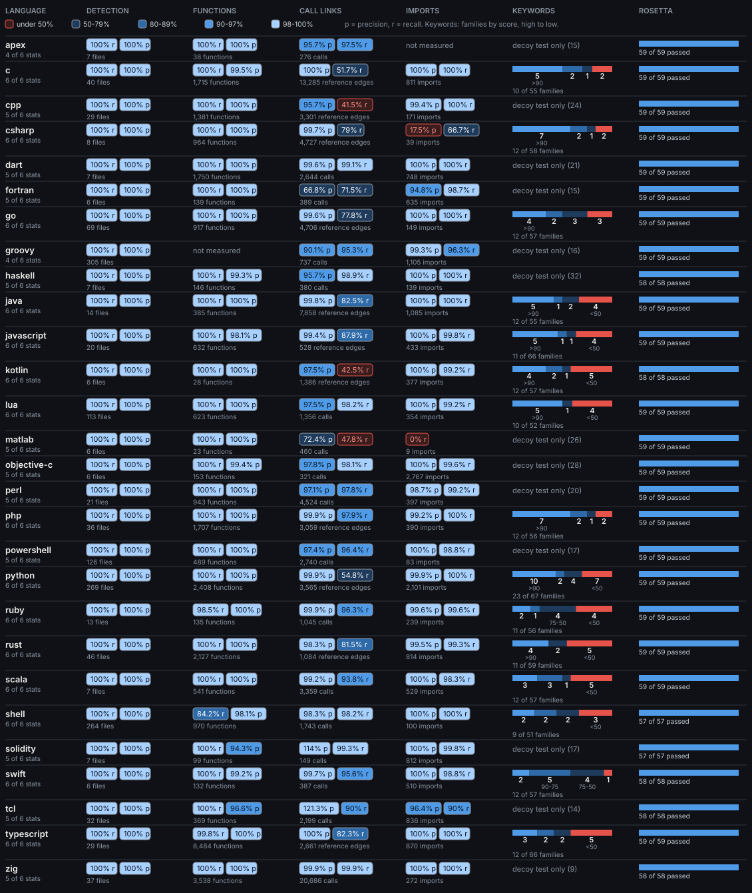

# Language evidence sheets

Six independent measurements per language, each with its own method and sample size. There is no overall score:
a language's number says how it did against the best reference that exists for it, and the sheet says what that
reference is. Generated by `tests/tools/language_sheets.py` from the committed baselines.

## DSL / config

| language | Detection | Functions | Call links | Imports | Keywords | Rosetta |
|---|---|---|---|---|---|---|
| [hcl](hcl.md) | not measured | not measured | not measured | 0% recall | not measured | not measured |

## legacy/mainframe

| language | Detection | Functions | Call links | Imports | Keywords | Rosetta |
|---|---|---|---|---|---|---|
| [cobol](cobol.md) | 100% recall / 100% precision | not measured | not measured | not measured | not measured | 58 of 58 passed, 0 failed |
| [easytrieve](easytrieve.md) | not measured | not measured | not measured | not measured | not measured | not measured |

## modern-tooled

| language | Detection | Functions | Call links | Imports | Keywords | Rosetta |
|---|---|---|---|---|---|---|
| [c](c.md) | 100% recall / 100% precision | 100% recall / 99.5% precision | 100% precision / 51.7% recall | 100% precision / 100% recall | 10 of 55 families: 5 >90, 2 90-75, 1 75-50, 2 <50 | 59 of 59 passed, 0 failed |
| [typescript](typescript.md) | 100% recall / 100% precision | 99.8% recall / 100% precision | 100% precision / 82.3% recall | 100% precision / 100% recall | 12 of 66 families: 3 >90, 2 90-75, 2 75-50, 5 <50 | 59 of 59 passed, 0 failed |

## unclassified

| language | Detection | Functions | Call links | Imports | Keywords | Rosetta |
|---|---|---|---|---|---|---|
| [abap](abap.md) | 100% recall / 100% precision | not measured | not measured | not measured | decoy test only (21) | 58 of 58 passed, 0 failed |
| [acs](acs.md) | not measured | not measured | not measured | not measured | not measured | 50 of 50 passed, 0 failed |
| [ada](ada.md) | 100% recall / 100% precision | not measured | 82.2% precision / 58.6% recall | not measured | decoy test only (1) | 59 of 59 passed, 0 failed |
| [agc_assembly](agc_assembly.md) | 100% recall / 100% precision | not measured | not measured | not measured | decoy test only (21) | 56 of 56 passed, 0 failed |
| [apex](apex.md) | 100% recall / 100% precision | 100% recall / 100% precision | 95.7% precision / 97.5% recall | not measured | decoy test only (15) | 59 of 59 passed, 0 failed |
| [assembly](assembly.md) | 100% recall / 100% precision | not measured | not measured | not measured | decoy test only (15) | 58 of 58 passed, 0 failed |
| [batch](batch.md) | 100% recall / 100% precision | not measured | not measured | not measured | not measured | not measured |
| [blp](blp.md) | 100% recall / 100% precision | not measured | not measured | not measured | not measured | not measured |
| [bms](bms.md) | 100% recall / 100% precision | not measured | not measured | not measured | not measured | 38 of 38 passed, 0 failed |
| [clist](clist.md) | not measured | not measured | not measured | not measured | not measured | 39 of 47 passed, 8 failed |
| [cpp](cpp.md) | 100% recall / 100% precision | 100% recall / 100% precision | 95.7% precision / 41.5% recall | 99.4% precision / 100% recall | decoy test only (24) | 59 of 59 passed, 0 failed |
| [crystal](crystal.md) | not measured | not measured | not measured | not measured | not measured | 58 of 59 passed, 1 failed |
| [csd](csd.md) | not measured | not measured | not measured | not measured | not measured | not measured |
| [csharp](csharp.md) | 100% recall / 100% precision | 100% recall / 100% precision | 99.7% precision / 79% recall | 17.5% precision / 66.7% recall | 12 of 58 families: 7 >90, 2 90-75, 1 75-50, 2 <50 | 59 of 59 passed, 0 failed |
| [css](css.md) | 100% recall / 100% precision | 100% recall / 100% precision | not measured | not measured | decoy test only (2) | 51 of 51 passed, 0 failed |
| [dart](dart.md) | 100% recall / 100% precision | 100% recall / 100% precision | 99.6% precision / 99.1% recall | 100% precision / 100% recall | decoy test only (21) | 59 of 59 passed, 0 failed |
| [db2_sql](db2_sql.md) | 100% recall / 100% precision | not measured | not measured | not measured | decoy test only (2) | 56 of 57 passed, 1 failed |
| [dockerfile](dockerfile.md) | 100% recall / 100% precision | not measured | not measured | not measured | decoy test only (11) | 58 of 58 passed, 0 failed |
| [elixir](elixir.md) | not measured | not measured | not measured | 92.9% precision / 97.3% recall | not measured | not measured |
| [embedded_python](embedded_python.md) | 100% recall / 100% precision | not measured | not measured | not measured | decoy test only (18) | 59 of 59 passed, 0 failed |
| [erlang](erlang.md) | not measured | not measured | not measured | 100% precision / 100% recall | not measured | not measured |
| [fortran](fortran.md) | 100% recall / 100% precision | 100% recall / 100% precision | 66.8% precision / 71.5% recall | 94.8% precision / 98.7% recall | decoy test only (15) | 59 of 59 passed, 0 failed |
| [fsharp](fsharp.md) | not measured | not measured | not measured | not measured | not measured | 53 of 58 passed, 5 failed |
| [glsl](glsl.md) | not measured | not measured | not measured | not measured | not measured | not measured |
| [go](go.md) | 100% recall / 100% precision | 100% recall / 100% precision | 99.6% precision / 77.8% recall | 100% precision / 100% recall | 12 of 57 families: 4 >90, 2 90-75, 3 75-50, 3 <50 | 59 of 59 passed, 0 failed |
| [groovy](groovy.md) | 100% recall / 100% precision | not measured | 90.1% precision / 95.3% recall | 99.3% precision / 96.3% recall | decoy test only (16) | 59 of 59 passed, 0 failed |
| [haskell](haskell.md) | 100% recall / 100% precision | 100% recall / 99.3% precision | 95.7% precision / 98.9% recall | 100% precision / 100% recall | decoy test only (32) | 58 of 58 passed, 0 failed |
| [hlasm](hlasm.md) | 100% recall / 100% precision | not measured | not measured | not measured | not measured | 57 of 57 passed, 0 failed |
| [hlo](hlo.md) | 100% recall / 100% precision | not measured | not measured | not measured | not measured | not measured |
| [html](html.md) | 100% recall / 100% precision | 100% recall / 100% precision | not measured | not measured | decoy test only (3) | 53 of 53 passed, 0 failed |
| [java](java.md) | 100% recall / 100% precision | 100% recall / 100% precision | 99.8% precision / 82.5% recall | 100% precision / 100% recall | 12 of 55 families: 5 >90, 1 90-75, 2 75-50, 4 <50 | 59 of 59 passed, 0 failed |
| [javascript](javascript.md) | 100% recall / 100% precision | 100% recall / 98.1% precision | 99.4% precision / 87.9% recall | 100% precision / 99.8% recall | 11 of 66 families: 5 >90, 1 90-75, 1 75-50, 4 <50 | 59 of 59 passed, 0 failed |
| [jcl](jcl.md) | 100% recall / 100% precision | not measured | not measured | not measured | not measured | 52 of 52 passed, 0 failed |
| [julia](julia.md) | not measured | not measured | not measured | 97.2% precision / 93.2% recall | not measured | not measured |
| [kotlin](kotlin.md) | 100% recall / 100% precision | 100% recall / 100% precision | 97.5% precision / 42.5% recall | 100% precision / 99.2% recall | 12 of 57 families: 4 >90, 2 90-75, 1 75-50, 5 <50 | 58 of 58 passed, 0 failed |
| [livecode](livecode.md) | 100% recall / 100% precision | not measured | not measured | not measured | decoy test only (13) | 59 of 59 passed, 0 failed |
| [lua](lua.md) | 100% recall / 100% precision | 100% recall / 100% precision | 97.5% precision / 98.2% recall | 100% precision / 99.2% recall | 10 of 52 families: 5 >90, 1 75-50, 4 <50 | 59 of 59 passed, 0 failed |
| [m4](m4.md) | 100% recall / 100% precision | not measured | not measured | not measured | decoy test only (17) | 52 of 52 passed, 0 failed |
| [makefile](makefile.md) | 100% recall / 100% precision | 100% recall / 100% precision | not measured | not measured | decoy test only (9) | 57 of 57 passed, 0 failed |
| [matlab](matlab.md) | 100% recall / 100% precision | 100% recall / 100% precision | 72.4% precision / 47.8% recall | 0% recall | decoy test only (26) | 59 of 59 passed, 0 failed |
| [mlir](mlir.md) | 100% recall / 100% precision | not measured | not measured | not measured | not measured | not measured |
| [nim](nim.md) | not measured | not measured | not measured | 99.7% precision / 96.7% recall | not measured | not measured |
| [nix](nix.md) | 100% recall / 100% precision | not measured | not measured | not measured | not measured | not measured |
| [objective-c](objective-c.md) | 100% recall / 100% precision | 100% recall / 99.4% precision | 97.8% precision / 98.1% recall | 100% precision / 99.6% recall | decoy test only (28) | 59 of 59 passed, 0 failed |
| [ocaml](ocaml.md) | not measured | not measured | not measured | 100% precision / 100% recall | not measured | not measured |
| [perl](perl.md) | 100% recall / 100% precision | 100% recall / 100% precision | 97.1% precision / 97.8% recall | 98.7% precision / 99.2% recall | decoy test only (20) | 59 of 59 passed, 0 failed |
| [php](php.md) | 100% recall / 100% precision | 100% recall / 100% precision | 99.9% precision / 97.9% recall | 99.2% precision / 100% recall | 12 of 56 families: 7 >90, 2 90-75, 1 75-50, 2 <50 | 59 of 59 passed, 0 failed |
| [pli](pli.md) | 100% recall / 100% precision | not measured | not measured | not measured | decoy test only (11) | 58 of 58 passed, 0 failed |
| [postgresql](postgresql.md) | not measured | not measured | not measured | not measured | not measured | 56 of 57 passed, 1 failed |
| [powershell](powershell.md) | 100% recall / 100% precision | 100% recall / 100% precision | 97.4% precision / 96.4% recall | 100% precision / 98.8% recall | decoy test only (17) | 59 of 59 passed, 0 failed |
| [proto](proto.md) | 100% recall / 100% precision | not measured | not measured | not measured | not measured | not measured |
| [python](python.md) | 100% recall / 100% precision | 100% recall / 100% precision | 99.9% precision / 54.8% recall | 99.9% precision / 100% recall | 23 of 67 families: 10 >90, 2 90-75, 4 75-50, 7 <50 | 59 of 59 passed, 0 failed |
| [r](r.md) | not measured | not measured | not measured | 0% recall | not measured | not measured |
| [rexx](rexx.md) | 100% recall / 100% precision | not measured | not measured | not measured | not measured | 54 of 54 passed, 0 failed |
| [ruby](ruby.md) | 100% recall / 100% precision | 98.5% recall / 100% precision | 99.9% precision / 96.3% recall | 99.6% precision / 99.6% recall | 11 of 56 families: 2 >90, 1 90-75, 4 75-50, 4 <50 | 59 of 59 passed, 0 failed |
| [rust](rust.md) | 100% recall / 100% precision | 100% recall / 100% precision | 98.3% precision / 81.5% recall | 99.5% precision / 99.3% recall | 11 of 59 families: 4 >90, 2 75-50, 5 <50 | 59 of 59 passed, 0 failed |
| [scala](scala.md) | 100% recall / 100% precision | 100% recall / 100% precision | 99.2% precision / 93.8% recall | 100% precision / 98.3% recall | 12 of 57 families: 3 >90, 3 90-75, 1 75-50, 5 <50 | 59 of 59 passed, 0 failed |
| [scheme](scheme.md) | 100% recall / 100% precision | not measured | 35.3% precision / 72.7% recall | not measured | decoy test only (10) | 59 of 59 passed, 0 failed |
| [shell](shell.md) | 100% recall / 100% precision | 84.2% recall / 98.1% precision | 98.3% precision / 98.2% recall | 100% precision / 100% recall | 9 of 51 families: 2 >90, 2 90-75, 2 75-50, 3 <50 | 57 of 57 passed, 0 failed |
| [solidity](solidity.md) | 100% recall / 100% precision | 100% recall / 94.3% precision | 114% precision / 99.3% recall | 100% precision / 99.8% recall | decoy test only (17) | 57 of 57 passed, 0 failed |
| [sqlite](sqlite.md) | 100% recall / 100% precision | not measured | not measured | not measured | decoy test only (16) | 55 of 55 passed, 0 failed |
| [swift](swift.md) | 100% recall / 100% precision | 100% recall / 99.2% precision | 99.7% precision / 95.6% recall | 100% precision / 98.8% recall | 12 of 57 families: 2 >90, 5 90-75, 4 75-50, 1 <50 | 58 of 58 passed, 0 failed |
| [tcl](tcl.md) | 100% recall / 100% precision | 100% recall / 96.6% precision | 121.3% precision / 90% recall | 96.4% precision / 90% recall | decoy test only (14) | 58 of 58 passed, 0 failed |
| [td](td.md) | 100% recall / 100% precision | not measured | not measured | not measured | not measured | not measured |
| [yacc](yacc.md) | 100% recall / 100% precision | not measured | not measured | not measured | decoy test only (10) | 54 of 54 passed, 0 failed |
| [yaml](yaml.md) | 100% recall / 100% precision | not measured | not measured | not measured | decoy test only (4) | 57 of 57 passed, 0 failed |
| [zig](zig.md) | 100% recall / 100% precision | 100% recall / 100% precision | 99.9% precision / 99.9% recall | 100% precision / 100% recall | decoy test only (9) | 58 of 58 passed, 0 failed |
| [zscript](zscript.md) | not measured | not measured | not measured | not measured | not measured | 52 of 52 passed, 0 failed |
