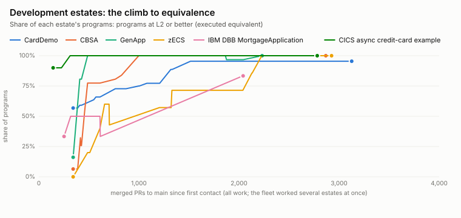
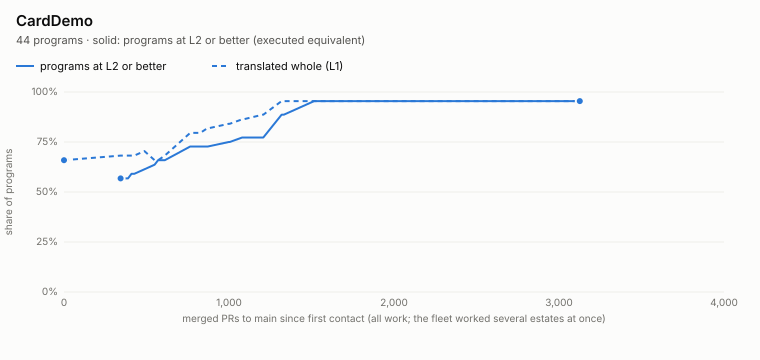
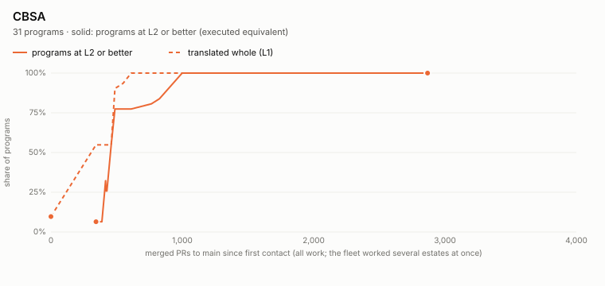
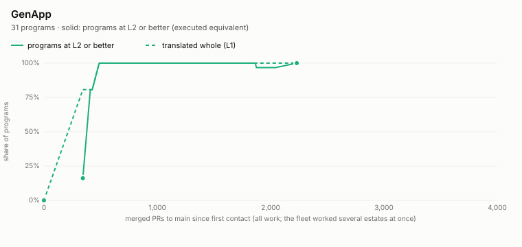
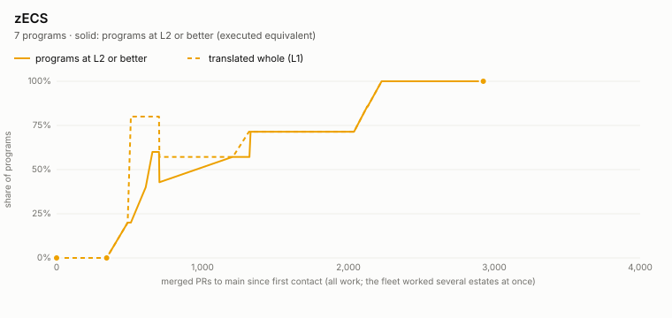
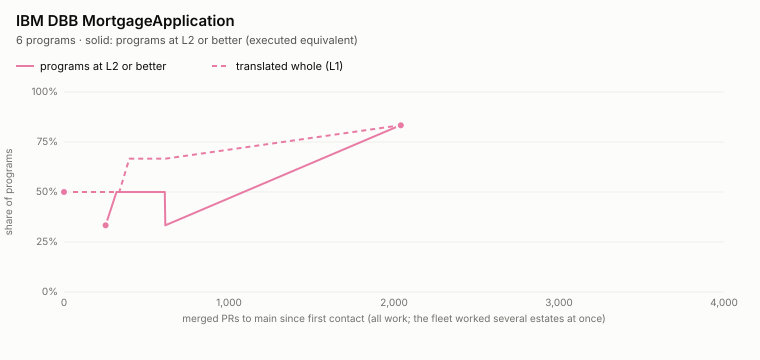
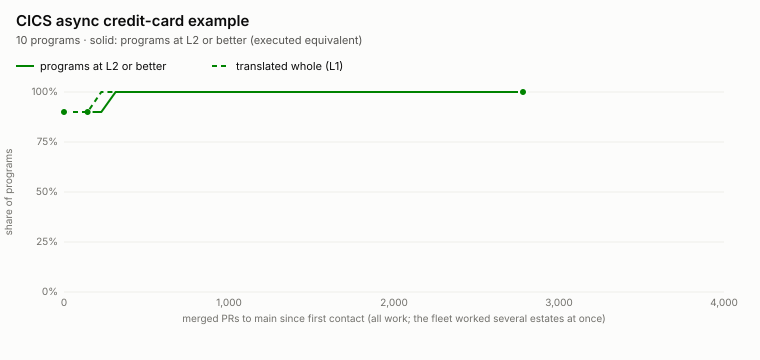
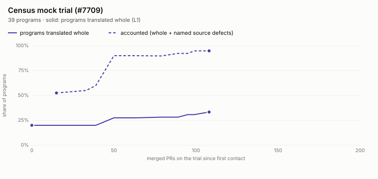
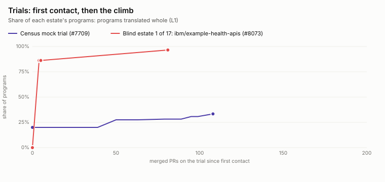
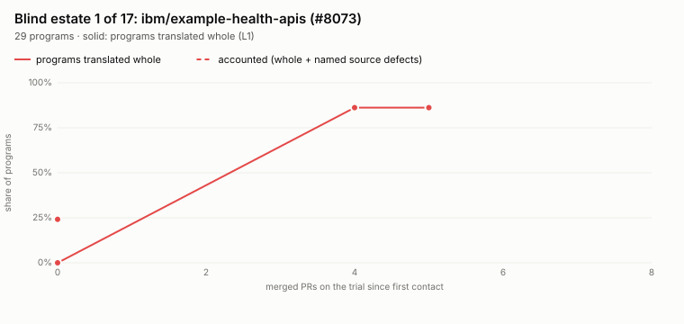

# Estate journey: first contact, then the climb

*Generated by `tests/tools/estate_journey.py` from `docs/language_status/estate_journey/journey.json`; do not edit. Method: [estate trial methodology](estate_trial_methodology.md).*

Every estate starts the same way: freeze the engine, run the translator over the estate as it is, and record **first contact**. Then we post the evidence, close the error classes it exposed, re-measure after each merged PR, and move to the next estate. This page shows each estate's first contact and its climb, measured in merged PRs, and what each one taught us. Six development estates came first; then a census of nine public repos we never developed on; then the first of 17 pre-registered blind draws. 16 draws remain.

**How to read the numbers.** Development estates are measured at **L2, executed equivalent**: a case runs the program and the Java port equals the COBOL oracle on every scenario. Trials on estates we have not developed on are measured at **L1, translated whole**, plus **accounted** (whole, or every gap a named source defect with an IBM citation). Rule 2 forbids writing cases for them, so they can't reach L2. The two measures are never drawn on one axis. The oracle is GnuCOBOL with our CICS stub, not z/OS ([levels](definition_of_done.md)).

## Chapter 1: six development estates (first contact 2026-10-01 to 10-07)

The deterministic translator met its six development estates in the first week of October. These estates are *burned*: we write cases for them, so they can climb past L1 to equivalence (L2) and beyond. The dashed line in each estate chart is L1 (translated whole); the solid line is L2 or better.

### CardDemo

| | |
|---|---|
| First contact | 29 / 44 (66%) programs translated whole, 2026-10-01 7:50 PM |
| 2026-10-22 4:36 AM | first program at L5 (mutants accounted for) · 2 / 44 (5%) · 347 PRs naming the estate · 20.4 days |
| 2026-10-23 5:53 AM | best L2+ share reached: 42 of 44 at L2 or better (never all 44) · 42 / 44 (95%) · 400 PRs naming the estate · 21.4 days |
| 2026-11-01 5:36 AM | every L2+ program also at L4+ (42 of 44 at L4 or L5) · 42 / 44 (95%) · 557 PRs naming the estate · 30.4 days |

**What we learned**

- The first proof found a defect in the original: CBACT04C never adds the last account's interest (the loop tests EOF before the update branch). The port keeps the original behaviour rather than its evident intent. (#3748)
- CardDemo is where the deterministic translator was built: byte storage laid out as GnuCOBOL does, a Java runtime with 299 constructs byte-equal to GnuCOBOL, and 23 of 23 cases proven with no model. (#4089)
- A model can still help after the proof: a customer model refactors a proven det port one method at a time, and every step is proven again (COACTUPC, CBACT02C). (#4091)
- Two programs (CBEXPORT, CBIMPORT) translated "whole" but GnuCOBOL cannot compile them: whole is not proof, and a source defect must be named, not ported. (#4804, #7227)
- COPAUA0C forced IMS DL/I (EXEC DLI), VSAM and IBM MQ into one case, with MQ fault injection; it was the first CardDemo program recorded at L5. (#5842, #6552, #5982)

### CBSA

| | |
|---|---|
| First contact | 3 / 31 (10%) programs translated whole, 2026-10-01 7:50 PM |
| 2026-10-19 4:26 AM | all 31 programs L2 or better · 31 / 31 (100%) · 192 PRs naming the estate · 17.4 days |
| 2026-10-27 4:37 AM | all 31 programs L3 or better · 31 / 31 (100%) · 25.4 days |
| 2026-10-30 6:09 AM | all 31 programs L4 or better · 31 / 31 (100%) · 412 PRs naming the estate · 28.4 days |

**What we learned**

- Db2 inside CICS: one Db2 unit of work per CICS task, LINKed COMMAREA results compared, EXEC SQL SET; UPDACC and DBCRFUN proven against a real Db2. (#4104)
- Generator gaps surfaced only on a second estate: no store mapped for the abend file ABNDFILE (ABNDPROC). (#4091)
- File-update tokens (READ UPDATE / REWRITE / DELETE / UNLOCK TOKEN) had to be modelled for DELCUS. (#5090)
- Branch coverage (L4) needed reviewed infeasible outcomes and owner rulings where IBM is silent, e.g. CRECUST fault arms and BANKDATA's practically unreachable branch (family P). (#6837, #6774, #7700)

### GenApp

| | |
|---|---|
| First contact | 0 / 31 (0%) programs translated whole, 2026-10-01 7:50 PM |
| 2026-10-10 10:21 PM | all 31 programs L2 or better · 31 / 31 (100%) · 88 PRs naming the estate · 9.1 days |
| 2026-10-29 6:03 AM | all 31 programs L4 or better · 31 / 31 (100%) · 281 PRs naming the estate · 27.4 days |

**What we learned**

- Db2 under CICS at scale: all eight Db2 programs proven, with multi-program tasks, positioned UPDATE, clock fields, CICS named counters and LINKed SQL programs. (#4116, #4122)
- The VSAM customer file entity held only the 10-byte key of a 225-byte record: KEYS / RECORDSIZE inside IDCAMS DATA(...) were not read. (#4091)
- A WRITEQ LENGTH longer than its FROM item (X6) made LGSETUP's case hollow until the past-FROM read was modelled. (#4808, #6962)
- Full coverage is not a strong test: GenApp has the lowest mutation kill rate of the estates (44.5% raw, 336 open survivors) and 12 declared differences. (docs/language_status/estate_evidence/report.md@origin/generated 3e81ee10c)

### zECS

| | |
|---|---|
| First contact | 0 / 5 (0%) programs translated whole, 2026-10-01 7:50 PM |
| 2026-10-29 6:03 AM | all 7 programs L2 or better · 7 / 7 (100%) · 179 PRs naming the estate · 27.4 days |
| 2026-11-01 5:36 AM | all 7 programs L4 or better (4 at L5 that day) · 7 / 7 (100%) · 256 PRs naming the estate · 30.4 days |

**What we learned**

- zECS brought assembler into scope: an HLASM front end with an address model lowers ZECS002 and ZECSNC to COBOL, and coverage is measured on the lowered program. (#6890, #7034)
- New CICS surface: INQUIRE URIMAP browse and WRITE OPERATOR, with browse order stated as an assumption (X32). (#4773, #4808)
- Pointer and CWA code had to be refused by reason, then modelled (ADDRESS CWA lowered by the det port). (#5497, #7270)
- L5 is fragile: revalidating attacked survivors withdrew L5 from ZECS003, ECS001 and ZECSNC. (#7333, #7496)

### IBM DBB MortgageApplication

| | |
|---|---|
| First contact | 3 / 6 (50%) programs translated whole, 2026-10-03 7:07 AM |
| 2026-10-28 5:21 AM | best share: 5 of 6 at L4 (never all 6) · 5 / 6 (83%) · 117 PRs naming the estate · 24.9 days |

**What we learned**

- Source forms differ by IBM team: lower-case members, CBL cards in the sequence area, ID DIVISION, a PROGRAM-ID without its period, nested COPY, group USING items. All 6 were refused before these fixes. (#4216, #4285)
- A caller is not proven while anything it CALLs has a hole (owner decision): EPSCSMRT calling EPSMPMT's stub led to translating a case's subprograms. (#4803, #4868)
- Floating point needs an owner ruling: EPSMPMT's ** and FUNCTION ANNUITY run as IEEE binary64 for this program only. (#5867, #6831)
- ESDS browse by relative byte address (RBA) had to be modelled on both sides to prove EPSMLIST. (#4213, #4236)

### CICS async credit-card example

| | |
|---|---|
| First contact | 9 / 10 (90%) programs translated whole, 2026-10-07 2:22 PM |
| 2026-10-15 2:38 AM | all 10 programs L2 or better (all at L4 the same day) · 10 / 10 (100%) · 14 PRs naming the estate · 7.5 days |
| 2026-11-01 5:36 AM | all 10 programs at L5 (first estate fully L5) · 10 / 10 (100%) · 66 PRs naming the estate · 24.7 days |

**What we learned**

- The CICS asynchronous API (RUN TRANSID / FETCH) and channels and containers had to reach the harness before the front end ASYNCPNT could be proven. (#4578, #4647, #4948, #5147)
- Tasks with no COMMAREA and a per-scenario COMMAREA length (X23) were new to the harness. (#4642)
- One-digit level numbers (1 / 2 instead of 01 / 05) broke the schema forge (0 of 158 fields read), and END PROGRAM extents were wrong. (#4626, #4630, #4633)
- Small and uniform estates move fast: 9 of 10 whole at first contact and all 10 at L4 in about 7.5 days. (#4633, #5147)

## Interlude: the CICS training montage

Between the development estates and the census, the fleet spent October on CICS breadth: an IBM-documented crucible of CICS behaviours (cics-crucible), the L1 to L4 evidence ladder across every development program, owner rulings where IBM is silent, and mutation testing (L5). This page does not track that work statement by statement; its test is whether it carried to estates we had never seen.

## Chapter 2: the census mock trial (2026-11-04)

Nine public repos, counted by tools only and never developed on: a rehearsal of the blind protocol. Measured at L1 (translated whole) and accounted (whole, or every gap a named source defect); rule 2 forbids cases here.

### Census mock trial (#7709)

| | |
|---|---|
| First contact | 8 / 40 (20%) programs translated whole, 2026-11-04 1:46 PM |
| 2026-11-06 6:39 PM | close-out of the lessons write-up: 12 of 39 whole, 36 of 39 accounted · 12 / 39 (31%) · 104 trial PRs · 2.2 days |
| 2026-11-07 8:42 PM | final: 13 of 39 whole, 37 of 39 accounted (the ceiling under the owner rulings) · 13 / 39 (33%) · 109 trial PRs · 3.3 days |

**What we learned**

- Tuning on the burned estates did not transfer: the 10-24 to T0 delta was 0 programs, and first-contact rate on unseen code was about 20%. (#7709 T0 comment, #7709 lessons 2026-11-06)
- Where the data flows mattered more than the construct: the COMP-5 default switch was forecast +3 whole and gave +0, because all 3 programs pass COMP-5 data through CICS channel containers (about 10 more PRs). (#7829, #7845, #7868)
- Some constructs are features, not gaps: JSON GENERATE / PARSE took 15 PRs for 2 programs, CICS WEB 11 PRs for 1. (#7524, #7525)
- Most "accounted" came from naming source faults (about 24 of 37), not translating; translator work moved whole by +5 (8 to 13). (#7709 final 2026-11-07)
- The measuring tools had their own bugs: a copy member counted as a program (#7901), product-copybook list missing BAQ / HWT (#7899), owner maps naming closed issues, --unmask printing census names (#7755). (#7901, #7899, #7755, #7906)
- A source-defect label is a claim about IBM and must be checked per option and shape: the 37th program was nearly counted for the wrong reason; IBM allows a constant for URIMAP(data-value), so the fix translated it (#8057) and a sweep found 10 more such options. (#7967, #8057, #8066, #8067)

## Chapter 3: the first blind estate (drawn 2026-11-07)

Drawn at T0 from the 17 pre-registered candidates (drand round 6531446), after the preflight passed and main was frozen. Restated from 58 to 29 programs: 29 were compile-listing copies (owner ruling 2026-11-08). The overlay compares the two trials' climbs.

### Blind estate 1 of 17: ibm/example-health-apis (#8073)

| | |
|---|---|
| First contact | 0 / 29 (0%) programs translated whole, 2026-11-07 10:32 PM |
| 2026-11-08 8:14 AM | 25 of 29 whole (86%) · 25 / 29 (86%) · 5 trial PRs · 0.4 days |

**What we learned**

- Plumbing, not semantics, decided first contact: 28 of 29 failures at T0 were the engine finding (or not finding) copybooks; once they resolved, 25 of 29 translated whole. (#8074, #8079, #8087)
- The expanded listing copies were a natural control: with copybooks inlined they translated 14 of 29 at T0, separating "can we find the files" from "can we translate the code". (#8081)
- Evidence shared the bug it measured: 6 of 8 "clone defect" labels were our resolver's fault. Clone evidence must come from an independent search. (#8113, #8111)
- The 10 "EXEC SQL" programs were an artifact of listing line numbers; all 17 real SQL statements translate, the Db2 work paying off on first contact. (#8081, #4098)
- The predicted weak spots (channels, SEND CONTROL, HANDLE AID, START / RETRIEVE) did not block anything; unpredicted layout issues did: copybook directories, extensionless members, .copy, listing duplicates. (#8087, #8102, #8108, #8112)
- Recovery was fast because the gaps were concentrated: about 10 hours and 5 PRs from 0 to 25 of 29, against 3 days and 104 PRs for the census. (#8073 lessons, #7709)

## Next: 16 draws left

Before each draw: the preflight, rule-10 citations, and the last estate's lessons closed as classes. After the first blind estate these are an independent copybook-resolution check (#8111), compile listings and duplicates out of the program basis (#8112), and clone evidence from an independent search (#8113). See the [methodology](estate_trial_methodology.md).

## Journal

Dated notes: what we assumed, what turned out to be true, and corrections.

- **2026-10-01**: First contact with the deterministic translator on four development estates; CardDemo had hand and model ports before, no translated-whole count exists earlier. (#4089)
- **2026-10-05**: Pre-registered the blind trial. We assumed the weak spots would be channels and containers, SEND CONTROL, plain RECEIVE, HANDLE AID and START / RETRIEVE. (estate4_preregistration.md)
- **2026-11-03**: L5 withdrawn from three zECS programs after revalidating attacked survivors: levels go down as well as up. (#7496)
- **2026-11-04**: Census T0: we forecast 25 of 40 whole; tuning on the development estates had moved unseen code by 0 programs since 10-24. (#7709)
- **2026-11-06**: A source-defect label flipped three times without a citation; rule 10 now requires an IBM citation and a review. (#7853, #7859, #7860, #7964)
- **2026-11-07**: The census's last program had been labelled a source defect; IBM's manual says URIMAP takes a data-value, so the code was valid and the fix translated it. (#7967, #8057)
- **2026-11-07**: Blind T0. We forecast 35 to 45 of 58 whole; the basis itself was wrong (58 counted 29 listing copies). (#8073, #8081)
- **2026-11-08**: Restated on 29 programs: first contact 0 of 29. 28 failures were copybook plumbing; 6 of 8 'missing copybook' labels were our resolver. None of the 10-05 weak spots blocked a program. (#8073)
- **2026-11-10**: Blind estate 1 reaches L2 on 4 of 29 programs (HCAZMENU, HCAZERRS, HCAVDB01, HCV1BA01: cases written, the deterministic port equal to GnuCOBOL on every scenario and injected fault). The Visit family's HCIVDB01, HCV1BI01 and HCV1PL01 wait on a Java SQLCODE +100 divergence (port blocker P126). Kept out of the L1 chart: the two measures are never drawn on one axis. (#8121, #8191)
- **2026-11-10**: Blind estate 1 reaches L2 on 6 of 29 programs: the Threshold family's HCATDB01 and HCT1BA01 join the four above (deterministic port equal to GnuCOBOL on 6 scenarios each, injected Db2 faults included). Kept out of the L1 chart. (#8121)
- **2026-11-10**: Blind estate 1 reaches L2 on 9 of 29 programs: the Patient family's HCAPDB01, HCAPDB02 and HCP1BA01 join the six above (deterministic port equal to GnuCOBOL on 6 to 8 scenarios each, injected Db2 faults included). The read path (HCIPDB01, HCP1BI01) waits on the Java SQLCODE +100 divergence (P126). Kept out of the L1 chart. (#8121)

## Caveats

- The oracle is GnuCOBOL plus our CICS stub, not IBM Enterprise COBOL on z/OS.
- Charts drop one-reading dips (a single report below both neighbours, restored by the next: a regenerated or stale report). Drops that last are kept; levels do go down (#7496).
- Development-estate charts count every PR merged to main (the fleet worked several estates at once); milestone tables give the PRs that name the estate, found by keyword search (approximate).
- A milestone date is when the first evidence report showing the level was generated; the PR that caused it can be earlier.
- Today 195 of 209 L4 programs and both L5 programs are marked stale (last measured against an earlier harness): not a regression, not current.
- Public code may be in models' training data; a private estate is the only uncontaminated test.
- Data gathered 2026-11-08 from origin/main 5edd0d627 and the generated evidence report (its history read from a local reflog, as the generated branch is force-pushed).
