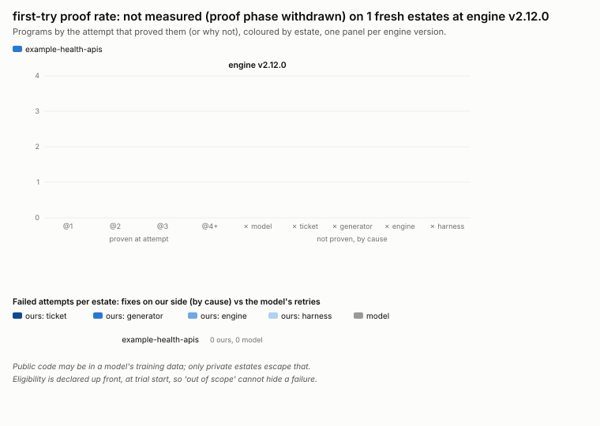

# Fresh-estate trials -- the first-try proof rate

Generated by `python tests/tools/trial.py report --write` from `tests/cobol_mainframe/trials.json`.
Do not edit by hand. `check` (in CI) fails when this page or the chart is stale.

**first-try proof rate: 23/28 (82%) on 1 fresh estates at engine v2.12.0**

Per program: did the porting loop's FIRST attempt produce Java the equivalence harness proves
identical to the COBOL? A trial freezes the system (engine commit, porting rules, model, harness),
takes an estate the system has never seen, and iterates each eligible program to a proof. Each
failed attempt carries its cause: the model's (a retry, same system) or ours (a fix commit with a
`Trial-Cause:` trailer: ticket, generator, engine, harness). A trialled estate is development data
for good: its numbers stay here but never count as first-try again. The rate counts programs whose
first attempt has a verdict (and every program of a closed trial). A WITHDRAWN trial's proof phase
never ran: its programs were never attempted, so they are left out of the rate rather than counted
as failures, and the rate reads 'not measured'.

- Public code may be in a model's training data; only private estates escape that.
- Eligibility is declared up front, at trial start, so 'out of scope' cannot hide a failure.

## Trials

| trial | estate | kind | started | closed | engine | model | eligible | out of scope | @1 | @2 | @3 | @4+ | not proven: model | not proven: ticket | not proven: generator | not proven: engine | not proven: harness | withdrawn | open |
|---|---|---|---|---|---|---|---|---|---|---|---|---|---|---|---|---|---|---|---|
| trial-001 | example-health-apis | public | 2026-11-09 | 2026-11-12 | v2.12.0 | claude-sonnet-5-5 (anthropic) | 28 | 1 | 23 | 5 | 0 | 0 | 0 | 0 | 0 | 0 | 0 | 0 | 0 |

## Programs

| trial | program | oracle | final | attempts (outcome/cause) |
|---|---|---|---|---|
| trial-001 | HCAPDB01 | compiled | proven@1 | 1:proven |
| trial-001 | HCAPDB02 | compiled | proven@1 | 1:proven |
| trial-001 | HCATDB01 | compiled | proven@1 | 1:proven |
| trial-001 | HCAVDB01 | compiled | proven@1 | 1:proven |
| trial-001 | HCAZERRS | compiled | proven@1 | 1:proven |
| trial-001 | HCAZMENU | compiled | proven@1 | 1:proven |
| trial-001 | HCIMDB01 | compiled | proven@2(engine) | 1:failed/engine c81d133790, 2:proven |
| trial-001 | HCIPDB01 | compiled | proven@2(engine) | 1:failed/engine c81d133790, 2:proven |
| trial-001 | HCITDB01 | compiled | proven@2(engine) | 1:failed/engine a6726f5a42, 2:proven |
| trial-001 | HCIVDB01 | compiled | proven@2(engine) | 1:failed/engine c81d133790, 2:proven |
| trial-001 | HCM1BI01 | compiled | proven@1 | 1:proven |
| trial-001 | HCM1PL01 | compiled | proven@1 | 1:proven |
| trial-001 | HCMABA01 | compiled | proven@1 | 1:proven |
| trial-001 | HCMADB01 | compiled | proven@1 | 1:proven |
| trial-001 | HCMADB02 | compiled | proven@2(engine) | 1:failed/engine 34f19ce25e, 2:proven |
| trial-001 | HCMAPL01 | compiled | proven@1 | 1:proven |
| trial-001 | HCMRESTW | compiled | proven@1 | 1:proven |
| trial-001 | HCP1BA01 | compiled | proven@1 | 1:proven |
| trial-001 | HCP1BI01 | compiled | proven@1 | 1:proven |
| trial-001 | HCP1PL01 | compiled | proven@1 | 1:proven |
| trial-001 | HCPRESTW | compiled | proven@1 | 1:proven |
| trial-001 | HCT1BA01 | compiled | proven@1 | 1:proven |
| trial-001 | HCT1BI01 | compiled | proven@1 | 1:proven |
| trial-001 | HCT1PL01 | compiled | proven@1 | 1:proven |
| trial-001 | HCTRESTW | compiled | proven@1 | 1:proven |
| trial-001 | HCV1BA01 | compiled | proven@1 | 1:proven |
| trial-001 | HCV1BI01 | compiled | proven@1 | 1:proven |
| trial-001 | HCV1PL01 | compiled | proven@1 | 1:proven |
| trial-001 | HCP1BU01 | - | out-of-scope(source missing from the repo: COPY member LGCMAREA is not in the estate) | - |

## Estates

| estate | kind | status | repo @ ref | trialled by |
|---|---|---|---|---|
| zopeneditor-sample | public | development | https://github.com/IBM/zopeneditor-sample @ 8f9835308de6 | - |
| cics-banking-sample-application-cbsa | public | development | https://github.com/cicsdev/cics-banking-sample-application-cbsa @ 417334533178 | - |
| aws-mainframe-modernization-carddemo | public | development | https://github.com/aws-samples/aws-mainframe-modernization-carddemo @ 59cc6c2fd7eb | - |
| cics-genapp | public | development | https://github.com/cicsdev/cics-genapp @ f6f3f4b2580d | - |
| zecs | public | development | https://github.com/walmartlabs/zECS @ 6d6bcbbc89c9 | - |
| dsf | public | development | https://github.com/navikt/DSF @ faade4961e31 | - |
| example-health-apis | public | development | https://github.com/ibm/example-health-apis @ 9cfe321e2028 | [trial-001](trials/example-health-apis.md) |
