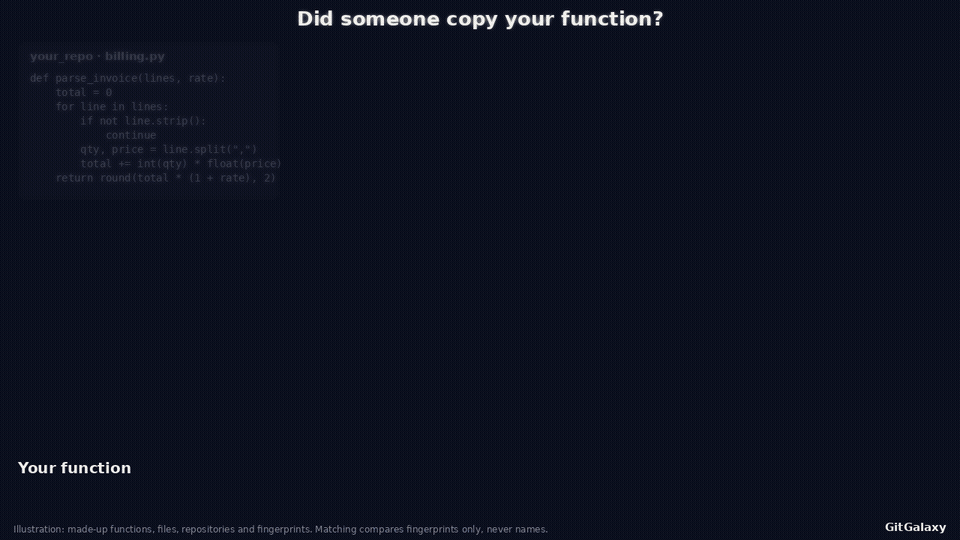
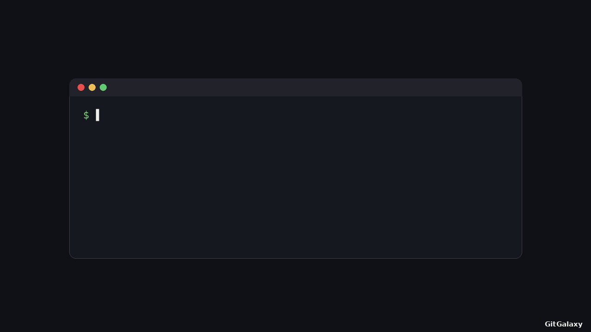

# What GitGalaxy does, shown

Short animations of the engine at work. **Every frame is rendered from real engine output:**
- the generators scan the code with this repository's engine;
- they take the function's actual database row or the scan's graph output;
- they locate each highlighted token with the engine's own per-language rules, matched on the engine's comment-free
  code stream.

`function_explainer.py` refuses to render if a highlighted count differs from the engine's count. Nothing is drawn by
hand.

## What the engine reads in one function

One function in a terminal. The engine:
1. detects the language;
2. finds the function's name and arguments;
3. counts each keyword family (branches, structural keywords, pointers, state changes, public surface, defensive
   checks, I/O and so on), shown as coloured highlights flowing into the function's record;
4. takes a second pass for size and comments;
5. produces the yes/no fingerprint of which keyword families are present, and the function's archetype.

Names and comment text are never interpreted, only structure.

| language | function | file |
|---|---|---|
| C | `gzeof` | zlib `gzlib.c` (zlib license, © Jean-loup Gailly and Mark Adler) — [GIF](function-c.gif) · [MP4](function-c.mp4) |
| Python | `_has_generator_banner` | `gitgalaxy/core/aperture.py` — [GIF](function-python.gif) · [MP4](function-python.mp4) |
| Java | `storeHostChecked` | `gitgalaxy/tools/cobol_to_java/det/cobolrt/Cobol.java` — [GIF](function-java.gif) · [MP4](function-java.mp4) |
| COBOL | `MAIN-PARA` | `tests/cics_crucible/fixture/cases/condition-handling/fx-ts-queue/src/FXTSQ.cbl` — [GIF](function-cobol.gif) · [MP4](function-cobol.mp4) |


## From one function to the whole call graph

The engine also resolves which functions call which, and which files import which. The camera:
1. starts on zlib's `gzread()` and draws the calls it makes;
2. follows them a second hop;
3. zooms out to every function in `gzread.c`;
4. zooms out to the whole codebase: 25 files (green circles) holding 187 functions (blue dots), with the 291 function
   calls the engine resolved as red lines and the 33 `#include` links between the codebase's own files as yellow lines.

[GIF](callgraph-c.gif) · [MP4](callgraph-c.mp4)


## How function shapes are built

A function's fingerprint is a column of Yes / No: which keyword families it contains. The animation builds a real
chain from the population's growth tree, one family at a time. Each dot is a real exact shape, with how many
functions have it and its level (= number of families present):

| dot | shape | functions | level |
|---:|---|---:|---:|
| 1 | function declaration + structural keywords | 54,516 | 2 |
| 2 | + calls / signatures with arguments | 177,180 | 3 |
| 3 | + public / exported surface | 170,862 | 4 |
| 4 | + state mutation | 84,383 | 5 |
| 5 | + branches | 54,854 | 6 |
| 6 | + pointers | 54,522 | 7 |
| 7 | + class / struct declarations | 33,581 | 8 |

**The whole family:** the 200 commonest shapes appear around the chain. They hold 3,449,456 functions, 49.7% of
6,936,799, across levels 0–10. From here every dot, the chain's included, is unlabelled and sized by the number of
functions that share its shape.

**Alternate parentage:** light grey dotted lines show it, 219 links in all: 148 of the 200 shapes could also have grown
from another common shape one family smaller. The chain's own alternate parents are then highlighted.

**The final results:** once the example chain has been shown, the left panel switches from that one path's
fingerprint to the final results:
- 6.9 million functions · 571 repositories · 56 languages;
- half of them (49.7%) fall into just the 200 shapes drawn;
- what dot size and level mean;
- 196 of 199 growth steps add exactly one family;
- 219 alternate parents, so 148 of 200 shapes can be built more than one way;
- 314,979 distinct shapes exist in all, and 19,238 of them cover 90%.

The traced chain then fades into the same line style as every other growth link, and its highlighted alternates fade to
plain grey. The film ends on the lattice map alone, with no history.

The 571 repositories and 56 languages are counted from the population DB: those with at least one function of 3+
lines. The scan had 745 targets.

Colours and layout:
- At the end every circle has the same purple and transparency; the chain is traced only by its white links.
- Alternate parents are subtle grey dotted lines, and the chain's own are soft violet.
- The film is portrait (1280 × 1440), and each level's column is packed so circles do not overlap. Sizes stay
  proportional to function counts.

196 of the 199 growth steps add exactly one keyword family.

**Data:** temporal-crucible's population fingerprint lattice (v2.12.0 scan of 745 repositories). Exploratory research
data, not an engine output format. The generator refuses to render a chain step that is not a one-family step.

[GIF](lattice.gif) · [MP4](lattice.mp4)

## Same job, three AI models

The agent-habits study ([squid-protocol/agent-habits](https://github.com/squid-protocol/agent-habits)) had three
autonomous coding agents build the same chess engine in Java, with the same prompt and checker and no human steering.
GitGalaxy's scan of each:

| model | functions | calls | public / general | private helpers |
|---|---:|---:|---:|---:|
| Sonnet | 22 | 36 | 95% | — |
| Haiku | 60 | 123 | 37% | 54% |
| Codex | 34 | 59 | 100% | — |

Codex's shape share covers only its 6 functions of ≥ 3 lines (its style packs many 1–2 line functions).

**Caption (keep it):**
- Across all 10 jobs, a program's nearest same-job neighbour was written by the same model 42 of 50 times (84%,
  chance 28%). That result is exploratory.
- Inside one shared codebase the model's handwriting mostly disappears: temporal-crucible WILD, Sonnet vs Opus,
  AUC 0.57, within chance.

[GIF](agents-same-job.gif) · [MP4](agents-same-job.mp4)

## One game, many languages (DOOM)

From the DOOM's DNA study ([`docs/wiki/museum-of-code/teardown-of-doom.md`](../wiki/museum-of-code/teardown-of-doom.md),
data `docs/wiki/museum-of-code/doom-dna/data.json`).

**The original:** linuxdoom's 16 parts: 777 functions, 1,605 calls.

**The ports:** five ports are drawn on the same map. A table then shows how much of the original's wiring between
parts each of 16 programs kept above a shuffled baseline:
- Scheme and Go translations kept as much as a C fork did (+0.51, +0.50 vs +0.51);
- Dart kept some;
- Java, Kotlin and C# kept none;
- rewrites from scratch and unrelated programs (Quake II, WinQuake, Lua) sit at chance.

**Caveats:**
- Functions are assigned to DOOM's parts by name and path, so this is not a blind test.
- "Kept none" may mean the design was lost or that the test cannot see it through very small functions.
- This measures code shape, not gameplay.

[GIF](doom-ports.gif) · [MP4](doom-ports.mp4)

## Did someone copy your function? (illustration)



This film is an illustration, not a measurement: every function, file, repository and fingerprint in it is made up,
from a fixed random seed.
- Your function becomes a fingerprint: one Yes / No cell per keyword family, with no names.
- The search compares that fingerprint against functions across a sea of repositories (red), files (green) and
  functions (blue): 50 misses, including two near misses one cell off.
- Then a function in `your_competitor` matches cell for cell, even though it was renamed `stolen_ip`.

The measured version on real code is the next film.

## Finding a copy without its name

OpenSSL's `crypto/x509/v3_utl.c` against BoringSSL's C++ `v3_utl.cc`. Each OpenSSL function is ranked against all
6,802 BoringSSL functions, by structure only, never by name.

**The three layers added in turn:**

| layers | copies found first |
|---|---:|
| coarse profile | 4 of 27 |
| + call set | 18 of 27 |
| + control-flow skeleton | 19 of 27 |

- The skeleton gains two copies and loses one (`bignum_to_string` drops to #3); the animation shows the drop.
- **Renamed copies:** of 14 pairs renamed by OpenSSL 3's `ossl_` prefix, 1 → 4 → 5 are found. For example,
  `ossl_x25519` → `X25519` goes from #107 to 1st.

**The honest headline:** across all 572 current OpenSSL → BoringSSL copies, the true copy is found first **11% → 44%**.

**The study figures:** the LAY study's published 94% (BoringSSL C → C++, n = 17) and 80% (all 90 copies) are for
CVE-touched functions in pre-fix code. They are not the general rate.

**Answer key:** the "true copy" key is name-based, as in the study. Renamed pairs are matched after stripping
`ossl_`, an extension of the study's rule.

[GIF](copyfinding.gif) · [MP4](copyfinding.mp4)

## From COBOL to Java, level by level

One CardDemo program, **COUSR01C** (add user), at evidence level **L5 · mutants accounted for**. This is the program's
current level in the published evidence report (generated branch `37b095760`, 2026-11-07).

**What it shows:**
- the COBOL paragraph `WRITE-USER-SEC-FILE`;
- the Java the deterministic translator writes for it (by rule, no model), with six COBOL → Java correspondences
  highlighted;
- the ladder, L0 to L5, each rung with its definition from this README's level table and its real evidence:

| level | evidence |
|---|---|
| L0 | in the survey of 44 CardDemo programs |
| L1 | 94/94 statements, 0 holes |
| L2 | det port equal on 25/25 scenarios |
| L3 | 9/9 live paragraphs |
| L4 | 20/20 branch outcomes net (20/21 raw) |
| L5 | 623/623 surviving mutants accounted for, of 1,231 |

At L5 one real surviving mutant is shown in place. It deletes an `EIBRESP` store that the program never reads; its
verdict is "equivalent".

**Caption caveats:**
- CardDemo is a development (burned) estate, so these are not first-try numbers.
- The oracle is GnuCOBOL plus GitGalaxy's CICS models, not z/OS.
- The raw mutation kill rate is 48%. L5 means every survivor has a reviewed verdict, not that most mutants were
  killed.
- Levels are reported, never "proven" (`.claude/rules/mainframe-evidence-policy.md`).

CardDemo is Apache-2.0, © Amazon.com, Inc. or its affiliates.

[GIF](proof-ladder.gif) · [MP4](proof-ladder.mp4)

## One scan, every language

The whole path of one real scan, from `pip install` to the reports.

1. The terminal shows the two commands. Then the scan's own log lines appear when the scan wrote them.
2. The tree shows one tile per file, grouped into its top-level folder. Each tile is coloured by the language the
   engine read it as, or grey if the scan left it out.
3. The tiles pour into a flow:
   - files on disk, through the three stages that leave files out;
   - one band per language (the 11 largest, then the rest of the function-level languages, the structure-only
     formats, the counted-only formats and the model-weight lane);
   - one engine, then the reports the scan wrote.

The bar along the bottom is the scan's real wall clock, taken from the log's timestamps: the engine's first line to
`PIPELINE_SUCCESS`. Each stage name is the log line that starts it. The film runs that clock faster and says by how
much.

The flow reveals at a constant speed, like the clock. The dots travel as one bolus behind the front and reach the
reports on the frame before the clock shows 100%. Then the reports ring once and the final screen holds for 15 s.

**Target:** [language-crucible](https://github.com/squid-protocol/language-crucible) at `197cbc5` (2026-11-06), with
its `data/` folder as the scan root. Scanning the repository root instead leaves out 2,757 files: each
`data/<language>/<project>` folder ships its own upstream licence, so the vendored-copy detector (#4545) rightly reads
it as a copy of another project.

| | files |
|---|---:|
| on disk (git-tracked) | 3,737 |
| left out by path and extension rules (no file opened) | 336 |
| left out by content guards (file read) | 30 |
| left out by the statistical audit (after parsing) | 7 |
| read, in 64 languages and formats | 3,364 |

The scan wrote 7 reports and took 42.4 s on the wall clock. The engine's own "mapped in" figure is 34.8 s, because it
leaves out setup.

How the numbers are kept honest:
- **Sources.** The counts come from the audit report's summary, its excluded-artifacts queue and its composition, and
  from the master database's `file_data` and `excluded_artifacts` rows (one tile per row).
- **Language levels.** Each language's level comes from the engine's registry: a `func_start` rule means "read to the
  function", any other non-empty rule means "structure only", no rules means "counted only".
- **Refusals.** `scan_flow_explainer.py` refuses to render if:
  - an exclusion reason has no stage;
  - read plus left out is not the files on disk;
  - the database disagrees with the audit;
  - the log has no `PIPELINE_SUCCESS` line.

What the picture shows along the way:
- **Tcl gap:** most of the `tcl/` folder is grey. SQLite's 114 `.test` files are Tcl scripts that no language claims
  yet.
- **Exclusion label:** the "System Exclusion, Hidden Directory, or Dynamic Ignored Dir" reason also covers
  vendored-copy and licence-file exclusions. That is why the first gate is labelled "Path rules" rather than by that
  reason.

[GIF](scan-flow.gif) · [MP4](scan-flow.mp4)



### Rainbow cut

`--style rainbow` draws the same scan with every language as its own stripe, red to violet. The stripes are equal on
purpose so that all 64 names fit, staggered in three columns, and each label carries the real file count. Up to the
"files read" bar the flow stays to scale. The non-code formats keep their hue, muted, and are bracketed as "structure
only" and "counted only".

The grey branch opens into the reasons the engine recorded, grouped into families (the 186 hidden, ignored, licence or
vendored files, the 142 with no language for their extension, and so on). A gold branch shows what still happens to
left-out files, as traced in the engine:
- **X-Ray:** the binary sweep (`run_xray_audit`) walks the disk itself and sees most left-out files. Here it found 63
  anomalies.
- **API map:** it also walks the disk itself and sees most left-out files. Here it found 377 shadow and 10 ghost APIs.
- **Where the counts land:** both are repo-level counts only. They land in the audit manifest, the database and the
  brief (§10.7), never in SARIF and never on a file.
- **SARIF:** SAST, the dependency firewall and the typosquat radar see read files only. SARIF holds 543 results, none
  on a left-out file.
- **Model weights:** the two files are taken aside at the path gate, header-audited and put back as their own lane (↺).
  They are not among the 373.
- **Secrets:** a secret-named file would also be put back, but none is tracked here.

[GIF](scan-flow-rainbow.gif) · [MP4](scan-flow-rainbow.mp4)


## Regenerate

The generators need Pillow, numpy and ffmpeg. These are docs tooling, not engine dependencies. Each scan runs with git
history disabled.

```bash
python scripts/media/function_explainer.py --file <zlib>/gzlib.c --function gzeof --above 2 --label "zlib · gzlib.c" \
    --out docs/media/function-c --attribution "Code: zlib (gzlib.c), © Jean-loup Gailly and Mark Adler, zlib license."
python scripts/media/function_explainer.py --file gitgalaxy/core/aperture.py --function _has_generator_banner \
    --label "GitGalaxy · gitgalaxy/core/aperture.py" --out docs/media/function-python
python scripts/media/function_explainer.py --file gitgalaxy/tools/cobol_to_java/det/cobolrt/Cobol.java \
    --function storeHostChecked --above 1 --label "GitGalaxy · cobolrt/Cobol.java" --out docs/media/function-java
python scripts/media/function_explainer.py \
    --file tests/cics_crucible/fixture/cases/condition-handling/fx-ts-queue/src/FXTSQ.cbl --function MAIN-PARA \
    --label "GitGalaxy · cics-crucible fixture FXTSQ.cbl" --out docs/media/function-cobol
python scripts/media/callgraph_explainer.py --src <dir with zlib's top-level *.c *.h> --start gzread --label "zlib" \
    --out docs/media/callgraph-c --attribution "Code: zlib (top-level sources), © Jean-loup Gailly and Mark Adler, zlib license."
python scripts/media/lattice_explainer.py --trees <temporal-crucible>/docs/fingerprint_trees_exploratory.json --chain-end 26 \
    --repos 571 --languages 56 --out docs/media/lattice
python scripts/media/agents_explainer.py --scans <agent-habits scans> --trees <temporal-crucible>/docs/fingerprint_trees_exploratory.json \
    --runs chess-java-claude-r1:Sonnet chess-java-haiku-r1:Haiku chess-java-codex-r1:Codex --out docs/media/agents-same-job
python scripts/media/doom_explainer.py --out docs/media/doom-ports          # reads docs/wiki/museum-of-code/doom-dna/data.json
python scripts/media/copyfinding_explainer.py --out docs/media/copyfinding  # table recomputed by scripts/media/copyfinding_data.py
python scripts/media/fingerprint_match_explainer.py --out docs/media/fingerprint-match  # illustration, no data
GITGALAXY_MAINFRAME_CORPORA=<corpora> python tests/tools/det_port.py run carddemo-useradd --translate-only --work /tmp/media-detport
python scripts/media/proof_ladder_explainer.py --work /tmp/media-detport --corpora <corpora> --out docs/media/proof-ladder  # needs origin/generated fetched
python scripts/media/scan_flow_explainer.py --src <language-crucible at 197cbc5>/data --label language-crucible/data \
    --version 2.12.0 --out docs/media/scan-flow   # or --scan-dir <galaxyscope --output dir> --log <its stdout+stderr>
python scripts/media/scan_flow_explainer.py --src <language-crucible at 197cbc5>/data --label language-crucible/data \
    --version 2.12.0 --style rainbow --out docs/media/scan-flow-rainbow
```

Each run writes `<out>.gif` (README size), `<out>.mp4` and `<out>.png` (the final frame). Every film starts directly on its content (no title card) and carries a plain "GitGalaxy" mark in the bottom-right corner (`scripts/media/_brand.py`).
The function and call-graph explainers were rendered with engine `main` at 2026-11-07, after #8024. The zlib sources are from zlib at `99623ef` (2026-11-04).
The scan-flow film was rendered with engine `main` at `f965fcae3` (2026-11-08).
