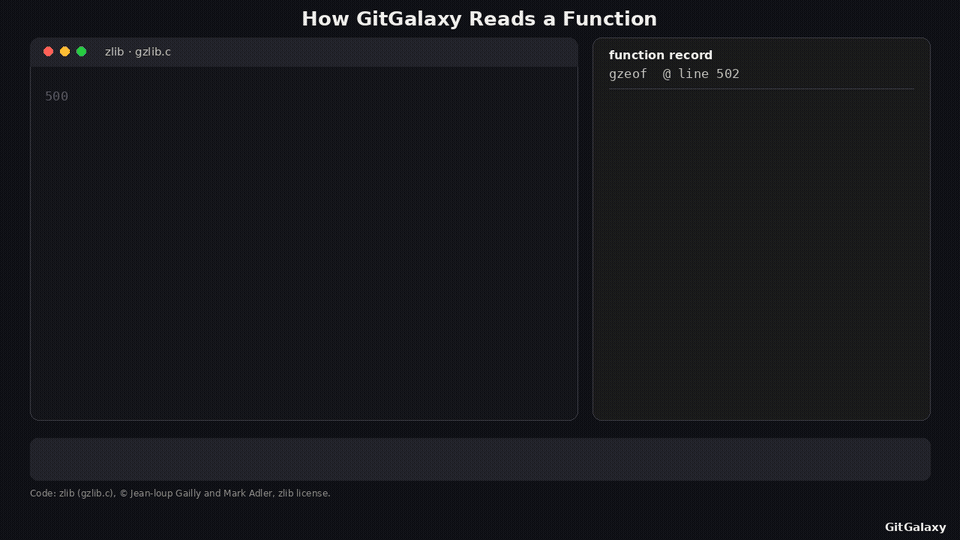
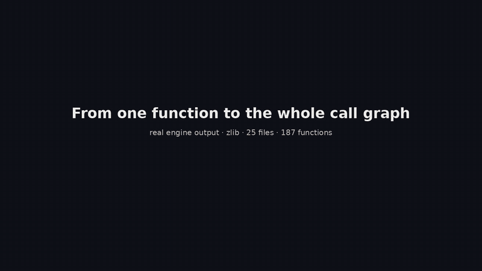

# What GitGalaxy does, shown

Short animations of the engine at work. **Every frame is rendered from real engine output:**
- the generators scan the code with this repository's engine;
- they take the function's actual database row or the scan's graph output;
- they locate each highlighted token with the engine's own per-language rules, matched on the engine's comment-free
  code stream.

`function_explainer.py` refuses to render if a highlighted count differs from the engine's count. Nothing is drawn by
hand.

## What the engine reads in one function

One function in a terminal. The engine:
1. detects the language;
2. finds the function's name and arguments;
3. counts each keyword family (branches, structural keywords, pointers, state changes, public surface, defensive
   checks, I/O and so on), shown as coloured highlights flowing into the function's record;
4. takes a second pass for size and comments;
5. produces the yes/no fingerprint of which keyword families are present, and the function's archetype.

Names and comment text are never interpreted, only structure.

| language | function | file |
|---|---|---|
| C | `gzeof` | zlib `gzlib.c` (zlib license, © Jean-loup Gailly and Mark Adler) — [GIF](function-c.gif) · [MP4](function-c.mp4) |
| Python | `_has_generator_banner` | `gitgalaxy/core/aperture.py` — [GIF](function-python.gif) · [MP4](function-python.mp4) |
| Java | `storeHostChecked` | `gitgalaxy/tools/cobol_to_java/det/cobolrt/Cobol.java` — [GIF](function-java.gif) · [MP4](function-java.mp4) |
| COBOL | `MAIN-PARA` | `tests/cics_crucible/fixture/cases/condition-handling/fx-ts-queue/src/FXTSQ.cbl` — [GIF](function-cobol.gif) · [MP4](function-cobol.mp4) |



## From one function to the whole call graph

The engine also resolves which functions call which, and which files import which. The camera:
1. starts on zlib's `gzread()` and draws the calls it makes;
2. follows them a second hop;
3. zooms out to every function in `gzread.c`;
4. zooms out to the whole codebase: 25 files (green circles) holding 187 functions (blue dots), with the 291 function
   calls the engine resolved as red lines and the 33 `#include` links between the codebase's own files as yellow lines.

[GIF](callgraph-c.gif) · [MP4](callgraph-c.mp4)



## Regenerate

The generators need Pillow, numpy and ffmpeg. These are docs tooling, not engine dependencies. Each scan runs with git
history disabled.

```bash
python scripts/media/function_explainer.py --file <zlib>/gzlib.c --function gzeof --above 2 --label "zlib · gzlib.c" \
    --out docs/media/function-c --attribution "Code: zlib (gzlib.c), © Jean-loup Gailly and Mark Adler, zlib license."
python scripts/media/function_explainer.py --file gitgalaxy/core/aperture.py --function _has_generator_banner \
    --label "GitGalaxy · gitgalaxy/core/aperture.py" --out docs/media/function-python
python scripts/media/function_explainer.py --file gitgalaxy/tools/cobol_to_java/det/cobolrt/Cobol.java \
    --function storeHostChecked --above 1 --label "GitGalaxy · cobolrt/Cobol.java" --out docs/media/function-java
python scripts/media/function_explainer.py \
    --file tests/cics_crucible/fixture/cases/condition-handling/fx-ts-queue/src/FXTSQ.cbl --function MAIN-PARA \
    --label "GitGalaxy · cics-crucible fixture FXTSQ.cbl" --out docs/media/function-cobol
python scripts/media/callgraph_explainer.py --src <dir with zlib's top-level *.c *.h> --start gzread --label "zlib" \
    --out docs/media/callgraph-c --attribution "Code: zlib (top-level sources), © Jean-loup Gailly and Mark Adler, zlib license."
```

Each run writes `<out>.gif` (README size), `<out>.mp4` and `<out>.png` (the final frame).

Rendered with engine `main` at 2026-11-07, after #8024. The zlib sources are from zlib at `99623ef` (2026-11-04).
