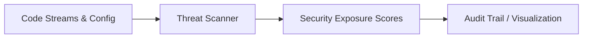

# Vulnerability & Threat Scanner

> **File Reference:** [`gitgalaxy/security/security_lens.py`](https://github.com/squid-protocol/gitgalaxy/blob/main/gitgalaxy/security/security_lens.py)

## Engineering Summary
This subsystem is the pattern-based security scanner. It runs a fixed set of regular expressions and a string-entropy check over each file and reports counts of the shapes it matched (dynamic execution, security-control bypasses, hardcoded secrets, invisible Unicode and so on). It does not look up CVEs and does no data-flow or taint tracking (removed in #3101). A hit is a structural shape worth review, not a confirmed vulnerability. Within the architecture, this module acts as the AppSec scanner for GitGalaxy.

## Purpose
To detect structural attack patterns, dynamic execution threats, and credential exposure across the codebase.

## Problem Being Solved
CVE lookups only find known-vulnerable package versions; they say nothing about what a repository's own files do. Some risky shapes are visible in the text itself: zero-width and bidi characters, arbitrary `eval`, prototype poisoning, disabled TLS verification, credentials assigned to string literals. This lens flags those shapes for review. No evaluation set exists for unknown or obfuscated attacks, so it makes no claim about catching them.

## Design
The engine decouples threat measurement from policy enforcement, allowing dynamic threat threshold injection (e.g., `--paranoid` mode). It scans for 13 signature families, the keys of `THREAT_SIGNATURES` in `security_lens.py`: `reflection_metaprogramming`, `safety_bypasses`, `io`, `high_risk_execution`, `state_mutation`, `dead_code`, `bitwise_ops`, `shadow_imports`, `homoglyphs`, `hardcoded_secrets`, `db_hooks`, `unicode_steganography` and `self_propagation` (a file copying or overwriting itself). It also computes Shannon entropy over string literals (see Tradeoffs). There is no taint or data-flow analysis: it was removed in #3101, and the `threat_tainted_injection` column it fed is an always-zero placeholder. Agentic-RCE detection was removed in #1020.

The lens returns per-file counts, snippets and line positions. It does not read network centrality. Scores are computed later by the signal processor; the only centrality weighting is the opt-in, linear multiplier in the supply-chain firewall (`supply_chain_firewall.py`: `1.0 + 0.5 × normalized_blast_radius` when that exceeds 1.0, plus 0.5 when betweenness exceeds 0.05).

Coverage is tested on planted inputs (`tests/security_auditing/test_security_lens.py` and the `*_4108` probe tests). There is no measured real-world recall or precision.

**Long-line blind spot.** Before any security regex or the entropy check runs, `SecurityLens._armor` empties every line of 250 or more characters. Nothing on such a line is matched, so a secret or `eval(` on a minified line is not reported. If armoring removed over 90% of a file, a short literal screen (`eval(`, `child_process`, `fetch(`, `NODE_TLS_REJECT_UNAUTHORIZED` and a few others) runs on the raw text instead; it does not cover secrets. Only Vault Sentinel reads long lines, by cutting them into overlapping pieces (`gitgalaxy/security/long_lines.py`, #7179). The blind spot is tracked in #8429.

## Pipeline Integration
Inputs: file text, the comment-blanked code stream from prism, and the file's language id.
Outputs: per-signature hit counts, up to three snippets each, and line positions; the signal processor turns the counts into exposure scores.
Dependencies: upstream prism (code stream), downstream signal processor and record keeper.

## Tradeoffs
- **Structural Mechanics vs Semantic Analysis**: Uses regex patterns to identify risk structures (e.g., dense XOR loops) rather than abstract interpretation. It has no data-flow information at all.
- **Heuristic Entropy Limits**: String literals of 64 to about 248 characters (the armor caps the line) with fewer than three spaces count as a hit when their Shannon entropy exceeds 4.8 bits per character. Files with an auto-generated marker in their first 2,000 characters (`@generated`, `DO NOT EDIT` and similar) skip the check. A separate 7.95 bits-per-byte threshold applies to binaries in `scan_binary`, which only the X-Ray binary anomaly detector calls. Benign encoded data, hashes and test fixtures above 4.8 are flagged the same way.

## Limitations
- Cannot detect purely logical vulnerabilities (e.g., flawed business logic).
- Every line of 250+ characters, in every file, is blanked before scanning (see the long-line blind spot above), so minified files and long single lines are mostly unscanned.
- No taint or data-flow analysis of any kind (removed #3101).

## Performance Notes
Uses Python's stdlib `re`, with required-literal prefilter gates that skip a signature's regex when its literal cannot appear (#3173). Blanking 250+ character lines keeps the regexes from backtracking on minified text (`test_redos_poison.py`, `test_minified_fallback_*`); the cost is the blind spot above.

## Future Work
Open signature gaps are tracked as issues (credential-file targeting #1173, persistence registration #1175, bulk environment dumps #1176). Taint tracking was removed in #3101; the code comment at its old site records about 0% precision and about 0% recall on the corpus.

## Related Components
- [Optical Orchestration](02-02-optical-orchestration.md)
