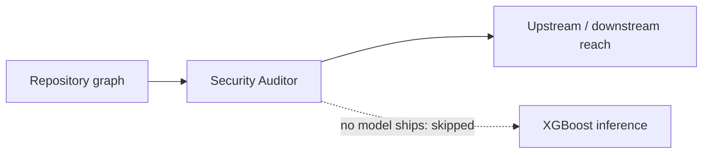

# Security Auditor

> **File Reference:** [`gitgalaxy/security/security_auditor.py`](https://github.com/squid-protocol/gitgalaxy/blob/main/gitgalaxy/security/security_auditor.py)

## Status: the classifier never runs
**No trained model ships.** `SecurityAuditor` loads `gitgalaxy_malware_xgb_multiclass.json` by default (`security_auditor.py`), and that file is not in this repository or in the package. Without it, `audit_repository` logs "Skipping ML Threat Inference (Model not loaded)" and returns. So in every install, `[full]` or not:
- no file is classified, and the AI threat columns are NULL;
- both golden masters record `"Inference Ran": false` (`tests/golden_master_audit/` and `tests/golden_master_zero_dep_audit/`);
- `--fail-on-malware` cannot fire.

The tests run the inference code against mocks or a tiny synthetic stand-in model (`tests/security_auditing/test_ml_real_model_2986.py`). That shows the plumbing works; it says nothing about detecting malware. No detection rate has been measured. Whether to ship a measured model or remove the classifier is open: [#8430](https://github.com/squid-protocol/gitgalaxy/issues/8430).

## Engineering Summary
This module holds the code for an XGBoost multiclass classifier over per-file feature vectors (structural metrics, complexity distributions, signature counts, dependency-graph reach). Its output classes are Safe Code, Botnet / DDoS, Stealer / Trojan, Dropper / Webshell and Native Infector. With no model shipped, the part that runs today is the dependency-graph step: exact transitive upstream/downstream counts for each file.

## Design
### Current Behavior
- **Dependency Graph Features (runs on every scan):** Counts every file each file transitively depends on (`total_upstream`) and every file that transitively depends on it (`total_downstream`), with their ratios. The counts are exact: #3040 replaced the 500-file-capped networkx/BFS pair with one native computation (`graph_engine.reach_counts`: cycle condensation plus reachability bitsets). It is bounded by a deterministic work budget, past which the totals are `None`.
- **Model loading:** Without a model file the auditor stops after the graph step. It also skips inference when `xgboost`, `scikit-learn`, `pandas` or `numpy` is missing; the AI columns are then NULL, not "Safe".
- **Feature vector (code path only):** Applies logarithmic scaling to structural counts and adds Gini coefficients and signature counts. The "global architectural distance" features (`assigned_macro_species`, `primary_z_score`, `dist_to_*`) are frozen constants, the same for every file, since the repo clustering model was retired ([#1159](https://github.com/squid-protocol/gitgalaxy/issues/1159)).
- **Shadow patch (code path only):** `--shadow-patch-detected` is a manual flag. No hash or version is compared; when the flag is set, every file with `file_impact > 0.5` is labelled Stealer / Trojan with the alert text "Hash mutated without version bump!". The override sits after the model check, so without a model it never runs ([#8431](https://github.com/squid-protocol/gitgalaxy/issues/8431)).

## Pipeline Integration
- **Inputs Received:** The repository graph with per-file metrics, signature counts and resolved dependencies; the `--shadow-patch-detected` flag.
- **Outputs Produced:** Upstream/downstream reach counts on every scan. The AI Threat Class, AI Threat Confidence and `is_ml_threat` fields would be written only if inference ran; today they are absent.
- **Dependencies:** Pre-computed structural metrics, signature counts and dependency edges.

## Tradeoffs
- **Probabilistic scores:** If a model were supplied, its scores would be probabilities from `predict_proba` (deterministic for a given model and input) with an unmeasured error rate.
- **Dependency footprint:** The `[full]` extra installs `xgboost`, `scikit-learn`, `pandas` and `numpy` for a classifier that does not run without a model.

## Limitations
- **No model, no evaluation:** No model ships and no labelled real-world evaluation exists, so there is no recall, precision or false-positive rate to report.
- **Frozen features:** The architectural-distance features carry no per-file information (#1159).
- **Shadow patch:** A manual flag with no hash comparison, unreachable without a model (#8431).

## Performance Notes
- The reach counts and the path metrics in the network risk sensor are bounded by a deterministic work budget (`PATH_METRICS_WORK_BUDGET = 50_000_000` edge scans per search, `gitgalaxy/core/network_risk_sensor.py`), which counts work, not time. Past it, the metric is `None`.

## Future Work
- Decide between shipping a model with a measured detection rate and removing the classifier and `--fail-on-malware` (#8430).
- Replace or remove the shadow-patch flag (#8431).

## Related Components
- Network Risk Sensor
- AI AppSec Sensor
- Audit Recorder
