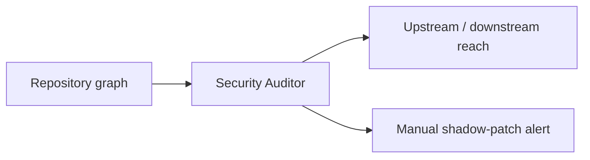

# Security Auditor

> **File Reference:** [`gitgalaxy/security/security_auditor.py`](https://github.com/squid-protocol/gitgalaxy/blob/main/gitgalaxy/security/security_auditor.py)

## Status: Removed (2026-11-19): research pending
The XGBoost malware classifier and the `--fail-on-malware` flag are removed. No trained model ever shipped, so the classifier never ran in any install and no detection rate was ever measured ([#8430](https://github.com/squid-protocol/gitgalaxy/issues/8430)). A model comes back only with a labelled, measured evaluation: see [#96](https://github.com/squid-protocol/gitgalaxy/issues/96). Until then GitGalaxy makes no malware-classification claim, and the AI threat columns are not produced.

## What the module does today
- **Dependency graph reach (every scan):** counts every file each file transitively depends on (`total_upstream`) and every file that transitively depends on it (`total_downstream`), with their ratios. The counts are exact: one native computation (`graph_engine.reach_counts`: cycle condensation plus reachability bitsets, #3040). It is bounded by a deterministic work budget (`PATH_METRICS_WORK_BUDGET = 50_000_000` edge scans per search, `gitgalaxy/core/network_risk_sensor.py`), which counts work, not time; past it the totals are `None`.
- **Shadow patch (manual hint):** `--shadow-patch-detected` is a manual flag. No hash or version is compared; when it is set, every file with `file_impact > 0.5` gets the alert "SHADOW PATCH (manually asserted via --shadow-patch-detected; no hash or version was compared)". It assigns no class and no score ([#8431](https://github.com/squid-protocol/gitgalaxy/issues/8431)).

## Pipeline Integration
- **Inputs:** the repository graph with per-file metrics and resolved dependencies; the `--shadow-patch-detected` flag.
- **Outputs:** upstream/downstream reach counts on every scan.

## Limitations
- The shadow patch is a manual hint, not a detection (#8431).
- There is no malware classifier. Structural counts describe code; they do not identify malicious code.

## Future Work
- A classifier returns only with a labelled, date-locked held-out evaluation against a baseline (#96).
- Replace the shadow-patch hint with real detection: a hash against the previous scan plus the manifest version (#8431).

## Related Components
- Network Risk Sensor
- AI AppSec Sensor
- Audit Recorder
