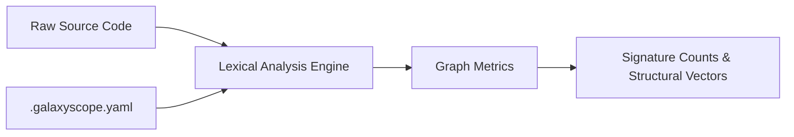

# Security Architecture & Competitive Analysis

> **File Reference:** [gitgalaxy/security/security_auditor.py](https://github.com/squid-protocol/gitgalaxy/blob/main/gitgalaxy/security/security_auditor.py)

## Engineering Summary
The DevSecOps ecosystem is populated by static analysis and software composition analysis (SCA) platforms that traditionally rely on full source code compilation, heavy Abstract Syntax Tree (AST) generation, or reliance on external vulnerability databases. These approaches introduce performance bottlenecks in high-throughput CI/CD pipelines, making real-time analysis difficult. To address this, a compilation-free, multi-language static analysis engine reads raw source with regular-expression signatures. Its security lens has been checked with a planted-secret probe in 44 languages ([validation](../validation.md)). It describes each file's security-relevant surface (signature counts such as hardcoded secrets, dynamic execution and TLS bypasses, plus structural vectors) and builds an import graph and function call graph, without build artifacts. These are descriptions of the code, not vulnerability findings: per-file structural risk was tested against real fix history and does not predict defects ([validation](../validation.md): "Per-file standing structural risk does not predict defects"). No security detector has a measured recall, precision or false-positive rate on real-world samples. This subsystem is the GitGalaxy analysis engine.

## Purpose
To provide fast, compilation-free static security auditing that can run directly on raw source code, eliminating the need for build environments or external database lookups.

## Problem Being Solved
Standard enterprise static analysis engines require successful compilation before analysis can proceed. This blocks analysis on partial or non-compiling code bases and slows down the CI/CD pipeline. Additionally, reliance on external cloud databases or language-specific compiler toolchains creates processing overhead and data egress concerns.

## Design
### Compilation-Free Lexical Analysis
Instead of building ASTs or requiring binary packaging, the system parses raw source code directly. Security rules are defined using standardized regular expression patterns and keyword permutations. Because core language constructs follow predictable structural patterns, a unified rule set can analyze multiple languages efficiently in a single pass.

### Graph metrics, and the ML classifier that does not run
The system computes structural mass, cyclomatic complexity, ownership entropy and dependency topology for every file. The code also contains an XGBoost malware classifier, but no trained model ships, so it never runs in any install ([#8430](https://github.com/squid-protocol/gitgalaxy/issues/8430); see [Security Auditor](02-20-security-auditor.md)).

### Architectural Comparison
* **Black Duck, npm audit, Snyk:** Traditionally rely on exact signature matching and proprietary cloud databases for known CVEs. The system operates fully offline, scanning actual source files directly alongside manifests. It uses configurable regular expression patterns and heuristic signature vectors to flag security risks.
* **Checkmarx, SonarQube:** Traditionally use deep data-flow and control-flow analysis on compiled artifacts or ASTs. The system operates entirely without source code compilation, constructing function call graphs via lightweight lexical parsing.
* **CodeQL:** Traditionally builds a relational database representation of the codebase. The system bypasses database compilation completely.
* **Dependabot, Socket.dev, Phylum:** Monitor dependency manifests and package behavior via cloud APIs. The SBOM recorder reads the first 8 KB of each `.js`, `.py`, `.ts`, `.php` and `.rs` file in an installed package and marks the package as an anomaly when a file has a dense string (entropy above 4.8 in a string literal of 64 to about 248 characters) or a language-identity anomaly. That anomaly flag has no measured false-positive rate, and no comparison with these tools has been run.
* **Endor Labs, govulncheck:** Use call-graph analysis to decide whether a known vulnerable function is reachable. The system builds a function call graph, but does not link it to vulnerable symbols, so it does no CVE reachability analysis.
* **Semgrep:** Applies lightweight AST-based pattern matching. The system uses regular expression signatures and density scoring without building ASTs.
* **Trivy:** Focuses on manifest parsing and CVE lookup tables. The system extends manifest scanning to include physical source file inspection.
* **Veracode:** Requires binary packaging and cloud processing. The system runs entirely on local developer hardware or self-hosted runners.

## Pipeline Integration
Inputs received include raw source code files and configuration settings (`.galaxyscope.yaml`). Outputs produced are per-file signature counts, structural vectors, and import and call graphs. Graph traversal is the engine's own standard-library code (`gitgalaxy/core/graph_engine.py`); networkx is not used at runtime (`tests/core_engine/test_no_networkx_runtime.py`).

## Tradeoffs
* **Lexical vs. Semantic Analysis:** By choosing compilation-free lexical analysis over deep data-flow analysis on ASTs, the system sacrifices semantic understanding (e.g., precise taint tracking across complex data structures) for speed and the ability to scan uncompiled code.
* **Heuristics vs. Exact CVE Matching:** Relying on heuristics and patterns allows offline scanning without a CVE database, but no false-positive rate has been measured. Findings can be suppressed with configurable allowlists.

## Limitations
* Semantic understanding of the code is limited because full ASTs are not generated.
* Cannot detect complex data-flow vulnerabilities that require precise type information or deep inter-procedural taint tracking.
* Heuristic signatures may generate false positives, requiring manual tuning of allowlists and denylists in the configuration.

## Performance Notes
The analysis completes rapidly and enables low-latency scanning per repository module because it bypasses database compilation, AST generation, and external network calls, relying instead on single-pass lexical scanning and in-memory graph traversals.

## Future Work
* **Planned Improvements:** Enhancing the precision of reachability graphs without sacrificing compilation-free speed.
* **Open decision:** ship a measured model for the XGBoost classifier, or remove it ([#8430](https://github.com/squid-protocol/gitgalaxy/issues/8430)).

## Related Components
* [GitGalaxy Documentation Master Index](index.md)
* [Next: Full API Network Map](04-01-full-api-network-map.md)

