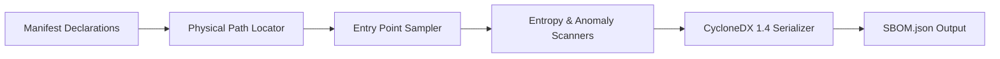

# Software Bill of Materials (SBOM) Generator

> **File Reference:** [gitgalaxy/recorders/sbom_recorder.py](https://github.com/squid-protocol/gitgalaxy/blob/main/gitgalaxy/recorders/sbom_recorder.py)

## Engineering Summary
Software supply chains rely heavily on declarative package manifests (like `package.json` or `requirements.txt`) to determine the bill of materials. A manifest says what was declared, not what is installed. This recorder also samples the installed package files on disk and marks a package when a sampled file looks anomalous (a dense high-entropy string, or a file whose content conflicts with its extension), then writes a CycloneDX 1.4 record. The marks are anomaly flags for review, not proof of tampering, and their false-positive rate has not been measured. This subsystem is the GitGalaxy SbomRecorder.

## Purpose
To generate CycloneDX 1.4 Software Bill of Materials (SBOM) documents, with a per-package note on whether the installed files were found and whether a sample of them raised an anomaly flag.

## Problem Being Solved
Declarative package manifests can be modified or spoofed. An SBOM built only from manifests says nothing about the installed code. This recorder adds a cheap look at the installed files; it has not been compared with other SCA or SBOM tools.

## Design
### Universal Manifest Parsing
The generator delegates manifest extraction to `UniversalManifestSlicer`, supporting multiple ecosystems (NPM, Packagist, PyPI, Cargo) within polyglot repositories.

### Physical Dependency Verification
For every dependency, the tool looks for the installed package on disk. A package not found is marked `UNVERIFIED_MISSING_ON_DISK`.
* **Candidate files:** only `.js`, `.py`, `.ts`, `.php` and `.rs` files are candidates. With the dependency cache they are ordered entry points first (`index`, `main`, `__init__`, `app`, `setup`), then shallow before deep; without it, at most five files per directory are scanned.
* **What is read:** only the **first 8,192 bytes** of each sampled file. Anything later in the file is not inspected.
* **Two checks per file;** either one marks the whole package `SPOOF_DETECTED`:
  * *Entropy:* any quoted string of 64 to 1,024 characters, with fewer than three spaces, whose Shannon entropy is above 4.8. Base64 data, hashes, minified bundles and embedded keys all qualify, so one such string is enough. Files that look machine-generated are skipped by this check. The check runs on the engine's ReDoS-armored text, where every line of 250+ characters is blanked, so a string on a long line is never checked ([#8429](https://github.com/squid-protocol/gitgalaxy/issues/8429)).
  * *Language identity:* the language detector's `anomaly_flags` (content that conflicts with the file's extension).
* **`SPOOF_DETECTED` is an anomaly flag, not a verdict.** It means a sampled file tripped one of the two checks. No false-positive rate has been measured, and `tests/tools_recorders/test_sbom_generator.py` tests the status logic with the security lens mocked, not detection on real packages. `VERIFIED_SAFE` means only that no sampled file tripped either check.
* **Stateful Caching:** File contents are hashed, and verdicts cached per file hash across scan sessions, respecting `fresh_scan_budget`.
* **Stateful Caching:** File contents are hashed, and verdicts cached per file hash across scan sessions, respecting `fresh_scan_budget`.

### CycloneDX 1.4 Serialization
The final report is a CycloneDX 1.4 JSON document enriched with custom properties: `gitgalaxy:trust_status` (`VERIFIED_SAFE`, `SPOOF_DETECTED`, `PARTIALLY_VERIFIED`, `UNVERIFIED_MISSING_ON_DISK`) and `gitgalaxy:anomaly_notes` (which check fired, in which file).

## Pipeline Integration
Inputs received include pipeline census data (`manifest_paths`), parsed artifact graphs, and session metadata. Outputs produced are structured CycloneDX JSON files. The generator integrates with `UniversalManifestSlicer` upstream and downstream compliance aggregators.

## Tradeoffs
* **Physical Scanning vs. Generation Speed:** Scanning physical files adds overhead compared to simply parsing manifests. To mitigate this, stateful caching and prioritized entry point sampling (`fresh_scan_budget`) are used, trading exhaustive file scanning for timely feedback.
* **Heuristic flags:** Shannon entropy above 4.8 flags benign encoded data (base64 assets, hashes, keys, minified code) as readily as an obfuscated payload. Every `SPOOF_DETECTED` needs manual review; how often it is a false alarm is unknown.

## Limitations
* If `fresh_scan_budget` is exceeded, deep nested files in large packages may be marked `PARTIALLY_VERIFIED` and left uninspected until subsequent runs.
* Without the dependency cache, at most five candidate files per directory are scanned; coverage is reported as `scanned/total` in the record.
* Only the first 8 KB of each file is read, and only the five extensions above are candidates (no `.mjs`, `.cjs`, native binaries or data files).
* Strings on lines of 250+ characters and strings longer than 1,024 characters are not entropy-checked.
* Detection on real malicious packages has not been measured.
* Highly dynamic dependency loading that bypasses package managers cannot be tracked.

## Performance Notes
The implementation is optimized using a `DependencyAuditCache`. Hashing files and looking up verdicts enables $O(1)$ result retrieval for unmodified packages, drastically reducing I/O and CPU overhead on repeated CI runs.

## Future Work
* **Current Behavior:** Samples installed files and emits CycloneDX 1.4 metadata with anomaly flags from the entropy and language-identity checks.
* **Planned Improvements:** Expand support to system-level package managers (e.g., APT, RPM) and integrate deeper binary artifact inspection.

## Related Components
* [GitGalaxy Platform](https://gitgalaxy.io/)
* [⬅️ Back to Master Index](index.md)

