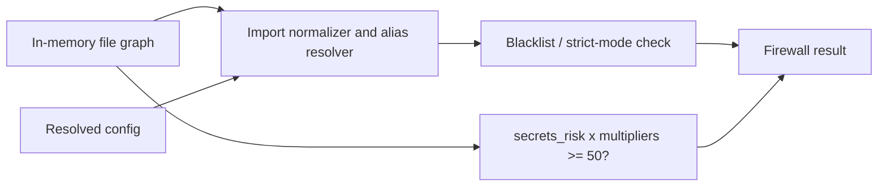

# Supply Chain Firewall (Import and Secrets-Risk Gate)

> **File Reference:** [gitgalaxy/tools/supply_chain_security/supply_chain_firewall.py](https://github.com/squid-protocol/gitgalaxy/blob/main/gitgalaxy/tools/supply_chain_security/supply_chain_firewall.py)

> **Known bug (#8428):** the standalone `supply-chain-firewall` CLI, and `tool: supply-chain-firewall` in the GitHub Action, currently never block on real scan output. The CLI hands the gate file entries from the audit JSON, which has neither `raw_imports` nor `risk_vector`, so every check is skipped and the run exits 0. The engine-internal call in `galaxyscope.py` (`run_firewall_audit(repository_graph, ...)`) receives the in-memory graph and works; its result is recorded in the scan summary (`ecosystem_audits.firewall`) and does not fail the scan. Other enforcement gaps: #8432.

## Engineering Summary
The Supply Chain Firewall is a gate over the scanned repository's own files. It compares each file's imports with configured block and allow lists, and checks one behavioural risk score the engine has already computed. It does not read installed dependency code: `node_modules`, `venv`, `.venv`, `vendor` and `third_party` are excluded by the default scan config (`gitgalaxy/standards/gitgalaxy_config.py`).

## Purpose
Fail a build when the repository imports a blocked package (audit mode) or an unapproved one (strict mode), or when a file's secrets-risk score crosses the threshold.

## Design
### Input
The firewall reads the engine's in-memory file graph (`parsed_files`): per file, `raw_imports`, `risk_vector` and, when centrality weighting is on, `telemetry.network_metrics`. Lists and flags come from the resolved config (`.galaxyscope.yaml` over `gitgalaxy_config.py`).

### Import Verification & Alias Resolution
Imports are normalized to a root package name (relative imports dropped, deep module paths collapsed). Then:

* **Audit mode (default):** a package in `BLACKLISTED_IMPORTS` is blocked; everything else passes. `BLACKLISTED_IMPORTS` ships empty, so audit mode blocks nothing until you add entries.
* **Strict mode (`STRICT_IMPORT_MODE = True`):** anything not in `APPROVED_IMPORTS` is also blocked.

When the engine supplies a manifest alias map, an aliased package is resolved to its true name before the blacklist check, so an alias cannot hide a blacklisted package (`test_alias_spoofing_detection`). The standalone CLI passes an empty alias map. The manifest auditor's other flags (namespace hijacking, direct-URI resolution, insecure registries) are written but not read by the firewall (#8432).

### Behavioural Gate
The firewall reads one risk vector from `SignalProcessor.RISK_SCHEMA`: `secrets_risk`, labelled "Secrets Leak Risk" (`_FIREWALL_RISK_MAP` in `supply_chain_firewall.py`). A file is flagged when the score, after multipliers, reaches 50 (`_FIREWALL_BLOCK_THRESHOLD`). No other risk category is gated. This vector (now `credential_material`) is REWORK-flagged as a formula artifact (#2979); see [`docs/vectors.md`](https://github.com/squid-protocol/gitgalaxy/blob/main/docs/vectors.md).

### Multipliers
1. **Build-time multiplier (10x):** the secrets-risk score is multiplied by 10 for files named setup.py, `build.rs`, `preinstall.js` or `postinstall.js` (`test_build_time_execution_multiplier`). `package.json` is also in the code's list, but `.json` files are skipped before this point, so it never gets the multiplier, and npm `scripts` hooks are not parsed.
2. **Network-centrality multiplier (opt-in):** off unless `FIREWALL_NETWORK_WEIGHTING = True`. When on, files with a normalized blast radius above 1.0 or betweenness above 0.05 get a higher multiplier (`test_network_weighting_*`).

### Skipped files
* Extensions treated as inert: `.svg`, `.xml`, `.jelly`, `.html`, `.css`, `.md`, `.json`, `.yaml`, `.yml`, `.txt`, `.properties`, and `.d.ts`.
* Any path containing `/test/` or `/tests/`, or a file name containing `test_` or `_test`. This is a substring match, so for example latest_config.py is skipped too (#8432).
* Paths in `ALLOWLIST_PATHS` are evaluated, but a flagged file there is counted as an allowlist bypass rather than a threat.

## Pipeline Integration

In a `galaxyscope` scan the result is attached to the scan summary. The standalone CLI exits 1 when it counts threats, which with #8428 open does not happen on real input.

## Evidence
The import checks, alias resolution and multipliers are tested with hand-built file entries (`tests/security_auditing/test_supply_chain_firewall.py`). No test runs the CLI end to end on a real scan, which is how #8428 went unnoticed. There is no measured detection rate on real compromised packages.

## Tradeoffs
* **Strict mode vs. developer velocity:** strict mode fails on every new dependency until it is approved.
* **Build-time multiplier vs. false positives:** a build script with a modest secrets-risk score can be blocked; exempt it with `ALLOWLIST_PATHS`.

## Limitations
* Only static imports are read. Dynamic imports (strings built at runtime) are not.
* Only `secrets_risk` is gated. Network calls, process execution, typosquatting and install hooks are not.
* Installed dependencies are excluded by the default config.
* Accuracy depends on the engine's import extraction for each language.

## Related Components
* [GitGalaxy Platform](https://gitgalaxy.io/)
* [⬅️ Back to Master Index](index.md)

