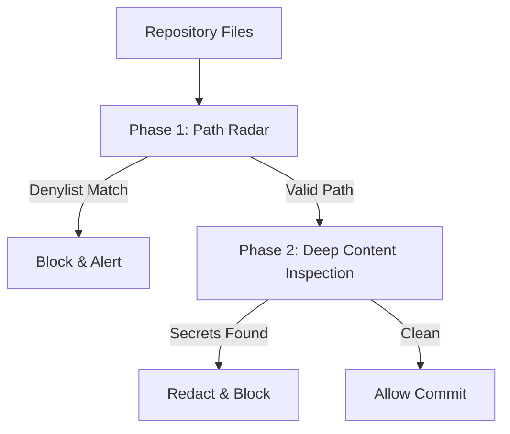

# Vault Sentinel (Secrets Scanner)

> **File Reference:** [gitgalaxy/tools/supply_chain_security/vault_sentinel.py](https://github.com/squid-protocol/gitgalaxy/blob/main/gitgalaxy/tools/supply_chain_security/vault_sentinel.py)

## Engineering Summary
Developer environments often accidentally leak sensitive credentials via hardcoded keys or committed configuration files. Catching these leaks requires scanning code before it enters version control. Vault Sentinel is a secret scanner meant for pre-commit hooks and CI: it fails the run on secret-named files (`.pem`, `id_rsa`, `.env` and similar) and on file contents that match the engine's `hardcoded_secrets` signature or three extra patterns (AWS secret access keys, Google API keys, JWTs). It runs one signature instead of the full engine so it can stay inside a commit hook; no benchmark of its speed is committed. Its detection is tested on planted secrets (`tests/security_auditing/test_vault_sentinel_control.py`); there is no measured recall on real leaks.

## Purpose
To fail a pre-commit hook or CI job when a credential-shaped file or string is about to be committed or deployed.

## Problem Being Solved
Standard security scanners apply hundreds of heavy regex patterns and AST rules, which can take minutes to execute. If a pre-commit hook takes too long, developers bypass it. Vault Sentinel runs only the credential signature, so it does far less work per file than a full scan. Its run time has not been benchmarked; the summary it prints reports the time and files per second of each run.

## Design
### Sensor Optimization
The tool restricts `SecurityLens` to one signature, `hardcoded_secrets` (`security.restrict_signatures(("hardcoded_secrets",))`), and adds three patterns of its own (`EXTRA_SECRETS`: AWS secret access keys, Google `AIza` keys, JWTs). Nothing else is read: no `dead_code`, no entropy, no other threat signature. Long lines are split into chunks first (`chunk_long_lines`), so a secret on a minified line of 250+ characters is still read here, unlike in the main engine scan.

### Two-Pass Detection Pipeline
1. **Phase 1: path checks.** Each file path is checked against the ignore rules (`ApertureFilter`), against `DENYLIST_PATTERNS` (wildcards matched on the file name; the list is empty by default, and the config file shows commented examples such as `master_key.*`), and against the aperture's secret-file lists: `SECRETS_EXTENSIONS` (`.pem`, `.key`, `.p12`, `.pfx`, `.jks` and others) and `SECRETS_EXACT` (`id_rsa`, `.env`, `.env.local`, `.env.production`, `.npmrc`, `credentials.json` and others). A match counts as a leak without a content scan. This phase is not free of I/O: every file is `stat`ed, and a key- or certificate-named file is opened to check whether it holds only public material (a certificate or public key is not counted).
2. **Phase 2: content scan.** Remaining text files (anything without a NUL byte in its first 8 KB, up to 5 MB) are read and scanned with the restricted `SecurityLens` plus `EXTRA_SECRETS`. Secrets in comments are read too, because the raw text is scanned, though no test plants one there. The console never prints any part of a match: each hit prints `********[REDACTED]********`.

### Configuration & Allowlist Management
Settings are resolved via `resolve_config()` (the defaults in `gitgalaxy/standards/gitgalaxy_config.py`, overridable with `--config .galaxyscope.yaml`). A file on `ALLOWLIST_PATHS` is still scanned, but a hit is logged as an allowlist bypass and does not fail the run. **The default allowlist contains `tests/`**, and a folder entry matches at the start of any path segment or after `_` or `-`, so every file under `tests/`, `src/tests/` or `unit_tests/` is exempt by default. A real secret committed under a tests folder will not fail the run unless you remove that entry. `APERTURE_CONFIG` holds the secret-file lists and the engine's size limits.

## Pipeline Integration
Inputs received include local repository files and `.galaxyscope.yaml` configurations. Outputs produced are the run's elapsed time and files per second, leak counts, and the paths of flagged files (matched text redacted). It functions as an active blocking gate upstream of the main build process.

## Tradeoffs
* **One signature vs. a full scan:** By limiting `SecurityLens` to `hardcoded_secrets`, the tool does not report any other code issue.
* **Regex matching only, no entropy:** The sentinel uses regex and path checks only. It does not run Shannon entropy (used elsewhere in GitGalaxy), so a secret with no recognised name or token format is not found.

## Limitations
* Custom, proprietary internal key formats will not be detected unless manually added to the `THREAT_SIGNATURES`.
* Files under any `tests/` folder are exempt by default (see the allowlist above).
* Only the exact secret-file names in `SECRETS_EXACT` are caught by name: `.env.staging`, for example, is not, unless you add a `DENYLIST_PATTERNS` entry such as `.env*`.
* Text files over 5 MB, symlinks, and files with a NUL byte in their first 8 KB are not content-scanned unless the engine's aperture accepts them.
* A file that cannot be read is counted under "Files Not Scanned" and does not fail the run.
* Detection is tested on planted secrets only; recall on real-world leaks has not been measured.

## Performance Notes
Phase 1 does no content read for most files (one `stat` each; key- and certificate-named files are opened for the public-material check). No throughput figure is committed; each run prints its own elapsed time and files per second.

## Future Work
* **Current Behavior:** Blocks commits based on static regex and path matching.
* **Planned Improvements:** Integrating an asynchronous key-validation API call to check if detected AWS or GitHub tokens are actively valid before failing the build, reducing false positive blocks on revoked keys.

## Related Components
* [GitGalaxy Platform](https://gitgalaxy.io/)
* [⬅️ Back to Master Index](index.md)

