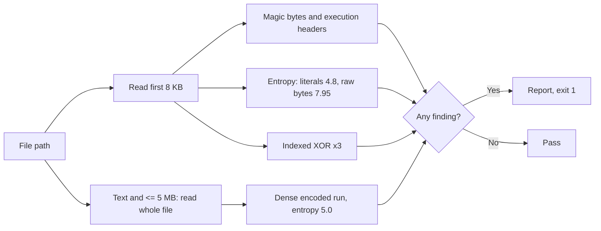

# Binary Anomaly Detector (Heuristic File Integrity Scanner)

> **File Reference:** [gitgalaxy/tools/supply_chain_security/binary_anomaly_detector.py](https://github.com/squid-protocol/gitgalaxy/blob/main/gitgalaxy/tools/supply_chain_security/binary_anomaly_detector.py)

## Engineering Summary
Source parsers usually skip binary files. The Binary Anomaly Detector (X-Ray) reads them on purpose and checks bytes rather than file extensions: a file whose first bytes do not match its extension, executable headers inside other files, dense high-entropy data, and a repeated indexed-XOR pattern.

## Purpose
Triage of magic-byte mismatches, embedded executable headers and dense encoded or encrypted data in a repository, failing the run (exit 1) on a finding.

## Design
### Selective Binary Ingestion
The module overrides the standard `ApertureFilter` binary exclusion so binary files are read. Files under a `test/`, `tests/` or `phpunit/` path segment, and paths in `ALLOWLIST_PATHS` or `XRAY_BYPASS_PATHS`, are still checked, but a finding there is counted as allowed and does not fail the run (`test_a_real_test_folder_stays_exempt`). Files with an extension in `XRAY_BYPASS_EXTENSIONS` (by default `.json`, `.gz`, `.zip`, `.tar`, `.png`, `.jpg`, `.jpeg`, `.ico`, `.yml`) get the magic-byte check only: their entropy, embedded-header and XOR findings are ignored, but a file that does not start the way its type must still fails.

### What is read
* **The first 8 KB** of every file, for the header, string-entropy, binary-entropy and XOR checks.
* **The whole file** for the dense-run check, when it is text (no NUL byte in the first 8 KB) and no larger than 5 MB (`MAX_DENSE_SCAN_BYTES`). This is how a payload past the first 8 KB, or on one very long line, is caught (`test_a_large_payload_after_the_first_8_kb_fails`).

Binary files, and text files over 5 MB, are examined only in their first 8 KB.

### Checks
1. **Magic-byte mismatch:** the file's first bytes are compared with its extension (for example an executable named `logo.png`). Required headers cover `.png`, `.jpg`/`.jpeg`, `.gz`, `.xz`, `.zip`, `.pdf`, `.ico` and `.tar` (a tar has no magic at offset 0: `ustar` at byte 257, or a valid header checksum, or an all-zero empty archive). A bypassed type with no header here (`.json`, `.yml`) is not checked for a mismatch.
2. **Embedded execution headers** in the first 8 KB: ELF, Mach-O, WebAssembly and `#!/bin/` anywhere; `MZ` only at offset 0. A `#!/bin/` shebang in a `.sh`, `.bash`, `.zsh` or `.command` file is exempt (`test_xray_shebang_shield`).
3. **Entropy, three thresholds with different scopes:**
   * string literals in the first 8 KB (fewer than three spaces): Shannon entropy above **4.8** (`SecurityLens.scan_content`);
   * the first 8 KB as raw bytes, when longer than 256 bytes: above **7.95** (`SecurityLens.scan_binary`);
   * runs of 256 or more base64/URL-safe characters anywhere in a text file up to 5 MB (declared `data:` URIs removed): above **5.0** on the first 4,096 characters of the run (`DENSE_RUN_ENTROPY`).
   Files with a bypassed extension, which includes the image and archive types, skip all three.
4. **Bitwise operation trap:** three or more repeated in-place XORs on indexed bytes (`buf[i] ^= k;`) are flagged (`test_repeated_indexed_xor_is_flagged_and_named_as_such`). A plain XOR decode loop, and a `a ^ b ^ c` chain, are not detected.

## Evidence
Each check is tested on planted inputs (`tests/security_auditing/test_xray_control.py`, `test_binary_anomaly_detector.py`, `test_disguised_executable_4126.py`). There is no measured detection or false-positive rate on real malware or real repositories.

## Pipeline Integration
Inputs are file paths and the resolved config. Outputs are anomaly messages and exit code `1` when any non-allowlisted anomaly is found. Inside a `galaxyscope` scan the result is recorded in the scan summary (`ecosystem_audits.xray`).

## Tradeoffs
* **8 KB head for binaries:** a payload past the first 8 KB of a binary file, or of a text file over 5 MB, is not examined.
* **Entropy heuristics:** dense benign data (compressed fixtures, embedded keys, minified bundles) can trip the thresholds; use `XRAY_BYPASS_EXTENSIONS` or `XRAY_BYPASS_PATHS`. Bypassed types, including images and archives, get the header check only.

## Limitations
* Images are checked only for a matching header. Steganographic content in an image is not detected.
* Thresholds are fixed constants; they are not calibrated against a labelled corpus.

## Memory
Memory per file is bounded by the 8 KB head for binaries and by the file size (at most 5 MB) for text files.

## Future Work
* A tail read (the last 8 KB) for binaries, to catch payloads appended to the end of large files.

## Related Components
* [GitGalaxy Platform](https://gitgalaxy.io/)
* [⬅️ Back to Master Index](index.md)

