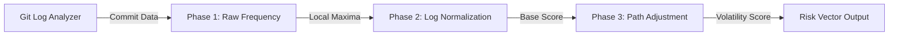

# Deep Churn (Codebase Volatility)

> **File Reference:** [`gitgalaxy/metrics/signal_processor.py`](https://github.com/squid-protocol/gitgalaxy/blob/main/gitgalaxy/metrics/signal_processor.py)
>
> **Metric:** Relative Commit Volatility & Change Frequency
>
> **Summary:** Measures how frequently a source file is modified over time relative to the rest of the repository. Churn is auto-scaled across the codebase so that the most volatile file anchors the maximum score (100.0), and all other files are normalized logarithmically against this maximum.
>
> **Effect:** Maps directly to the GitGalaxy Universal Surface Spectrum, scaling from 🟦 **Deep Blue** (stable, rarely touched code) to 🟥 **Intense Red** (highly active hotspots).

## Engineering Summary
This subsystem measures how frequently a source file is modified over time relative to the rest of the repository. It solves the problem of raw commit counts being misleading by auto-scaling churn across the codebase. It exists to highlight highly active hotspots that may indicate architectural instability or constant bug fixing. By using a two-pass auto-scaling normalization model, it fits into the broader risk assessment pipeline of GitGalaxy.

## Purpose
To measure relative commit volatility and change frequency across the repository, identifying files undergoing frequent, intense modification relative to project history.

## Problem Being Solved
Code stability varies naturally across project types. Raw commit counts fail to capture true volatility because a rapidly evolving repository might see dozens of commits per week, whereas a stable library might average one commit per month. Using raw counts would unfairly penalize fast-moving projects and hide issues in slower ones.

## Design
The system uses a two-pass auto-scaling normalization model to measure relative volatility:
1. **Raw Commit Frequency:** Commit volume is normalized against the square root of the file's age in weeks to dampen the penalty on long-standing legacy files. **What "age" means in the code:** the time since the file's **last modification** (the repository's newest time minus the file's modification time, never less than one week), not the time since the file was created. A file edited this week counts as one week old whatever its history. `commit_count` is the number of commits that touched the file inside the Chronometer's 12-month sweep.
2. **Logarithmic Normalization:** The global maximum frequency ($\text{MaxFreq}$) is identified. A logarithmic transformation $\ln(1 + x)$ flattens extreme outliers and scales all scores onto a 0–100 range.
3. **Contextual Path Adjustment:** The directory Path Modifier ($Mp$) is applied.

**Mathematical Formulation**
$$\text{RawFrequency} = \frac{\text{Commits}}{\sqrt{\max(\text{AgeInWeeks}, 1.0)}}$$
$$\text{BaseScore} = \left( \frac{\ln(1 + \text{RawFrequency})}{\ln(1 + \max(\text{MaxFreq}, 1.0))} \right) \times 100.0$$
$$\text{FinalScore} = \min(\text{BaseScore} \times Mp, 100.0)$$

## Pipeline Integration

- **Inputs received:** `commit_count` (commits that modified the file within the Chronometer's 12-month sweep), `age_in_weeks` (weeks since the file's last modification, minimum 1), and `max_freq` (highest raw change frequency in repo).
- **Outputs produced:** A normalized volatility score (0-100).
- **Dependencies:** Requires Git version control history upstream. Feeds downstream into the Universal Surface Spectrum dashboard.

## Tradeoffs
- Logarithmic normalization is chosen to flatten extreme outliers, which sacrifices linear differentiation at the high end but prevents a single hyper-active file from compressing the distribution of the rest of the files.
- Dampening file age using a square root rather than a linear divisor was chosen to avoid over-penalizing legacy files while still accurately highlighting recent churn spikes.
- Explicit language fidelity ($Fc$) and syntactical opacity ($Irc$) are deliberately not applied, as commit history is treated as an exact, deterministic log independent of language syntax.

## Limitations
- Only accounts for commit frequency, not commit size or semantic complexity of changes.
- Cannot distinguish between trivial formatting commits and massive architectural refactors; a file with 10 typo fixes is weighted identically to one with 10 structural redesigns.
- Highly dependent on team commit hygiene (e.g., squashed merges vs. raw commit logs).- Highly dependent on team commit hygiene (e.g., squashed merges vs. raw commit logs).
- Counts mass migrations like any other commit. In 13 repositories, 4-44% of in-place edits to surviving functions (median about 22%) were mechanical sweeps (the same call or macro swapped across many functions in one quarter); they raise churn without being new work.
- Follows paths, not file identity: a renamed or moved file starts a new history, and the 12-month sweep is the only window (no lifetime counts or true file age).
- When no usable history exists (not a git checkout, an exported tree with no `.git`, a shallow clone) the value is a neutral `0.0`, which is indistinguishable from a file with no commits.

## Measured Behavior (exploratory, 2026-11)
> **Research notes:** temporal-crucible, branch `sensor-overhaul`, `docs/sensor-overhaul/` (guide, `sensors/activity.md`, `sensors/tech_debt.md`) and `docs/turn_surface_area.md`. Measurements are exploratory (13 repositories; a 580-repository population sample confirms the descriptive results).

- **Rank-equivalent to a 365-day commit count.** Across 35,287 file-intervals in 7 repositories (history-aware scans), the persisted churn value correlates 0.96 (within-repository ranks) with the number of commits to the file in the last 365 days, and 1.00 with the raw frequency.
- **Shares its recency term with [File Stability](08-10-file-stability.md).** The two history values correlate -0.86 within repositories (one principal component carries 93% of their joint variance), and -0.88 across 27,957 files with history in 494 repositories of the v2.12.0 population database. In practice they behave as one axis, "how recently did this file change".
- **Independent of the keyword gauges.** Absolute rank correlation with every keyword-based risk value is at most 0.11; it correlates +0.55 with ownership entropy and +0.67 with silo risk.
- **Relation to outcomes (descriptive, no risk claim).** Added to code size, churn and stability raise AUC for later fixes by +0.015 to +0.019 under three fix-label definitions; within size quartiles churn ranks later fixes at AUC 0.65 and correlates +0.26 with how much a file changes in the next interval. A single 365-day commit count carries the same information; 30-day, 90-day and lifetime windows add nothing.

## Performance Notes
The logarithmic transformation and square root operations execute in $O(N)$ time across all files during the post-scan phase, ensuring fast calculation. The primary performance cost is bounded by the underlying Git log extraction process.

## Future Work
Current behavior relies strictly on commit frequency. Planned improvements aim to incorporate commit size (lines added/deleted) and semantic impact into the volatility weighting to distinguish between trivial formatting and substantive logic changes. 

## Related Components
- Git Log Analyzer
- Path Modifier ($Mp$)
- GitGalaxy Universal Surface Spectrum
