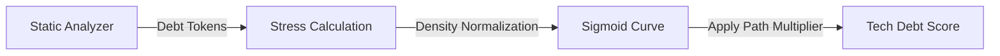

# Tech Debt Exposure

> **File Reference:** [`gitgalaxy/metrics/signal_processor.py`](https://github.com/squid-protocol/gitgalaxy/blob/main/gitgalaxy/metrics/signal_processor.py)
>
> **Metric:** Density of Planned vs. Fragile Work Markers
>
> **Summary:** Measures technical debt density using developer code annotations (`TODO`, `FIXME`, `HACK`, `XXX`). It differentiates between planned pending work (`TODO`, `WIP`) and admitted logic fragility (`HACK`, `FIXME`), calculating a weighted stress score normalized per 100 lines of code.
>
> **Effect:** Maps directly to the GitGalaxy Universal Surface Spectrum:
> * 🟦 **VERY LOW (Score 0-19):** Polished. Code aligns with expectations with no active debt annotations.
> * 🟨 **INTERMEDIATE (Score 40-59):** Active Development. A moderate density of planned task markers.
> * 🟥 **VERY HIGH (Score 80-100):** High Risk. High density of fragile fixes (`HACK`, `FIXME`) and unfinished stubs (`TODO`).

## Engineering Summary
This subsystem quantifies explicit technical debt by analyzing developer code annotations. It solves the problem of unmanaged debt accumulation by converting qualitative comments (`TODO`, `FIXME`) into a measurable density metric. The system exists to distinguish between standard planned work and admitted structural fragility. By normalizing these markers per line of code, it integrates into GitGalaxy as a targeted indicator of code quality and maintenance backlog.

## Purpose
To calculate the density of planned work versus admitted logic fragility and map this density into an actionable technical debt risk score.

## Problem Being Solved
Technical debt is often hidden in codebase comments, making it difficult to measure programmatically. While issue trackers capture macroscopic tasks, localized structural hacks and temporary stubs are frequently forgotten, silently increasing maintenance friction and defect probability.

## Design
The analysis engine categorizes comment tokens into two debt classes:
- **Planned Work (1.0x Weight):** `TODO`, `WIP`, `STUB`, `REFACTOR`. Represents tracked future tasks.
- **Fragile Fixes (3.0x Weight):** `HACK`, `FIXME`, `XXX`, `UGLY`. Explicit admissions of buggy or brittle logic.

**What the code does beyond the annotation markers.** The score also counts two implicit terms that are not comments: functions flagged as unreferenced by name (`unreferenced_by_name`, weight 2.0) and duplicate logic (`duplicate_logic`, weight 5.0); when any implicit term and any acknowledged marker are both present, the stress is multiplied by 1.5. A file with no markers and no implicit terms returns 0.0 immediately.

**Mathematical Formulation**
1. **Stress Sum Calculation:**
$$\text{Slop} = (\text{Unreferenced} \times 2.0) + (\text{DuplicateLogic} \times 5.0)$$
$$\text{StressSum} = (\text{PlannedDebt} \times 1.0) + (\text{FragileDebt} \times 3.0) + (Irc \times 0.5) + \text{Slop}$$
$$\text{if } \text{Slop} > 0 \text{ and } (\text{PlannedDebt} > 0 \text{ or } \text{FragileDebt} > 0): \; \text{StressSum} \mathrel{\times}= 1.5$$
2. **Density Normalization (per 100 LOC):**
$$\text{Density} = \left( \frac{\text{StressSum}}{\max(\text{LOC}, 50)} \right) \times 100.0$$
The denominator is the UEF evidence-mass floor ([08-03](08-03-transforming-regex-counts.md)): a `TODO` and a `FIXME` in a 6-line config file and the same pair in a 49-line one carry the same debt score (#2655).
3. **Sigmoidal Threshold Mapping:**
$$\text{RawScore} = \frac{100.0}{1 + e^{-0.5 \times (\text{Density} - 5.0)}}$$
4. **Apply Path Modifier:**
$$\text{FinalScore} = \min(\text{RawScore} \times Mp, 100.0)$$

## Pipeline Integration

- **Inputs received:** Heuristic comment token hits (`planned_debt`, `fragile_debt`), LOC, and environmental modifiers.
- **Outputs produced:** A normalized technical debt score (0-100).
- **Dependencies:** Relies upstream on the comment extraction phase of the static analysis engine.

## Tradeoffs
- Weighting `FIXME` at 3x the severity of `TODO` was chosen to heavily penalize admitted broken logic, sacrificing equality among debt markers to prioritize immediate bug risks.
- Sigmoid thresholding around 5.0 stress points per 100 lines assumes a baseline tolerance for debt; this prevents hyper-penalization of standard development workflows, but may mask low-level chronic debt.
- The language Fidelity Coefficient ($Fc$) is deliberately excluded because `TODO` carries identical semantic meaning regardless of language syntax.

## Limitations
- Highly reliant on developer discipline. If a team does not use `TODO` or `FIXME` conventions, this metric will report a false 0.0 risk.
- Does not interface with external issue trackers (e.g., Jira, GitHub Issues) to verify if a `TODO` is actually scheduled or abandoned.
- Custom debt tags (e.g., `OPTIMIZE`, `TECHDEBT`) are not recognized unless explicitly added to the static scanner regex.- Custom debt tags (e.g., `OPTIMIZE`, `TECHDEBT`) are not recognized unless explicitly added to the static scanner regex.
- The score is a density squashed by a sigmoid and mixes three different things (annotation markers, unreferenced names, duplicate logic); see Measured Behavior. It moves with net line count even when no debt marker is added or removed (the density-denominator artifact tracked in `docs/vectors.md`, `debt_markers`).
- No age, owner or history: a three-year-old `FIXME` and a three-day-old `TODO` look alike, and nothing says whether the marker's author is still around.

## Performance Notes
Operates with $O(1)$ complexity using pre-computed token arrays. Incorporates an early exit shortcut: if no debt markers are present, the function immediately returns `0.0`, bypassing floating-point arithmetic.

## Future Work
Currently, the system is strictly lexical and static. Future iterations plan to integrate with Git history to calculate "Debt Age" (penalizing a 3-year-old `FIXME` more than a 3-day-old `TODO`) and to support custom dictionary definitions for team-specific debt tags.

## Measured Behavior (exploratory, 2026-11)
> **Research notes:** temporal-crucible, branch `sensor-overhaul`, `docs/sensor-overhaul/` (guide, `sensors/activity.md`, `sensors/tech_debt.md`) and `docs/turn_surface_area.md`. Measurements are exploratory (13 repositories; a 580-repository population sample confirms the descriptive results).

- **Counting the markers is sound.** The engine's planned-plus-fragile counts match a plain text search of the same commit: per-file Spearman +0.84 to +0.97 across eight repositories (libgit2 +0.92, libxml2 +0.95, redis +0.84, curl +0.94, sqlmap +0.90, scapy +0.95, sphinx +0.97, prometheus +0.94); the engine counts slightly more (more marker words, several human languages).
- **The composite loses it.** The persisted tech-debt value correlates only +0.32 (median over repositories) with the marker counts, because the sigmoid mixes in unreferenced names and duplicate logic; 59% of files score 0 and the value is sparse.
- **Debt density does not predict fixes.** A file's comment profile, including debt density, adds +0.003 AUC beyond size, churn and history (temporal-crucible comment-profile study).
- **How debt behaves over time** (nine C projects, every marker followed through its life): about three quarters of debt comments are eventually removed, but projects range from 38% to 98% and from months to decades; `XXX` lives longest (median 3.0 years against 1.1 for `TODO` and `FIXME`); about half is repaid by its own author; debt is repaid in large commits, not bug fixes.
- **Old debt is stuck, not riskier.** Debt older than the 90th percentile of what that repository has repaid ("fossils") is repaid within two years 6.9% of the time against 22.0% for other debt; fossils in files with 10 or more commits that year are repaid 12.6% of the time against 2.6% in quiet files; markers whose author is still active are repaid more often. Marker class (`TODO` vs `FIXME` vs `XXX`) and bare markers do not change the odds.

## Related Components
- Static Analysis Engine
- Path Modifier ($Mp$)
- Implicit Risk Correction ($Irc$) — the language strictness term ([08-03](08-03-transforming-regex-counts.md)); zero for every language since the #2720 pilot
