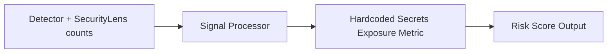

# Hardcoded Secrets Exposure

> **File Reference:** [`gitgalaxy/metrics/signal_processor.py`](https://github.com/squid-protocol/gitgalaxy/blob/main/gitgalaxy/metrics/signal_processor.py)

## Engineering Summary
Scores a file from its count of hardcoded-credential matches (`sec_hardcoded_secrets`: API keys, tokens, passwords assigned to string literals), raised by whole-file counts of debug prints, dead code and globals. This subsystem evaluates the input signals to calculate a formalized risk score. In GitGalaxy, this subsystem is known as the Hardcoded Secrets Exposure metric.

## Purpose
The metric calculates a density-based risk score (0-100) from the file's credential-match count and line count.

## Problem Being Solved
Unmitigated anti-patterns and vulnerabilities often lead to hard-to-debug bugs and security flaws. By statically analyzing the codebase, this subsystem proactively identifies hazardous logic.

## Design
The analysis engine evaluates credential presence and careless code practice multipliers:

| Variable | Signal Key | Weight | Description |
| :--- | :--- | :--- | :--- |
| `sec_hardcoded_secrets` | Static Pattern | **10.0x Base** | Regex matches for private API keys, tokens, or passwords. |
| `debug_prints` | `debug_prints` | **+1.0 per hit** | Count of print/log statements anywhere in the file. No proximity to the secret is checked. |
| `dead_code` | `dead_code` | **+1.0 per hit** | Count of dead-code hits anywhere in the file, whether or not they contain a key. |
| `globals` | `globals` | **+1.0 per hit** | Count of global-scope assignments anywhere in the file, not only ones holding a secret. |
| `llm_api` | `llm_api` | **3.0x Multiplier** | Calling external APIs (`llm_api > 0`) without global config management (`globals == 0`). |

### 1. Base Leak & Amplification Mass
$$\text{BaseLeak} = \text{sec\_hardcoded\_secrets} \times 10.0$$
$$\text{Amplifiers} = 1.0 + \text{debug\_prints} + \text{dead\_code} + \text{globals}$$

If external API calls are detected without global configuration structures, amplifiers spike by $3.0\times$:

$$\text{Amplifiers} = \text{Amplifiers} \times 3.0$$

In standard non-paranoid mode without reflection/metaprogramming signals, amplifiers are capped at $2.0$.

The amplifier terms are whole-file counts: a file with one secret and twenty unrelated `print(` calls gets the same amplification as one that prints the secret.

### 2. Leak Mass Formulation
$$\text{LeakMass} = \text{BaseLeak} \times \text{Amplifiers}$$

### 3. Sigmoid Normalization with Reduced Padding
Because leaked credentials represent high severity regardless of file size, density uses a reduced Laplace padding ($\text{LOC} + 50$):

$$\text{Density} = \left( \frac{\text{LeakMass}}{\max(\text{LOC} + 50, 1)} \right) \times 100.0$$

Mapped via Sigmoid (Standard threshold = 3.0, slope = 1.0; Paranoid threshold = 0.5, slope = 2.0). Scores below $5.0$ are truncated to $0.0$.

```python
def _calc_secrets_risk(self, loc: int, raw_signals: dict[str, int], mp: float) -> float:
    """
    Calculates Secrets Risk Exposure (Credential Exposure).
    """
    base_leak = raw_signals.get("sec_hardcoded_secrets", 0) * 10.0

    if base_leak == 0:
        return 0.0

    careless_amplifiers = (
        1.0 + raw_signals.get("debug_prints", 0) + raw_signals.get("dead_code", 0) + raw_signals.get("globals", 0)
    )

    if raw_signals.get("llm_api", 0) > 0 and raw_signals.get("globals", 0) == 0:
        careless_amplifiers *= 3.0

    if not getattr(self, "is_paranoid", False) and raw_signals.get("sec_reflection_metaprogramming", 0) == 0:
        careless_amplifiers = min(careless_amplifiers, 2.0)

    leak_mass = base_leak * careless_amplifiers

    t = self.risk_tuning.get("secrets_risk", {})
    density = (leak_mass / max(loc + t.get("loc_padding", 50), 1)) * 100.0

    if getattr(self, "is_paranoid", False):
        threshold = t.get("paranoid_threshold", 0.5)
        slope = t.get("paranoid_slope", 2.0)
    else:
        threshold = t.get("std_threshold", 3.0)
        slope = t.get("std_slope", 1.0)

    try:
        score = 100.0 / (1.0 + math.exp(-slope * (density - threshold)))
    except OverflowError:
        score = 100.0 if density > threshold else 0.0

    if score < 5.0:
        score = 0.0

    return min(score * mp, 100.0)
```

**Score bands:** the score is a sigmoid of match density only. It does not tell environment-variable retrieval from inline keys, test secrets from production ones, or low-entropy from high-entropy values; the bands below are plain score ranges.
* 🟦 **LOW (Score 0–19):** no credential match, or few matches relative to the file's size (scores under 5.0 are floored to 0).
* 🟨 **MODERATE (Score 40–59):** match density near the sigmoid threshold.
* 🟥 **VERY HIGH (Score 80–100):** match density well past the threshold, often with amplifiers applied.

### 4. The 100.0 override (keyfiles)
The formula above is skipped for files the aperture flags as exposed secret files: an extension in `SECRETS_EXTENSIONS` (`.pem`, `.key`, `.p12` and others), a name in `SECRETS_EXACT` (`id_rsa` and others), or an aperture reason containing `CRITICAL LEAK`. Their `secrets_risk` is set to 100.0 and every other risk to 0 except churn (`signal_processor.py`, the "CRITICAL SECRETS EXPOSURE OVERRIDE" block). Files the aperture excluded with a `CRITICAL LEAK` reason are also put back on the map as synthetic artifacts with `secrets_risk` 100.0 and `file_impact` 5000.0, unless their path contains `/test/`, `/tests/`, `mock` or `dummy` (`galaxyscope.py`, the critical-leak escalation).

### 5. What the input count misses
`sec_hardcoded_secrets` comes from `SecurityLens`, which blanks every line of 250 or more characters before its regexes run (`SecurityLens._armor`). A key on a minified or otherwise long line is not counted, and this score stays 0 for it. Vault Sentinel is the only scanner that reads such lines (`gitgalaxy/security/long_lines.py`, #7179; blind spot tracked in #8429). The credential patterns are tested on planted inputs (`tests/core_engine/test_embedded_credentials_probe_4108.py`, `tests/core_engine/test_embedded_credentials_real_scan_4108.py`) and the formula by `test_signal_processor_*secrets*` in `tests/core_engine/test_signal_processor.py`; there is no measured real-world recall.

## Pipeline Integration
Inputs are per-file signal counts from the detector's language rules (`debug_prints`, `dead_code`, `globals`, `llm_api`) and from `SecurityLens` (`sec_hardcoded_secrets`, `sec_reflection_metaprogramming`), plus the path multiplier `mp`. The output is a risk score (0-100) in the `secrets_risk` slot of the risk vector. GitGalaxy has no AST parser; these are regex counts.


## Tradeoffs
* Chose static keyword counting and heuristic multipliers over dynamic symbolic execution to prioritize speed across large codebases.
* Specific weights are fixed heuristics that balance safety against over-penalization, sacrificing precise dynamic validation for constant-time calculation.

## Limitations
* Detection is strictly reliant on recognized keywords and standard patterns.
* Cannot dynamically confirm actual vulnerabilities or trace deep runtime dataflows.
* May produce false positives in non-standard or heavily abstracted codebases.

## Performance Notes
The calculation operates in $O(1)$ time leveraging pre-computed token counts, making it suitable for real-time risk profiling on massive codebases.

## Future Work
* Planned improvements include integrating static dataflow tracing to verify execution paths and reduce false positives.
* Expand language support and framework-specific annotations.

## Related Components
* **[Signal Processor Module](https://github.com/squid-protocol/gitgalaxy/blob/main/gitgalaxy/metrics/signal_processor.py)**
* **[GitGalaxy Platform](https://gitgalaxy.io/)**
* **[⬅️ Back to Master Index](index.md)**
