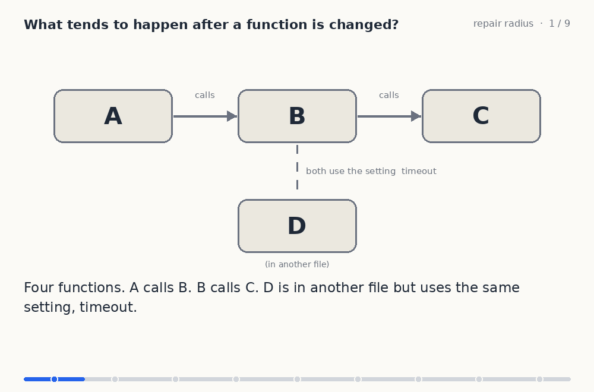

# Repair Radius: What Tends to Follow a Change

> **Status:** exploratory research, one author, not peer reviewed. Every number is an association measured on C code in six open-source projects. The scripts, outputs and a prediction written before each run are in the temporal-crucible repository (`docs/sensor-overhaul/sensors/ripple_radius.md`); several predictions failed, and the failures are recorded there. This page replaces the headline of [Blast Radius of a Change](08-28-blast-radius.md) with measurements on verified functions and more repositories.
>
> **Summary:** When a function is changed and a bug caused by that change is later fixed, the fix is most often in the same function, then in a close neighbour in the call graph, and it often reuses a name the change touched. Small changes are repaired once, close by; big changes are repaired again and again, scattered. This appears to be useful as a checklist when changing a function, not as a prediction.

## An example with four functions
- **B** reads a setting and returns a value. **A** calls B. B calls **C**. **D**, in another file, never calls anything here but uses the same setting, `timeout`.
- **Day 1:** a developer changes B so that it returns an error code when the setting is missing (it used to return zero).
- **Weeks or months later** a bug caused by that change is found. What tends to follow:

| If | then, typically | numbers |
|---|---|---|
| a bug caused by the change turns up | the fix is in **B itself** | 43% to 72% of the time, depending on the project |
| the fix is not in B | it is in a **close neighbour** (A or C) more often than in a random function of the same size in the same file | 1.6 to 2.2 times as often |
| B's result or arguments changed | **callers like A** add a check on the result | 8 to 14 times as often as fixes inside B; changed call arguments about 1.6 to 1.7 times as often |
| other code uses the same name as the change (`timeout`) | it can need a fix **with no call link at all** (D) | 45% of such fixes share a specific name with the change, 6.7 times as often as fixes after unrelated changes in the same directory |
| the change is small (under 20 lines) | fixes stay close, and usually there is one | 14% of the changes that were fixed needed two or more fixes |
| the change is big (500 or more lines) | fixes **scatter and keep coming** | half to three quarters needed two or more fixes (kernel and DPDK 77%, Mesa 49%); 4 to 5 fixes on average in the kernel and DPDK |
| a cause checked a name in a condition | the repair adds or changes a guard on it | 53% against 27% otherwise |

## How it was measured
1. **Named causes.** A fix commit that names the commit that caused the bug: the `Fixes: <sha>` line of the kernel, DPDK, Mesa and OpenSSL, curl's references. For each pair, the functions each commit changed.
2. **Verified functions.** The function named by a diff header is often not the function that changed (a table or macro after a function is credited to the function above it). Each named function is compared with its first parent with tree-sitter and kept only if its text changed: 13% of the named functions were not edited. Removing them raised the radius by about 8%.
3. **A baseline.** For each fixed function outside the changed set, the comparison is with other functions from the same file, of similar size, outside the changed set. The "radius" is the observed share within 1 or 2 calls divided by the share expected from that baseline.
4. **Checks that could have removed it.** Matching the baseline on how recently and how often a function was changed (no change: 1.55 against 1.57 in DPDK); removing functions that changed together with the cause before (it grew, to 1.71); the size of the change; the same author or not (kernel).

## What was found
| | finding | numbers (verified C functions) |
|---|---|---|
| Radius | within 2 calls of a changed function, against the same-file baseline | kernel 2.15, FreeBSD 2.17 (39 pairs), Mesa 1.78, OpenSSL 1.72, curl 1.65, DPDK 1.57 |
| Same function | share of pairs where the fix is in a function the cause changed | curl and FreeBSD 72%, kernel 59%, Mesa 57%, DPDK 50%, OpenSSL 43% |
| Size | the radius shrinks with the size of the change | under 20 lines to 500 or more: kernel 3.06 to 1.31, Mesa 2.16 to 1.34, DPDK 2.09 to 1.23 |
| Direction | for fixes in a different file, callers beat callees | callers against callees: kernel 4.43 against 2.74, Mesa 4.37 against 2.28, DPDK 2.87 against 1.50, curl 7.9 against 1.5 |
| Callers adapt | repairs in a caller change the call's arguments, and add an `if` that tests the changed function | arguments changed in 19% to 27% of caller repairs against 11% to 17% in the same function; an added `if` testing the changed function 8 to 14 times as often |
| Shared names | the repair uses the same specific identifier as the cause (field, variable, constant, called function) | 80% in the same function, 57% to 73% in neighbours, **45% where no call path exists**; mostly data (79% fields, variables, macros, types) |
| What the cause did | the shared name was mostly tested or used, rarely defined | checked in a condition 31%, newly used 31%, use changed 20%, defined 12%, redefined or removed 3% |
| The repair mirrors the cause | same kind of edit | after a check: guard or condition 53% against 27%; after a changed use: changed arguments 25% against 17% |
| Interfaces | a cause that changes a definition in a header | 37% of causes; their repairs land in another file or far in the same file 1.26 times as often |
| Repeated repairs | the chance of another repair rises with each repair | kernel 29% after one, 66% after five; DPDK 39% to 70%; Mesa 19% to 57% |
| What makes a change need repeated repairs | size, not shape or author | two or more fixes: under 20 lines 14%, 500 or more lines 77% (kernel, DPDK), 49% (Mesa); author's earlier experience little |
| Time | no wave spreading outward | the radius weakens only slightly with lag: kernel 2.13 to 1.93, DPDK 1.48 to 1.39, Mesa clearer, 1.97 to 1.55 |

## What it does not say
- **Association, not cause.** Nothing here shows why a fix lands where it does. A shared name can mean an interface changed and its users had to follow, the same hardware condition handled elsewhere, or a copied pattern.
- **It describes, it does not predict.** A given change may break nothing. Only changes that were later fixed and whose fix names its cause are in the data, so the figures cannot say how likely a change is to be fixed at all.
- **C only.** Only `.c` and `.h` files were read; Mesa's and QEMU's C++ and Rust are outside. Nothing has been tested for other languages.
- **Modest effects.** 1.6 to 2.2 times a baseline for the radius, and weaker for big changes (1.2 to 1.3 at 500 lines or more), partly because a big change has a big neighbourhood.
- **Selection by habit.** Projects that write `Fixes:` lines are the ones measured; DPDK's near-mandatory trailer gives a different mix of changes from the kernel's.
- **Static calls.** Calls through function pointers are missing from the call graph, which understates the radius somewhat.
- **Closest earlier work.** Fixes following dependency links near their cause is not new: for example Wen et al., FSE 2019 (Java, the same file and statement level), and Park, Kim and Bae, EMSE 2017 (follow-up fixes and structural dependence). A literature check did not find the function-level call distance against a matched same-file baseline, the callers-versus-callees direction, the size dependence or the shared-name result, but it did not read every paper in full and found nothing is not the same as nothing exists.

## What it could mean for `gitgalaxy change`
Nothing is implemented. The measured pattern suggests a reminder under a changed function: its direct callers, whether they handle a changed result, other code using the same fields and constants, and a note that a change of several hundred lines is usually followed by repeated repairs. These would be reminders, phrased as such: the page above says what tends to follow, not what will. See [Change Report](08-26-change-report.md) for the current behaviour.
