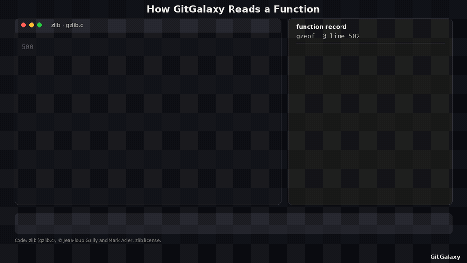
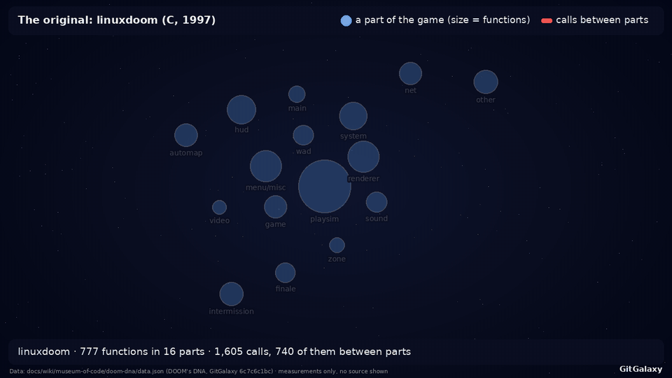
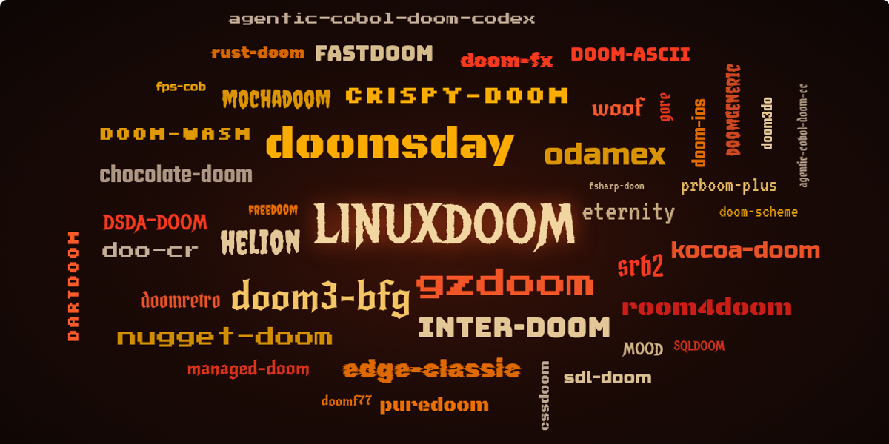

# DOOM's DNA: What Survives Translation, Porting, and Rewriting

*By Joe Esquibel · November 2026 · Built with [GitGalaxy](https://github.com/squid-protocol/gitgalaxy) & [structural-fingerprint-scanner](https://github.com/squid-protocol/gitgalaxy-population-analyses)*

> **Interactive Visualizers:**
> * **[Open the 16-Track Call-Graph DNA Gene Map →](dna-tracks-mockup.html)** *(recalculated across all ports, pure call-graph communities, no filename rules)*
> * **[Open the Legacy Function & Tree Explorer →](index.html)**

---

## Core Claims *(modular bullets for rearranging with infographics)*

* **Claim 1 — A function's structural shape + call-graph neighborhood acts like DNA, even with zero names read.** Stripping every identifier, string, and comment, unsupervised **Seed-and-Extend** (`composition` mode + Fused Gromov–Wasserstein + `delta` offset + 3-hop call-graph extension) recovers **65–95%** of 1-to-1 functions across C ports (`mood` 95.3%, `puredoom` 89.0%, `doomgeneric` 84.9%, `sdl-doom` 82.3%, `doom-ascii` 80.8%, `doom-wasm` 78.8%, `chocolate-doom` 65.0%).
* **Claim 2 — Structural DNA survives cross-language translation.** Even when ported to **Go** (`gore`, flat directory layout, `0.2%` filename-taxonomy match), Seed-and-Extend calibrates the `C → Go` translation vector `delta` and recovers **426 / 561 (75.9%)** exact 1-to-1 functions (`74 / 80 = 92.5%` on Tier-1 FGW seeds).
* **Claim 3 — True from-scratch rewrites and unrelated controls sit at ~0% noise.** Across **9** controls (`lua` 0.0%, `quake` 0.6%, `quake2` 0.6%, plus Go `goom3d` / `bubbletea`, Rust `macroquad`, C raycasters, and Apache-2.0 COBOL `carddemo-cobol-ctrl`) and **66** cross-pair permutations of novel/from-scratch/agentic repos (`rust-doom`, `room4doom`, `helion`, `agentic-cobol-doom-cc`, `agentic-cobol-doom-codex`, `fps-cob`, `sqldoom`, `cssdoom`, `doomf77`, `fsharp-doom`), every non-DOOM pair scores **0–1** accidental name hits.
* **Claim 4 — Paradigm shifts erase call-graph DNA, even when ported from Chocolate Doom.** In our preregistered held-out test (`DOOM-E5`), `cydoomgeneric` hit **100.0%** Tier-1 (`156/156`, `FGW_cost = 0.313`) against `doomgeneric`, whereas `iron-doom` (ported from Chocolate Doom into **Bevy ECS** in Rust) dropped to **0.0%** (`0/147`) — decoupling an imperative call graph into ECS systems erases structural lineage.
* **Claim 5 — Horizontal borrowing across separate branches is visible without names.** Subtracting `linuxdoom` and sweeping cross-branch twins (`horizontal_transfers.py`) isolates Chocolate Doom's `textscreen` UI library inside `odamex` (178/212 T1 hits), `eternity` (210/276 T1 hits), `woof`, `nugget-doom`, and `prboom-plus`; `src/hexen` copied into `dsda-doom` (28 twins); MBF21 pointers shared between `dsda-doom` and `woof`/`nugget-doom`; `man` docgen copied into `woof`; and hidden ancestry (`doom-ios` embedding `prboom-plus`, `sdl-doom` matching `doomgeneric`/`doom-ascii`).
* **Claim 6 — The 16 subsystems don't need manual filename buckets.** Community detection on `linuxdoom`'s call graph discovers 16 organic call-graph systems (`C01`–`C16`) directly from call edges, so single-header (`puredoom`) and flat-directory (`gore`) ports light up the exact systems they belong to instead of collapsing into `other %`.

---

## Visual 1: How One Function's Structural Fingerprint Moves Across Ports

---

## Visual 2: Comparing All DOOM Ports & Controls Side by Side

---

## Visual 3: The 16-Track Call-Graph DNA Gene Map

Instead of forcing code into manual filename buckets, we run greedy modularity on `linuxdoom`'s call graph to discover **16 call-graph communities** (`C01: P_Random / P_SetMobjState`, `C02: Z_Malloc / W_CacheLumpNum`, ..., `C16: Leaf / Misc Core`). Every port's functions—including horizontally borrowed libraries and port-unique code—are projected onto those 16 tracks:

* **Red (`linuxdoom`):** vertical 1993 C core DNA recovered by Seed-and-Extend
* **Blue (`chocolate-doom`):** `textscreen`, `src/hexen`, `man` docgen
* **Green (`prboom-plus`):** `deh_*` / PrBoom / MBF21
* **Purple (`doomgeneric`):** `DG_*` platform shim
* **Cyan (`woof`):** MBF / WinMBF
* **Light Grey:** functions unique to that port

**[Launch the Interactive 16-Track DNA Gene Map →](dna-tracks-mockup.html)** *(live recalculated data in [`dna_tracks_data.json`](dna_tracks_data.json))*

---

## Summary Evidence Tables

### A. Seed-and-Extend Recovery vs. Controls (`linuxdoom` Reference)

| Repo | Language / Origin | Functions | Tier-1 Seeds (Name Prec.) | After 3-Hop SE (Name Prec.) |
|---|---|---:|---:|---:|
| `mood` | C + COBOL port | 1,859 | 110 (`100.0%`) | 687 / 721 (**`95.3%`**) |
| `puredoom` | C (single header) | 1,546 | 98 (`100.0%`) | 590 / 663 (**`89.0%`**) |
| `doomgeneric` | C | 1,192 | 97 (`100.0%`) | 547 / 644 (**`84.9%`**) |
| `sdl-doom` | C | 1,079 | 99 (`100.0%`) | 535 / 650 (**`82.3%`**) |
| `doom-ascii` | C | 1,019 | 98 (`100.0%`) | 517 / 640 (**`80.8%`**) |
| `doom-wasm` | C | 2,035 | 95/96 (`99.0%`) | 505 / 641 (**`78.8%`**) |
| **`gore`** | **Go** (flat dir) | 996 | 74/80 (**`92.5%`**) | 426 / 561 (**`75.9%`**) |
| `chocolate-doom` | C | 5,129 | 95/103 (`92.2%`) | 433 / 666 (**`65.0%`**) |
| `cydoomgeneric` *(E5)* | C + Python | 1,109 | 91/92 (`98.9%`) | 287 / 620 (**`46.3%`**, `100%` T1 vs `doomgeneric`) |
| `iron-doom` *(E5)* | Rust (Bevy ECS port) | 319 | 0/24 (`0.0%`) | 0 / 147 (**`0.0%`**) |
| `rust-doom`, `room4doom`, `helion` | From-scratch | 582–8,386 | 0 (`0.0%`) | 0 (**`0.0%`**) |
| `lua`, `quake`, `quake2`, `goom3d`, `bubbletea`, `macroquad`, `carddemo-cobol-ctrl` | Permissive controls | 55–5,289 | 0–2 (`0–3.5%`) | 0–3 (**`0.0–0.6%`**) |

### B. Horizontal Transfers & Hidden Lineage (`horizontal_transfers.py`)

| Pair | Twins | Exact Names | Shared Module | Finding |
|---|---:|---:|---|---|
| `eternity` ↔ `chocolate-doom` | 210 T1 | 182 SE | `textscreen` | Horizontal borrow onto SMMU/MBF branch |
| `odamex` ↔ `chocolate-doom` | 178 T1 | 136 SE | `textscreen` | Horizontal borrow onto ZDoom branch |
| `doom-wasm` ↔ `woof` | 67 | 53 | `textscreen` | Horizontal borrow onto MBF/WinMBF branch |
| `chocolate-doom` ↔ `dsda-doom` | 39 | 29 | `src/hexen` | Hexen subsystem copied into PrBoom+ branch |
| `dsda-doom` ↔ `woof` | 47 | 37 | `prboom2/src <-> src` | Shared MBF21 action pointers |
| `chocolate-doom` ↔ `woof` | 19 | 13 | `man` | Shared docgen tooling |
| `doom-ios` ↔ `prboom-plus` | 272 | 257 | `code/prboom` | Hidden PrBoom ancestry (declared `linuxdoom`) |
| `doomgeneric` ↔ `sdl-doom` | 528 | 521 | `doomgeneric <-> src` | Shared Chocolate-derived minimal SDL base |

---

