# Every Model Has a Tell

> **This is the text edition.** The full article is interactive: hover any program, re-sort the distance map,
> draw the wiring for any job, and open a card for each of the 60 programs.
> **[Open the interactive article →](agent-habits/index.html)**

[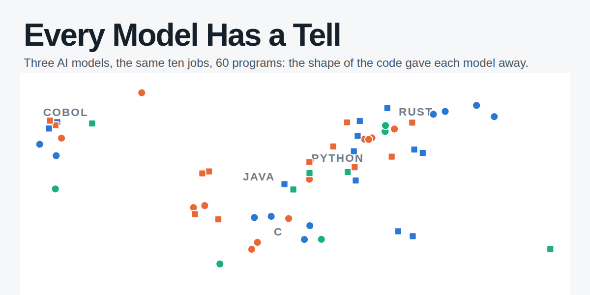](agent-habits/index.html)

**Three AI models built programs for the same ten jobs. The shape of their code kept giving them away.**

We gave Claude Code (running two different models, Sonnet 5.5 and Haiku 5.5) and OpenAI's Codex (gpt-6-luna)
identical jobs: a chess engine and a logic-puzzle (SAT) solver, each in C, Java, Python, Rust and COBOL, 60 programs
in all. Then we ignored every name and every word of every comment, measured only the code's structure with the
[GitGalaxy](https://github.com/squid-protocol/gitgalaxy) scanner, and asked: can you still tell who wrote it?

*By Joe Esquibel, with the GitGalaxy code-scanning engine · November 2026.* Every number links to the file it came from in the study's repository, [github.com/squid-protocol/agent-habits](https://github.com/squid-protocol/agent-habits), which holds everything needed to check it.

| 83% | 2× as alike | 10 of 10 |
|---|---|---|
| of programs had a closest look-alike, among programs doing the same job, written by the **same** model (43 of 52; exploratory, to be repeated). Guessing would get 27%. | Two programs by the same model for the same job differ about half as much as two by different models (shape difference 0.32 vs 0.62). | jobs in which Haiku documented more of its functions than both Sonnet and Codex. The clearest single habit. |

**The short version**

- **Our predictions weren't confirmed.** We wrote down in advance that Claude would differ from Codex in five specific
  ways. After correcting for running several tests, none of the five passed; the closest missed by a hair.
- **But each model kept its handwriting.** A model's second, independent round of programs looked like its first, and
  a program's closest look-alike came from the same model 83% of the time.
- **The habits belong to models, not companies.** Sonnet and Haiku both run inside Claude Code, yet they differ from each
  other about as much as either differs from Codex.
- **Language matters most.** Changing a program's language moves its shape about three times as far as changing the
  model, so the model's handwriting only shows when you compare programs doing the same job.

---

## How it worked

Handwriting gives people away. A detective can match a ransom note to a suspect without reading a word of it, from the
slant of the letters and the pressure of the pen. Code has handwriting too: how a program is cut into pieces, how long
each piece runs, how many decisions it makes, which parts call which.

Three models built the same two programs in five languages. Each run started in a fresh, sealed container with the same
written instructions and no human in the loop; an automatic judge with a hidden test set decided when a program was done
([prompts, checker and harness](https://github.com/squid-protocol/agent-habits/tree/main/kit)). 57 of the 60 programs passed within their run; the two that ran out the 60-minute
clock passed when checked afterwards, so 59 of 60 work ([run ledger](https://github.com/squid-protocol/agent-habits/blob/main/runs/runs.csv), [run results](https://github.com/squid-protocol/agent-habits/blob/main/RESULTS.md#1-the-runs)).

| | Sonnet 5.5 (Claude Code) | Haiku 5.5 (Claude Code) | Codex (gpt-6-luna) |
|---|---|---|---|
| Rounds | 2 independent rounds | 2 independent rounds | 1 round |
| Programs | 24 | 24 | 12 |
| Median working time | 2.4 min | 19.7 min | 6.4 min |

**In one paragraph.** A *job* is one task in one language, such as "chess engine in Rust"; there are ten, and two of
them (chess in Rust, SAT in Python) got one extra repeat run per round. For every program, GitGalaxy builds a shape
profile: how many functions it has and how big they are, how many decisions each makes, which functions call which, and
where comments sit (not what they say). Two profiles reduce to one *shape difference*: 0 means identical shape, and
about 1 is typical for two programs written in different languages. Every comparison that matters is made between
programs doing the same job. No AI classifier is involved anywhere in the measuring
([measurement scripts](https://github.com/squid-protocol/agent-habits/tree/main/measure), [pinned engine `7d2e1f627`](https://github.com/squid-protocol/gitgalaxy/commit/7d2e1f627)).

## Handwriting without a name

Take any program and line it up against every other program that did the same job (3 to 9 of them). Which one has the
most similar shape? If structure carried no trace of its author, the closest look-alike would come from the same model
about as often as a blind pick: 27% of the time. It came from the same model **43 times out of 52 (83%)**. A shuffle test
that relabelled the models at random 2,000 times never reached 43 ([method and result](https://github.com/squid-protocol/agent-habits/blob/main/results/data/identify_model.txt),
[script](https://github.com/squid-protocol/agent-habits/blob/main/measure/identify_model.py)).

Two honest footnotes. This test was an afterthought, not one of the registered predictions, so it needs repeating on
fresh programs. And for Sonnet and Haiku the closest look-alike was usually the model's *own second round* (34 of the
43 matches), so this is largely the "a model repeats itself" result below, seen from another angle. Codex ran once per
job except in two, so only 4 Codex programs could be scored here (all 4 matched).

## The prediction that wasn't confirmed

This study began with someone else's experiment. [Mathieu Acher](https://mathieuacher.com/), a computer scientist at the
University of Rennes, published pairs of programs that Claude Code and Codex built for the same tasks, with a human
steering each one. When we scanned his pairs, the two agents looked different: Claude seemed to comment more, Codex seemed
to leave functions early with `return`, and so on.

Looking at data and then announcing what you saw is how you fool yourself, so we did it the slow way. We wrote down five
predictions and the exact test for each, published them with a timestamp
([preregistration](https://github.com/squid-protocol/agent-habits/blob/main/preregistration/PREREGISTRATION.md); public copy and script hashes in
[gitgalaxy-population-analyses `agent-habits-prereg/`](https://github.com/squid-protocol/gitgalaxy-population-analyses/tree/main/agent-habits-prereg),
commit `5700b9e`, 2026-11-01T12:41Z), and only then ran 60 fresh programs that no prediction had seen. Each test counts
the plain way: in how many of the ten jobs did the prediction point the right way? "Fluke odds" is the chance of a
result that strong by luck alone, corrected for running several tests at once (Holm).

**The scorecard: the vendor story didn't hold; the model story did.**

| Prediction (written down before the runs) | Held in | Fluke odds | Verdict |
|---|---:|---:|---|
| *Sonnet vs Codex: the original five* | | | |
| Sonnet writes more comments | 8 of 10 | 0.219 | not shown |
| Sonnet documents more functions | 4 of 6 | 0.688 | not shown |
| Codex leaves functions early more often | 9 of 10 | 0.054 | close |
| Sonnet uses more `while` loops | 6 of 8 | 0.434 | not shown |
| Codex adds Python helper scripts | 0 of 0 | — | not testable (no program did it) |
| *Side prediction* | | | |
| Sonnet's functions call more other functions (fan-out) | 0 of 7 | — | **reversed**: Codex higher in all 7 |
| *Added before the runs: Haiku vs Codex, Haiku vs Sonnet* | | | |
| Haiku documents more functions than Codex | 10 of 10 | 0.005 | **confirmed** |
| Haiku writes more comments than Codex | 9 of 10 | 0.043 | **confirmed**, but fragile (lost if failed runs are left out) |
| Haiku writes more comments than Sonnet | 10 of 10 | 0.010 | **confirmed** |
| Haiku documents more functions than Sonnet | 10 of 10 | 0.010 | **confirmed** |
| Sonnet uses more `while` than Haiku | 8 of 8 | 0.023 | **confirmed** |
| *Same model, two rounds (expected: no difference)* | | | |
| Sonnet round 1 vs round 2, all five habits | — | 1.0 | as expected: no difference |
| Haiku round 1 vs round 2, all five habits | — | 1.0 | as expected: no difference |

Every registered test, with sensitivity checks: [RESULTS.md §2–4](https://github.com/squid-protocol/agent-habits/blob/main/RESULTS.md#2-registered-primary-families-d16-version),
[families_d16.md](https://github.com/squid-protocol/agent-habits/blob/main/results/data/families_d16.md), [families_sensitivity.json](https://github.com/squid-protocol/agent-habits/blob/main/results/data/families_sensitivity.json),
[secondary.json](https://github.com/squid-protocol/agent-habits/blob/main/results/data/secondary.json).

The closest call was Codex's early exits: they showed up in 9 of 10 jobs and missed the bar by a hair. Nothing was
refuted either. But the rows that did pass tell a different story from the one we went looking for. Haiku, the smaller
Claude model, documents its functions far more than Codex *and* far more than its sibling Sonnet. Sonnet, meanwhile,
reaches for `while` loops more than Haiku in every language that has them.

> **The habits didn't follow the company name on the box. They followed the model inside it.**

## What moves a program's shape

A fingerprint is only interesting if you know what else leaves marks, so we compared every pair of programs, about 1,700
of them, and sorted the pairs by what they had in common.

*Changing the language changes the code about three times as much as changing the model. Each dot is one pair of the 59
readable programs; the black tick is each row's median. Pairs reuse programs, so the rows describe this set rather than
independent trials. The pairs piled at "2+" all involve Codex's Java chess engine, the oddest program in the set
([group medians](https://github.com/squid-protocol/agent-habits/blob/main/results/data/relations_d16.json), [every pair](https://github.com/squid-protocol/agent-habits/blob/main/results/data/sfs_structure_pairs.csv)).*

Two runs of the same model on the same job sit close (median 0.32). Swap the model and the difference roughly doubles
(0.62); swap the task instead and it's about the same (0.63). Swap the *language* and it triples (1.01). A chess engine in
COBOL and one in Python, written by the same model, have less in common than two Python chess engines by different models.

> **Language is the loudest accent. The model is the handwriting underneath it.**

## A model repeats itself

A fingerprint has to be stable to be useful. So Sonnet and Haiku each did the whole job twice, in two independent rounds,
with no memory of the first. If the first round's style were a fluke, the second would land anywhere.

| Sonnet | Haiku |
|---|---|
| 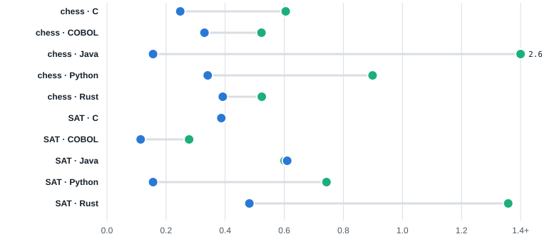 | 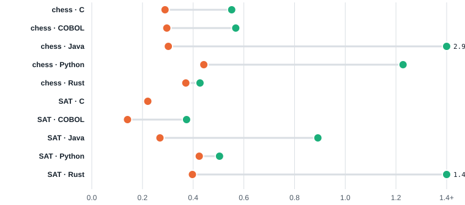 |

*Blue/orange dot: shape difference between a model's two rounds. Green dot: that model's round one vs Codex on the same
job. Sonnet's rounds were closer to each other than to Codex in 8 of 9 jobs, Haiku's in 9 of 9. Codex's C SAT solver is
missing (GitGalaxy read no functions in it); differences past 1.4 are clipped and labelled. The registered version of
this test used only two jobs and is labelled underpowered
([D11](https://github.com/squid-protocol/agent-habits/blob/main/preregistration/PREREGISTRATION.md#d11-2026-11-01-before-any-run-of-the-new-rounds-and-before-any-measure-of-any-run-second-rounds-of-s-and-k),
[cell values](https://github.com/squid-protocol/agent-habits/blob/main/results/data/relations_d16.json)).*

## Haiku's comment habit

One habit is visible without any scanner at all. Haiku puts a comment above its functions, more than Sonnet in every one
of the ten jobs and more than Codex in every one of them too. Codex, in most jobs, writes almost no comments.

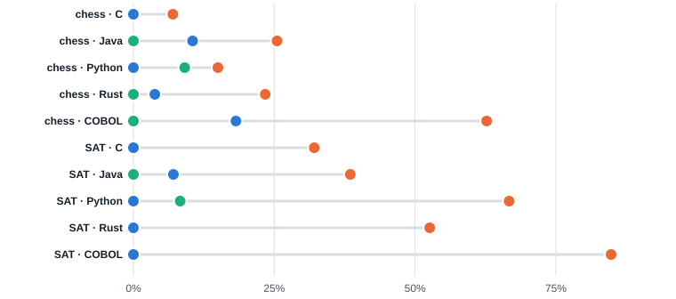

*Share of functions with a comment directly above, round-one programs; Codex's dots sit at 0% in most jobs, often hiding
Sonnet's. Comment lines per line of code tell the same story: [figure](agent-habits/figures/comments-lines.svg),
[per-run values](https://github.com/squid-protocol/agent-habits/blob/main/results/data/runs_measures.csv).*

This is not "Claude comments more": Sonnet and Haiku run in the same Claude Code tool and differ sharply. And it's about
how *much* and *where* they comment, not what the comments say; a tool that sorts comments by meaning was right only 54%
of the time on this code, so no test uses it ([blind hand-check](https://github.com/squid-protocol/agent-habits/blob/main/results/data/handcheck_confirm.json)).

## The clock

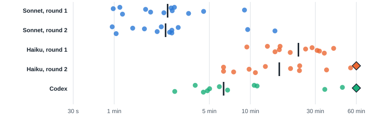

*Haiku worked 7 to 9 times longer than Sonnet (medians: Sonnet 2.5 and 2.4 min, Haiku 22.5 and 16.3 min, Codex 6.4 min).
The scale stretches short times so that equal gaps mean equal ratios. Diamonds are the two runs that hit the 60-minute
cap; both programs passed when checked afterwards ([run ledger](https://github.com/squid-protocol/agent-habits/blob/main/runs/runs.csv)).*

## What else GitGalaxy can now see (exploratory)

The registered tests are finished, but the same scans answer more questions, and these are where the next study starts.
Everything in this section was measured after the fact, each with its own comparison, and should be confirmed on fresh
runs before anyone builds on it. Each follow-up has its own folder with the script, per-program table and a one-page
finding ([index](https://github.com/squid-protocol/agent-habits/tree/main/followups)).

**Codex packs its code tight; Haiku spreads it out.** Codex's program was smaller than Sonnet's in 9 of 10 jobs and denser
per line in 10 of 10: three of its chess engines fit in under 60 lines, dense enough to trip GitGalaxy's minified-code
filter. Haiku wrote more code than Sonnet in 10 of 10 jobs, yet its most tangled function was simpler in 10 of 10. A
model's two rounds differ by a median 7% in size; different models by 53% ([size and shape](https://github.com/squid-protocol/agent-habits/blob/main/followups/size-shape/FINDING.md)).

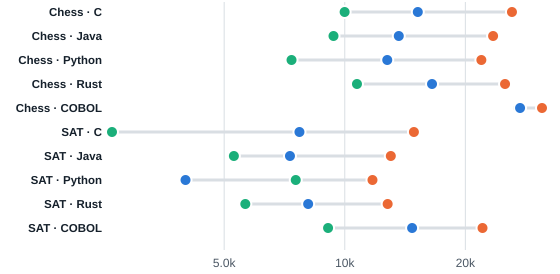

**Codex doesn't route its calls through a few hubs after all.** An earlier COBOL-only study suggested it did. Across all
five languages, Codex and Sonnet send about the same share of calls to their top 3 functions (medians 37% and 36%; Codex
higher in 7 of 10 jobs). Haiku's call chains do run deeper than Codex's, in 7 of 7 jobs. A null result, reported because
we went looking for it ([wiring](https://github.com/squid-protocol/agent-habits/blob/main/followups/wiring/FINDING.md)).

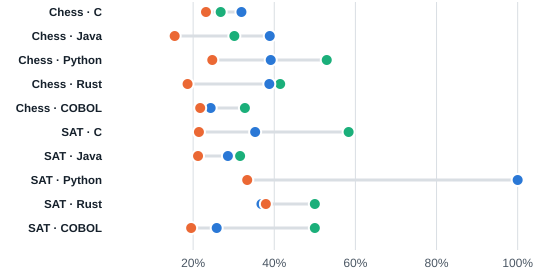

| Sonnet | Haiku | Codex |
|---|---|---|
| 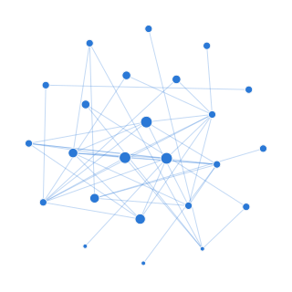 | 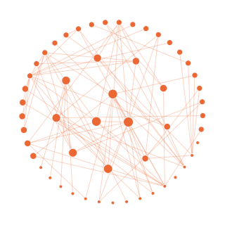 | 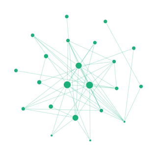 |

*One job, three models: the chess engine in Python. Dots are functions (bigger = called more often), lines are calls.
Sonnet: 24 functions, 46 calls; Haiku: 53 functions, 89 calls; Codex: 22 functions, 51 calls
([all 60 call graphs](https://github.com/squid-protocol/agent-habits/tree/main/followups/wiring/per_run_edges)).*

**More time didn't mean more code.** Haiku is slow because it builds its program in dozens of small steps where Sonnet
writes it in one go, not because it fails more. Codex took more than twice Sonnet's time and still wrote less. And when
one model did the same job twice, the slower run was the bigger one in 13 of 22 pairs: a coin flip
([time vs code](https://github.com/squid-protocol/agent-habits/blob/main/followups/time-vs-code/FINDING.md)).

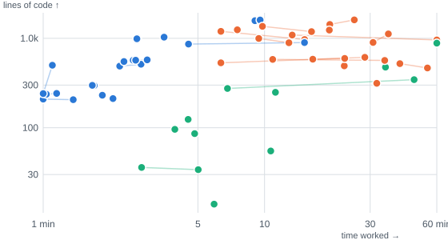

**Which of the original hunches survived?** Our predictions came from Acher's programs, where a person steered older,
larger models. With no human and newer models, three habits kept their direction: Codex leaving functions early, Codex's
more complex functions, and Claude's bitwise tricks. Heavy commenting survived only in Haiku, and Claude's wider fan-out
flipped. These are directions only, uncorrected (about 450 such comparisons were made), and steering, model generation and
program size all changed at once, so a habit that didn't travel says nothing about why
([habit-by-habit table](https://github.com/squid-protocol/agent-habits/blob/main/followups/steered-vs-autonomous/FINDING.md)).

## The scanner got caught too

Codex writes dense code, sometimes 2,000 characters on a single line. GitGalaxy has a safety rule that skips files that
look minified, and it quietly skipped four of Codex's programs. We caught it by checking GitGalaxy's function counts
against two independent tools (Tree-sitter and ctags), applied a rule written down in advance (D16), and fixed the
scanner ([validity report](https://github.com/squid-protocol/agent-habits/blob/main/validity/README.md), [gitgalaxy#7501](https://github.com/squid-protocol/gitgalaxy/issues/7501)).
Where GitGalaxy read a file, the three tools agreed almost function for function. The experiment didn't just use the
instrument; it improved it.

## What it can't tell you

- **Which agent is better.** The judge was pass/fail. Nothing here ranks quality.
- **Anything beyond these models, tasks and languages.** Ten jobs is small, and several results rest on one or two of
  them. The look-alike result was exploratory; it needs repeating on fresh runs and a new task.
- **Habits in human-steered work.** These runs are autonomous; Acher's are steered.
- **What the comments say.** We measure how much and where; classifying comments by meaning was right only 54% of the
  time on this code.

## How we know it's not luck

- **Written down first.** Predictions, tests and the sha256 of every analysis script were published before the
  confirmation runs; every later change is a dated deviation (D1–D16) committed before it was used
  ([preregistration](https://github.com/squid-protocol/agent-habits/blob/main/preregistration/PREREGISTRATION.md)).
- **Against chance.** The look-alike result is compared with a shuffle test: relabelling the models at random never
  matched it in 2,000 tries.
- **Against itself.** Each Claude model ran twice; a model's two rounds differ less than models do, and none of the
  registered habits differed between rounds.
- **Against other tools.** GitGalaxy's function lists were checked against Tree-sitter and ctags on all 60 programs
  ([validity/](https://github.com/squid-protocol/agent-habits/tree/main/validity)).
- **One instrument.** Every number comes from one pinned version of GitGalaxy, commit
  [`7d2e1f627`](https://github.com/squid-protocol/gitgalaxy/commit/7d2e1f627).
- **Both versions shown.** Where the D16 rule changed a measurement, the instrument-default result is kept beside it
  ([families.json](https://github.com/squid-protocol/agent-habits/blob/main/results/data/families.json) vs [families_d16.json](https://github.com/squid-protocol/agent-habits/blob/main/results/data/families_d16.json)).

---

## Check my work

Everything needed to corroborate the numbers above is in the [study's repository](https://github.com/squid-protocol/agent-habits). The provenance runs top to bottom: what we
predicted, what the agents were given, what they wrote, how it was measured, what came out.

| Step | Where | What's there |
|---|---|---|
| 1. Predictions | [`preregistration/`](https://github.com/squid-protocol/agent-habits/tree/main/preregistration) | The registration (hypotheses, tests, α, script hashes) with dated deviations D1–D16, the frozen exploratory scripts, the found-pair search |
| 2. The task | [`kit/`](https://github.com/squid-protocol/agent-habits/tree/main/kit) | Prompts, the checker with its held-out and practice sets, the run harness, Dockerfile, run order |
| 3. The programs | [`runs/`](https://github.com/squid-protocol/agent-habits/tree/main/runs) | All 60 programs as the agents wrote them ([`runs/code/`](https://github.com/squid-protocol/agent-habits/tree/main/runs/code)), the run ledger ([`runs.csv`](https://github.com/squid-protocol/agent-habits/blob/main/runs/runs.csv)), each run's prompt and checks ([`runs/meta/`](https://github.com/squid-protocol/agent-habits/tree/main/runs/meta)), the excluded pilot runs |
| 4. The instrument check | [`validity/`](https://github.com/squid-protocol/agent-habits/tree/main/validity) | GitGalaxy vs Tree-sitter vs ctags on all 60 programs; the D16 gap and its recovery |
| 5. Measurement | [`measure/`](https://github.com/squid-protocol/agent-habits/tree/main/measure) | The adapter and every analysis script (`families_d16.py`, `sensitivity.py`, `secondary.py`, `keywords_confirm.py`, `identify_model.py`, `relations_d16.py`, `run_sfs.sh`) |
| 6. Registered results | [`RESULTS.md`](https://github.com/squid-protocol/agent-habits/blob/main/RESULTS.md), [`results/data/`](https://github.com/squid-protocol/agent-habits/tree/main/results/data) | Every verdict, sensitivity analysis and table, as Markdown, JSON and CSV |
| 7. Exploratory follow-ups | [`followups/`](https://github.com/squid-protocol/agent-habits/tree/main/followups) | Size and shape, wiring, time vs code, steered vs autonomous: script, per-program table, summary and finding for each |
| 8. This write-up | [`article/`](https://github.com/squid-protocol/agent-habits/tree/main/article), [`figures/`](https://github.com/squid-protocol/agent-habits/tree/main/figures) | `build_data.py` (every number on the page, from steps 6–7), `export_figures.py` (the figures above, from the page's own chart code), the interactive edition |

**To re-derive the numbers:** `python measure/adapter.py`, then `families_d16.py`, `sensitivity.py`, `secondary.py`,
`keywords_confirm.py`, and `measure/run_sfs.sh` plus `relations_d16.py`. The scans themselves are regenerated by
`measure/scan_all.sh` with GitGalaxy `7d2e1f627`; the scripts read them by absolute path. Then, in that repository,
`python3 -I article/build_data.py` (it stops if the look-alike total no longer comes out at 43 of 52) and
`python3 -I article/export_figures.py`.

## Built on Mathieu Acher's paired-agent studies

This work exists because [Mathieu Acher](https://mathieuacher.com/) (University of Rennes / IRISA) published something
rare: the *same* tasks built by Claude Code and by Codex, side by side, with code, git history and session logs preserved:
[agentic-cobol-study](https://github.com/acherm/agentic-cobol-study) (MIT) and the agentic-chessengine-\* repositories
with their [meta-analysis](https://github.com/acherm/agentic-chessengine-metaanalysis). Our exploratory look used ten of
his MIT-licensed same-task pairs; the habits it suggested became the predictions we registered, tested here on fresh code
no hypothesis had seen. His study is human-steered; ours is autonomous. Any error here is ours, not his.

## Related work

| Work | What it reports | What this study adds or corroborates |
|---|---|---|
| Bisztray et al., [*I Know Which LLM Wrote Your Code Last Summer*](https://arxiv.org/abs/2506.17323) (AISec 2025) | A trained classifier attributes C programs to one of several LLMs (about 95%); comment style is a strong feature. | Model identity shows up **without training** and **without comment text** (exploratory nearest-look-alike, 83% vs 27% chance), and comment *amount* separates models (Haiku vs Sonnet and Codex, 10 of 10 jobs). |
| [*The Hidden DNA of LLM-Generated JavaScript*](https://arxiv.org/pdf/2510.10493) (2025) | Structural patterns attribute LLM-written Node.js programs, robust to minification. | Structure carries model identity in five other languages; and the converse risk: dense AI-written code can be **mistaken for minified code** by a scanner's own safeguards. |
| [*Code Fingerprints: Disentangled Attribution of LLM-Generated Code*](https://arxiv.org/pdf/2603.04212) (2026) | Claude-generated code leans on explicit control-flow constructs. | Partly consistent: Sonnet uses more `while` than Haiku in 8 of 8 jobs, but against Codex only directionally; the habit looks model-specific, not vendor-wide. |
| [*Style, Not Self*](https://arxiv.org/html/2609.30048v1) (2026) | Surface style cues explain how LLMs attribute code. | Consistent: the trace is a stable habit of form (0.32 within a model vs 0.62 between models, repeated across independent rounds), not what the program does, since every program here does the same job. |

## Licence and provenance of the code

Measurements, counts and names describe the measured code. The 60 programs in [`runs/code/`](https://github.com/squid-protocol/agent-habits/tree/main/runs/code) were written by
the agents for this study; the source-provenance rule is in the
[preregistration](https://github.com/squid-protocol/agent-habits/blob/main/preregistration/PREREGISTRATION.md#9-publication). Claude, Sonnet and Haiku are Anthropic's; Codex is
OpenAI's; GitGalaxy is not affiliated with either.
