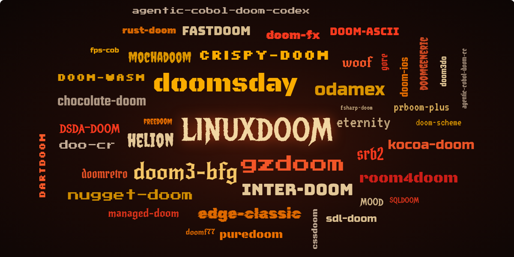

# DOOM's DNA: How Code Keeps Its Family Resemblance

*By Joe Esquibel · 31 October 2026 · made with the [GitGalaxy](https://github.com/squid-protocol/gitgalaxy) code-scanning engine*

> **This is the text edition.** The full article is interactive: follow any of the original's 662 functions through
> every descendant, explore the family tree, and compare wiring maps side by side.
> **[Open the interactive article →](doom-dna/index.html)**

Forty-three programs are descended from the 1997 release of DOOM's source code. Measure only their shape and you can
still tell who copied whom, and which translations kept the original blueprint.

Strip a program of every name, every comment, every line of readable text. What's left is its shape: how long each
function is, how often it branches, which parts of the program call which. That shape, it turns out, works like a
fingerprint.

DOOM is the perfect place to test it. When id Software released the game's source code in 1997 (the version known as
**linuxdoom**), programmers started copying it, porting it and rebuilding it, and they have not stopped. We gathered 43
of those descendants: faithful copies, souped-up source ports, and translations into about twenty languages, from Go and
Scheme to Fortran, COBOL and even SQL. Then we fed them to a code-measuring engine that never reads the code, and asked
it where each one came from.

| The headline facts | |
| :--- | :--- |
| **87% / 35%** | Chocolate Doom keeps 87% of the original's function names, but only 35% of the code inside them is unchanged |
| **0 to 0.6%** | of DOOM's shape shows up in Quake, Quake II and Lua. A faithful DOOM copy: 31% |
| **60% vs 20%** | with every name hidden, a Go translation's functions still land in the right part of the game; guessing manages 20% |

## Names lie

**First, the old-fashioned way.** Before trusting a machine that never reads code, we read it: we compared every
descendant's source text with the original's, function by function. That gives the ground truth for everything that
follows. Then, in the next part, we throw the text away.

Start with the obvious way to trace a program's ancestry: look at what its functions are called. It does not work as
well as you'd think. Chocolate Doom, whose whole mission is an accurate reproduction of the original "including bugs",
keeps 87% of the original's function names, but only 35% of those functions still contain the same code. Doom Retro
keeps 69% of the names and just 0.2% of the code. GZDoom, a heavily modernised engine, keeps 32% of the names and 0.2%
of the code.

**Forks keep the original's function names long after the code inside has been rewritten.** Share of the original's
functions (at least 20 words of code) present in each C descendant, by name and by unchanged code, from a direct
source-text comparison:

| Descendant | Same function name | Same code, unchanged |
| :--- | ---: | ---: |
| doomgeneric | 85.5% | 39.4% |
| chocolate-doom | 86.7% | 34.9% |
| crispy-doom | 86.7% | 21.0% |
| prboom-plus | 80.5% | 8.8% |
| fastdoom | 72.4% | 6.8% |
| eternity | 66.3% | 0.8% |
| doomretro | 69.0% | 0.2% |
| gzdoom | 32.0% | 0.2% |

The interactive article lets you follow any one of the original's 662 scored functions through all 43 descendants. Two
things stand out. The best survivors in the C and C++ copies are game logic (`M_AddToBox`, `A_Tracer`, `T_Glow` and the
monster attacks). The first functions to vanish are almost all the original's 1997 Linux plumbing (X11 graphics, the
sound server), which every port had to replace.

## A fingerprint you can't read

So skip the names. The engine records, for every function, dozens of measurements: its length, its branches, its
inputs, what it touches, and which other functions it calls. A companion tool then hunts for "look-alikes": functions
in a descendant whose measurements match one of the original's too closely to be a coincidence. It never sees the code
or the names.

Then we checked its work against the actual source text. **93% of the look-alikes it found really are copies**, and it
caught about two-thirds of all the copies the text comparison found.

The real test is what happens with programs that have nothing to do with DOOM. Quake and Quake II, id Software's own
later games, and the Lua programming language are all written in C, like DOOM. They share between 0 and 0.6% of DOOM's
shape. Chocolate Doom shares 31%. And the fingerprint is not tuned to DOOM: Quake and Quake II, which really are related,
share 12.7% with each other.

> **Borrowed sideways.** Family trees assume code flows from parent to child. Biology knows better: bacteria swap genes
> with neighbours. Code does too. The engine's closest match for Eternity, a long-lived DOOM engine, isn't the original
> at all but a Chocolate Doom relative, through 200 look-alike functions. Only afterwards did the names explain it:
> Eternity carries 216 functions of Chocolate Doom's on-screen text library, and so does Odamex. The original has none.

## The family tree

Put those fingerprints together with each project's own account of where it came from and you can draw the whole
family, the way biologists draw an evolutionary tree. One honest difference: a biologist infers who descends from whom.
Here the family links are what each project says about itself; only the branch lengths are measured. A short branch
means a close copy, a long one little code in common. Translations rewrite every line, so their branches all reach the
far edge, even the ones that kept DOOM's design.

The main lines: linuxdoom → Chocolate Doom → Crispy Doom, Doom WASM, doomgeneric, Doom Retro and doom-ascii; linuxdoom
→ Boom → PrBoom → PrBoom+ → dsda-doom, with MBF → WinMBF → Woof → Nugget Doom and SMMU → Eternity beside it; linuxdoom →
ZDoom → GZDoom and Odamex; linuxdoom → Doom Legacy → SRB2. Twelve programs state no parent at all: they were written
from scratch. **[See the full interactive tree →](doom-dna/index.html#tree-band)**

## The blind test

Translations are the hard case. Rewrite DOOM in Go and every line changes, every function gets a new name, and the
look-alike hunt finds nothing. So what, if anything, survives?

We tried a blind test. DOOM's code is organised into 16 parts: the renderer, the monsters and physics, the sound, the
status bar and so on. We hid every name and file path in a translation and asked the engine to sort each function into
one of those parts using only its shape and who it calls. Then we checked where the names say it belongs.

**Some translations still sort themselves into DOOM's parts far better than guessing:**

| Descendant | Language | Sorted correctly, names hidden | Guessing (labels shuffled) | Beats guessing by |
| :--- | :--- | ---: | ---: | ---: |
| chocolate-doom (sanity check) | C | 50% | 21% | +29 pts |
| gore | Go | 60% | 20% | +40 pts |
| dartdoom | Dart | 48% | 24% | +24 pts |
| doom-scheme | Scheme | 46% | 26% | +20 pts |
| managed-doom | C# | 47% | 37% | +10 pts |
| doomf77 | Fortran | 42% | 39% | +3 pts |
| mochadoom | Java | 20% | 17% | +3 pts |
| kocoa-doom | Kotlin | 19% | 16% | +3 pts |
| room4doom (written from scratch) | Rust | 27% | 24% | +3 pts |

For the Go translation, the engine sorts 60% of the functions correctly; shuffled labels manage 20%. Among the quarter
of functions it was most sure about, it was right 99% of the time. Scramble the Go program's wiring, keeping how many
calls each function makes, and it drops to 39%: the wiring itself carries much of the signal.

## Translations that kept the blueprint

If the wiring carries the signal, look at the wiring directly. For every descendant we drew a map of which parts of the
game call which, and compared it with the original's map. To know how much of the match is real, we also scored each
program against itself with its functions shuffled at random between the parts. The gap between the two is the design
that survived.

**The Scheme and Go translations kept DOOM's wiring as well as a straight C copy; Java, Kotlin and C# kept none.**
Wiring match from 0 (nothing in common) to 1 (identical):

| Program | Language | Wiring match | Same program, shuffled | Gap (design, not chance) |
| :--- | :--- | ---: | ---: | ---: |
| chocolate-doom | C | 0.83 | 0.32 | +0.51 |
| crispy-doom | C | 0.83 | 0.38 | +0.45 |
| doom-wasm | C | 0.73 | 0.26 | +0.47 |
| doom-scheme | Scheme | 0.75 | 0.24 | +0.51 |
| gore | Go | 0.65 | 0.15 | +0.50 |
| dartdoom | Dart | 0.59 | 0.40 | +0.19 |
| doomf77 | Fortran | 0.41 | 0.36 | +0.05 |
| mochadoom | Java | 0.38 | 0.37 | +0.01 |
| kocoa-doom | Kotlin | 0.27 | 0.35 | −0.08 |
| managed-doom | C# | 0.10 | 0.25 | −0.15 |
| rust-doom (from scratch) | Rust | 0.10 | 0.04 | +0.06 |
| room4doom (from scratch) | Rust | 0.08 | 0.08 | 0.00 |
| helion (from scratch) | C# | 0.07 | 0.16 | −0.08 |
| Quake II (not DOOM) | C | 0.11 | 0.09 | +0.02 |
| WinQuake (not DOOM) | C | 0.05 | 0.07 | −0.03 |
| Lua (not DOOM) | C | 0.00 | 0.00 | 0.00 |

The Scheme and Go translations keep the original's wiring as far above chance as Chocolate Doom does. The Dart
translation keeps some. The Fortran, Java, Kotlin and C# translations keep none, and programs written from scratch, or
not related to DOOM at all, sit at chance, as they should.
**[Draw the wiring maps yourself →](doom-dna/index.html#wiring-band)**

## What it can't tell you

* **Family across languages from look-alikes.** Look-alike functions only work within one language. Across languages
  only the wiring carries a signal, and only for the closer translations.
* **Why Java, Kotlin and C# show nothing.** Those translations reorganised the most and chopped the code into tiny
  pieces: 34% of the Java port's functions and 43% of the Kotlin port's are three lines or shorter, against under 2% in
  the C copies. A lost design and a test that can't see it look the same here.
* **Whether two programs play the same.** This measures the shape of code, not what it does.

## How we know it's not luck

* **Against the text.** Every claim about copying is scored against a direct comparison of the source code (27,778
  function-and-descendant pairs). Ranked by how much of the original each descendant kept, the two methods agree closely
  (rank correlation 0.83 across 43 descendants).
* **Against chance.** Every similarity is shown next to the same program with the thing being measured shuffled. That
  matters: the raw wiring score made every translation look faithful (0.72 to 0.95), because most calls stay inside
  their own part of the program. The Fortran translation scored 0.91; shuffled at random, it still scored 0.80.
* **Against outsiders.** Three unrelated C programs (Quake, Quake II, Lua) set the baseline.
* **Against other tools.** On 42 of the 44 programs (the original and its 43 descendants) the engine's reading passes all
  seven checks against independent code tools (Universal Ctags, tree-sitter, libclang); the other two count functions
  differently.
* **One engine, one scan.** Every number comes from the same scans at one engine version (6c7c6c1bc) and regenerates
  from a command.

## Check my work

Written by **Joe Esquibel**, using the [GitGalaxy](https://github.com/squid-protocol/gitgalaxy) code-scanning engine.
Every number here comes from public code and can be rebuilt from it.

* **[The full study](https://github.com/squid-protocol/gitgalaxy/blob/main/docs/research/doom-port-study.md)**: every
  table behind this article, the checks, and the commands that regenerate them.
* **[The 44 programs](https://github.com/squid-protocol/gitgalaxy/blob/main/tests/doom_rosetta/manifest.csv)**: each
  one's source repository, the exact commit measured, its language, licence and stated lineage.
* **[The engine, as measured](https://github.com/squid-protocol/gitgalaxy/tree/6c7c6c1bca80dbaf4c3ac31410dc6cc960a65198)**:
  GitGalaxy at commit 6c7c6c1bc, the one version every number here comes from.
* **[The fingerprint scanner](https://github.com/squid-protocol/gitgalaxy-population-analyses/tree/main/structural-fingerprint-scanner)**:
  look-alike functions, wiring maps, the blind test and the drift timelines.
* **[The DOOM runs](https://github.com/squid-protocol/gitgalaxy-population-analyses/tree/main/structural-fingerprint-scanner/examples/doom)**:
  the scanner's DOOM inputs and results.
* **[Method: reading a score against chance](https://github.com/squid-protocol/gitgalaxy-population-analyses/blob/main/structural-fingerprint-scanner/docs/wiring-against-chance.md)**
  and **[the blind test](https://github.com/squid-protocol/gitgalaxy-population-analyses/blob/main/structural-fingerprint-scanner/examples/doom/blind_placement.md)**.
* **[The data behind the interactive article](doom-dna/data.json)**: one JSON file with every measurement its charts and
  tools draw from (no source code).

Found something that doesn't add up? [Open an issue on the GitGalaxy repository](https://github.com/squid-protocol/gitgalaxy/issues).

*Measurements only: no program's source code is reproduced, and only programs with a clear licence are included.
"DOOM" is used descriptively; this project is not affiliated with or endorsed by id Software, ZeniMax Media or
Microsoft. Quake and Quake II (GPL-2.0) and Lua (MIT) were scanned as unrelated controls.*

---
### See Your Own Code in 3D
This article was made with **GitGalaxy**, an AST-free structural physics engine that treats codebases like gravitational networks.

* 🌌 **Explore the 3D WebGPU Galaxy:** Upload your own repo's JSON payload securely in your browser at [gitgalaxy.io](https://gitgalaxy.io/).
* ⚙️ **View the Source:** GitGalaxy is open-source. Check out the blAST engine at [github.com/squid-protocol/gitgalaxy](https://github.com/squid-protocol/gitgalaxy).

---

**[⬅️ Back to the Museum of Code](index.md)** · **[Master Index](../index.md)**
